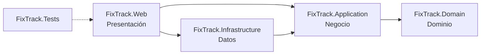

# FixTrack

[](https://github.com/JJMonzon072/fixtrack/actions/workflows/ci.yml)

Sistema web de gestión y seguimiento de órdenes de servicio técnico para un taller dedicado al mantenimiento y la reparación de computadoras, laptops y otros equipos tecnológicos.

Proyecto integrador de Programación II, desarrollado con C# y ASP.NET Core MVC.

## Problema que resuelve

El taller administra sus servicios con hojas de cálculo, mensajes y anotaciones manuales. Esto provoca pérdida de información, órdenes de reparación difíciles de controlar, retrasos en las entregas y falta de trazabilidad. FixTrack centraliza en una sola aplicación la información de clientes, equipos, técnicos y órdenes de servicio, prioriza el trabajo pendiente y controla quién accede a cada función.

## Estado del proyecto

El desarrollo avanza por fases y cada entrega pasa por una revisión de QA.

| Fase | Alcance | Estado |
| --- | --- | --- |
| 1 | Estructura de la solución, arquitectura por capas, sistema de diseño, navegación y páginas base | Aprobada e integrada a `main` (PR #1) |
| 2A | SQL Server con Entity Framework Core, modelo de datos inicial y módulo **Clientes** | Aprobada e integrada a `main` (PR #2) |
| 2B | Módulos **Equipos** y **Técnicos** e integración de equipos en el detalle del cliente | Aprobada e integrada a `main` (PR #3) |
| 3 | **Órdenes de servicio** completas, **algoritmo de priorización** y cola de trabajo, **panel con indicadores reales**, **autenticación y roles**, preparación para **despliegue con Docker** | **Entregada para revisión** |

La aplicación guarda sus datos en **SQL Server** (FixTrackDB, alojada en Somee). Todavía **no está publicada** en internet.

### Funciones

- **Órdenes de servicio:** recepción con cliente, equipo, problema reportado, prioridad, técnico opcional, entrega comprometida, costo estimado y observaciones. Asignación y reasignación de técnicos, diagnóstico, planificación, cambios de estado con reglas explícitas, costo final al entregar e historial de solo inserción. Listado con búsqueda, vistas (abiertas, vencidas, cerradas, todas), filtros por estado, prioridad y técnico (incluido "sin asignar") y paginación.
- **Cola de trabajo:** las órdenes abiertas ordenadas por un algoritmo determinista y explicable, separadas en reparaciones, en espera de repuestos y listas para entrega, cada una con su acción recomendada.
- **Panel:** indicadores calculados en SQL (abiertas, en reparación, listas, vencidas, sin asignar, recientes), distribución por estado y prioridad, acciones recomendadas, próximas entregas, órdenes recientes y carga por técnico. Con la base vacía muestra ceros, no datos de ejemplo.
- **Clientes, Equipos y Técnicos:** registro, búsqueda, edición y desactivación. Sus detalles muestran las órdenes relacionadas. No se puede desactivar a un técnico con órdenes abiertas.
- **Cuentas de acceso:** inicio de sesión, roles Administrador y Operador, administración de cuentas y cambio de contraseña.

Documentación detallada:

| Documento | Contenido |
| --- | --- |
| [docs/flujo-de-ordenes.md](docs/flujo-de-ordenes.md) | Ciclo de vida de una orden, transiciones, reglas, concurrencia y algoritmo de priorización con su fórmula y justificación |
| [docs/arquitectura.md](docs/arquitectura.md) | Capas, recorrido de una solicitud, servicios, seguridad, permisos por rol y despliegue |
| [docs/modelo-de-datos.md](docs/modelo-de-datos.md) | Tablas, relaciones, restricciones, migraciones, diagrama entidad-relación y diagrama de clases |
| [docs/referencia-para-el-equipo.md](docs/referencia-para-el-equipo.md) | Resumen para preparar diagramas, manuales y la exposición |

## Requisitos

- **.NET SDK 10.0** (LTS). `global.json` acepta cualquier SDK 10.0.x desde 10.0.100.
- macOS, Windows o Linux. El desarrollo se hace en macOS con Apple Silicon (M4).
- Un navegador moderno: Chrome, Edge, Safari o Firefox en una versión reciente.
- **Para ejecutar la aplicación:** una base SQL Server 2022 (Express o superior) con las migraciones aplicadas, su cadena de conexión y una cuenta de administrador. Consulta [Configurar la base de datos](#configurar-la-base-de-datos) y [Primer administrador](#primer-administrador).
- **Para compilar y ejecutar las pruebas no se necesita base de datos:** las pruebas usan SQLite en memoria.
- **Docker** solo si quieres construir la imagen de producción. No hace falta Node.js.

Para comprobar la versión instalada:

```bash
dotnet --list-sdks
```

## Inicio rápido

```bash
git clone https://github.com/JJMonzon072/fixtrack.git
cd fixtrack
git switch JJ

dotnet restore
dotnet build -c Release
dotnet test                              # no requiere base de datos
dotnet run --project src/FixTrack.Web    # requiere la cadena de conexión
```

Abre **http://localhost:5104**. La aplicación pide iniciar sesión. Si la base todavía no tiene un administrador, créalo antes con el comando de la sección [Primer administrador](#primer-administrador). Si falta la cadena de conexión, la aplicación se detiene al iniciar con un mensaje que explica cómo configurarla.

### Otras formas de ejecutar

| Objetivo | Comando |
| --- | --- |
| Recargar automáticamente al editar | `dotnet watch --project src/FixTrack.Web` |
| Ejecutar con HTTPS | `dotnet dev-certs https --trust` (solo la primera vez) y después `dotnet run --project src/FixTrack.Web --launch-profile https` → https://localhost:7171 |
| Ejecutar la compilación Release | `dotnet run --project src/FixTrack.Web -c Release` |
| Ejecutar la imagen Docker | Consulta [Despliegue con Docker](#despliegue-con-docker-render) |

### HTTPS por entorno

| Situación | Redirección a HTTPS | HSTS | Cookie de sesión |
| --- | --- | --- | --- |
| Desarrollo con el perfil `http` (predeterminado) | No: el perfil no expone un puerto HTTPS | No | Sin `Secure`, para funcionar en `http://localhost` |
| Desarrollo con el perfil `https` | Sí: `http://localhost:5104` → `https://localhost:7171` | No | `Secure` si la solicitud es HTTPS |
| Producción con un puerto HTTPS configurado | Sí | Sí | Siempre `Secure` |
| Producción en el contenedor detrás de Render | La hace el balanceador de Render; la aplicación reconoce HTTPS por el encabezado del proxy confiable | Sí | Siempre `Secure` |

La redirección se activa cuando `HttpsEndpoint.IsConfigured` encuentra un puerto HTTPS en las mismas fuentes que usa Kestrel (`ASPNETCORE_URLS`, `--urls`, `HTTPS_PORTS`, `HTTPS_PORT` o la sección `Kestrel:Endpoints`). Sin ese dato no hay a dónde redirigir y el middleware solo registraría una advertencia. Las comprobaciones de salud nunca se redirigen.

Si el certificado de desarrollo no es de confianza, Kestrel muestra `The ASP.NET Core developer certificate is not trusted` al usar el perfil `https`. Para resolverlo, ejecuta una vez `dotnet dev-certs https --trust`.

## Configurar la base de datos

La cadena de conexión se llama `ConnectionStrings:FixTrack` y **nunca se guarda en el repositorio**.

### En desarrollo: dotnet user-secrets

El proyecto `FixTrack.Web` tiene un `UserSecretsId`. Los secretos se guardan en tu perfil de usuario (`~/.microsoft/usersecrets/`), fuera del repositorio. Para registrar la cadena sin que la contraseña quede en pantalla ni en el historial de la terminal:

```bash
read -rs FIXTRACK_DB_PASSWORD        # escribe la contraseña; no se muestra
printf '{"ConnectionStrings:FixTrack":"Server=tcp:FixTrackDB.mssql.somee.com,1433;Database=FixTrackDB;User ID=<usuario>;Password=%s;Encrypt=True;TrustServerCertificate=False;HostNameInCertificate=vb4300.mgmt.somee.com;Connect Timeout=30;Application Name=FixTrack;"}' "$FIXTRACK_DB_PASSWORD" \
  | dotnet user-secrets set --project src/FixTrack.Web > /dev/null
unset FIXTRACK_DB_PASSWORD
```

Si la contraseña contiene comillas, barras invertidas o `;`, hay que escaparla según las reglas de JSON y de las cadenas de conexión de SqlClient.

**TLS:** la conexión va cifrada (`Encrypt=True`) y valida el certificado del servidor (`TrustServerCertificate=False`). Somee publica la base con el alias `FixTrackDB.mssql.somee.com`, pero su certificado de Let's Encrypt está emitido para el servidor compartido `vb4300.mgmt.somee.com`. `HostNameInCertificate` indica ese nombre para que la validación sea completa sin desactivarla. Si Somee mueve la base a otro servidor, la conexión fallará por certificado (no se conecta sin verificar) y habrá que actualizar ese valor.

### Configuración disponible

ASP.NET Core lee la misma configuración desde user-secrets o desde variables de entorno. En las variables, `__` reemplaza a `:`.

| Variable de entorno | Uso | Valor predeterminado |
| --- | --- | --- |
| `ConnectionStrings__FixTrack` | Cadena de conexión a SQL Server. **Secreto** | Ninguno: es obligatoria |
| `ASPNETCORE_ENVIRONMENT` | Entorno | `Production` en la imagen Docker |
| `PORT` | Puerto HTTP (lo define Render) | 8080 en la imagen |
| `ReverseProxy__KnownNetworks__0`, `__1`… | Redes (CIDR) desde las que se aceptan `X-Forwarded-For` y `X-Forwarded-Proto` | `10.0.0.0/8` en la imagen; ninguna fuera de ella |
| `Security__LoginAttemptsPerMinute` | Intentos de inicio de sesión por minuto y dirección IP | 10 |
| `TZ` | Zona horaria para mostrar fechas (se guardan en UTC) | `America/Guatemala` en la imagen |
| `InitialAdmin__Email`, `InitialAdmin__FullName`, `InitialAdmin__Password` | Solo para el comando `crear-administrador`. La contraseña es un **secreto** y es opcional: si falta, el comando la pide | Ninguno |

### Migraciones

El esquema se crea y modifica **solo con migraciones** versionadas en `src/FixTrack.Infrastructure/Persistence/Migrations/`. La aplicación no crea ni modifica tablas al iniciar.

```bash
dotnet tool restore    # instala dotnet-ef 10.0.13 (dotnet-tools.json)

# Crear una migración después de cambiar el modelo
dotnet ef migrations add <Nombre> --project src/FixTrack.Infrastructure --startup-project src/FixTrack.Web --output-dir Persistence/Migrations

# Revisar el SQL antes de aplicarlo (script idempotente)
dotnet ef migrations script --idempotent --project src/FixTrack.Infrastructure --startup-project src/FixTrack.Web -o migracion.sql

# Aplicar las migraciones pendientes a la base configurada (cualquiera de las dos formas)
dotnet ef database update --project src/FixTrack.Infrastructure --startup-project src/FixTrack.Web
dotnet run --project src/FixTrack.Web -- aplicar-migraciones
```

`aplicar-migraciones` es un comando de la propia aplicación: lista las migraciones pendientes, las aplica y termina, sin iniciar el servidor web. Sirve también con la imagen Docker, donde no está `dotnet-ef`.

Las migraciones reproducen el esquema completo desde cero en cualquier base SQL Server 2022 compatible, incluida la edición Express. FixTrackDB ya tiene aplicadas las cuatro migraciones existentes.

## Primer administrador

No hay registro público ni cuentas predeterminadas. La primera cuenta de administrador se crea con un comando explícito, que solo funciona mientras **no exista ningún administrador habilitado**. Después, las demás cuentas se crean desde **Administración → Usuarios** (`/usuarios`).

**Pendiente para el propietario:** FixTrackDB todavía no tiene un administrador definitivo. Para crearlo desde tu equipo, con la cadena de conexión ya configurada en user-secrets:

```bash
dotnet user-secrets set --project src/FixTrack.Web "InitialAdmin:Email" "tu-correo@ejemplo.com"
dotnet user-secrets set --project src/FixTrack.Web "InitialAdmin:FullName" "Tu nombre completo"
dotnet run --project src/FixTrack.Web -- crear-administrador
```

El comando pide la contraseña dos veces sin mostrarla. Debe tener al menos 12 caracteres, con mayúsculas, minúsculas y números. La contraseña no queda guardada en ningún archivo. Si prefieres no escribirla en la terminal, puedes definir `InitialAdmin__Password` como variable de entorno solo durante la ejecución del comando.

| Código de salida | Significado |
| --- | --- |
| 0 | Administrador creado |
| 1 | Datos no válidos (por ejemplo, una contraseña débil) o contraseñas que no coinciden |
| 2 | Faltan el correo o el nombre, o falta la contraseña y no hay una terminal para pedirla |
| 3 | Ya existe un administrador habilitado: no se creó otra cuenta |

Con la imagen Docker: `docker run --rm -it -e ConnectionStrings__FixTrack -e InitialAdmin__Email -e InitialAdmin__FullName fixtrack crear-administrador` (las variables se toman del entorno de tu terminal; no escribas sus valores en el comando).

## Despliegue con Docker (Render)

> La aplicación **no está publicada**. Estos son los pasos previstos; no se han ejecutado en Render.

La imagen se construye con el `Dockerfile` de la raíz:

```bash
docker build -t fixtrack .

# Prueba local: la cadena se toma de la variable del entorno actual, no se escribe en el comando
read -rs ConnectionStrings__FixTrack && export ConnectionStrings__FixTrack
docker run --rm -p 8080:8080 -e ConnectionStrings__FixTrack fixtrack
```

Características de la imagen: compilación multietapa con el SDK de .NET 10; imagen final `aspnet:10.0-noble-chiseled-extra` (sin shell, con ICU y zonas horarias), unos 255 MB; usuario sin privilegios (UID 1654); puerto 8080 o el de `PORT`; sin secretos (`.dockerignore` excluye configuraciones locales, pruebas, documentos y evidencias). GitHub Actions construye la imagen y comprueba que arranca, que `/salud` responde y que las páginas exigen sesión.

Pasos previstos para Render (plan gratuito, sin servicios de pago):

1. Antes del primer despliegue, desde un equipo de desarrollo: revisar el script de migraciones, aplicarlas (`aplicar-migraciones`) y crear el primer administrador (`crear-administrador`).
2. Crear un **Web Service** conectado al repositorio de GitHub, con entorno **Docker** y la rama `main` (después de la aprobación de QA).
3. Definir `ConnectionStrings__FixTrack` como variable secreta del servicio. Las demás variables ya tienen valor en la imagen.
4. Configurar el **Health Check Path** como `/salud`. `/salud/bd` sirve para diagnosticar la conexión a la base, pero no conviene como comprobación de vida: una falla temporal de Somee reiniciaría el servicio sin necesidad.
5. Después del primer despliegue, verificar que la respuesta HTTPS de `/cuenta/iniciar-sesion` incluya `Strict-Transport-Security`. Si falta, el proxy no está llegando desde `10.0.0.0/8` y hay que ajustar `ReverseProxy__KnownNetworks__0` con la red que use Render.

En el plan gratuito, Render suspende el servicio tras un periodo sin visitas y la primera solicitud siguiente tarda más en responder.

### Comprobaciones de salud

| Ruta | Responde | Uso |
| --- | --- | --- |
| `/salud` | `Healthy` (200) mientras el proceso responde | Comprobación de vida para la plataforma |
| `/salud/bd` | `Healthy` (200) si la base responde en 4 segundos; `Unhealthy` (503) si no | Diagnóstico de la conexión |

Ninguna exige sesión, ninguna muestra detalles (ni el servidor ni el error) y ninguna se guarda en caché.

## Rutas disponibles

Todas exigen iniciar sesión, salvo el inicio de sesión, las páginas de error, los archivos estáticos y las comprobaciones de salud.

| Ruta | Página | Rol |
| --- | --- | --- |
| `/cuenta/iniciar-sesion` | Inicio de sesión (`?volver=` regresa a la página solicitada, solo si es local) | Público |
| `/cuenta/cerrar-sesion` | Cerrar sesión (solo POST) | Cualquiera |
| `/cuenta/contrasena` | Cambiar la propia contraseña | Cualquiera |
| `/` | Panel general | Administrador, Operador |
| `/cola-de-trabajo` | Cola de trabajo priorizada | Administrador, Operador |
| `/ordenes` | Listado de órdenes: `?buscar=`, `?vista=abiertas\|vencidas\|cerradas\|todas`, `?estado=`, `?prioridad=baja\|normal\|alta\|urgente`, `?tecnico={id}\|sin-asignar`, `?cliente={id}`, `?equipo={id}`, `?pagina=` | Administrador, Operador |
| `/ordenes/nueva` | Registrar una orden; `?cliente={id}` o `?equipo={id}` preseleccionan los datos | Administrador, Operador |
| `/ordenes/{id}` | Detalle de la orden con su línea de tiempo | Administrador, Operador |
| `/ordenes/{id}/estado`, `/asignar`, `/diagnostico`, `/planificacion` | Cambiar de estado (`?a=` sugiere el estado), asignar técnico, registrar el diagnóstico, cambiar prioridad, fecha y costo estimado | Administrador, Operador |
| `/clientes`, `/clientes/nuevo`, `/clientes/{id}`, `/clientes/{id}/editar` | Clientes: listado, registro, detalle (con equipos y órdenes) y edición | Administrador, Operador |
| `/clientes/{id}/desactivar`, `/clientes/{id}/reactivar` | Cambiar el estado (solo POST) | Administrador, Operador |
| `/clientes/opciones?buscar=` | Sugerencias JSON de clientes activos (máximo 8). Sin sesión responde 401 | Administrador, Operador |
| `/clientes/{id}/equipos` | Equipos del cliente en JSON, para el formulario de órdenes | Administrador, Operador |
| `/equipos`, `/equipos/nuevo`, `/equipos/{id}`, `/equipos/{id}/editar` | Equipos: listado con filtro por tipo, registro, detalle (con órdenes) y edición | Administrador, Operador |
| `/tecnicos`, `/tecnicos/{id}` | Técnicos: listado con carga de trabajo y detalle con órdenes abiertas | Administrador, Operador |
| `/tecnicos/nuevo`, `/tecnicos/{id}/editar`, `/tecnicos/{id}/desactivar`, `/tecnicos/{id}/reactivar` | Registrar, editar y cambiar el estado de técnicos | Administrador |
| `/usuarios`, `/usuarios/nueva`, `/usuarios/{id}/editar`, `/usuarios/{id}/contrasena` | Cuentas de acceso: listado, alta, nombre y rol, restablecer contraseña | Administrador |
| `/usuarios/{id}/deshabilitar`, `/usuarios/{id}/habilitar` | Cambiar el estado de una cuenta (solo POST) | Administrador |
| `/salud`, `/salud/bd` | Comprobaciones de salud | Público |
| Cualquier otra | Página 404 con enlace al panel | — |

## Arquitectura

FixTrack sigue una **arquitectura por capas** con las dependencias apuntando hacia el dominio. Cada capa es un proyecto independiente, así que el compilador impide referencias en la dirección incorrecta. El detalle está en [docs/arquitectura.md](docs/arquitectura.md).

```
fixtrack/
├── .github/workflows/ci.yml     Integración continua (pruebas e imagen Docker)
├── Dockerfile, .dockerignore    Imagen de producción
├── FixTrack.sln
├── global.json                  Versión del SDK y runner de pruebas
├── Directory.Build.props        Configuración común (net10.0, nullable, advertencias como errores)
├── Directory.Packages.props     Versiones centralizadas de paquetes NuGet
├── dotnet-tools.json            Herramientas locales (dotnet-ef)
├── docs/                        Arquitectura, flujo de órdenes, modelo de datos y referencia para el equipo
├── src/
│   ├── FixTrack.Domain/         Entidades, reglas, flujo de estados y algoritmo de priorización
│   ├── FixTrack.Application/    Casos de uso y contratos
│   ├── FixTrack.Infrastructure/ EF Core, SQL Server, repositorios, migraciones y cuentas (Identity)
│   └── FixTrack.Web/            Controladores, vistas, seguridad, alojamiento, estilos y scripts
└── tests/
    └── FixTrack.Tests/          Pruebas unitarias, de integración y opcionales contra SQL Server
```

| Capa lógica | Proyecto | Contenido principal |
| --- | --- | --- |
| Presentación | `FixTrack.Web` | Controladores y vistas de todos los módulos, políticas de autorización, encabezados de seguridad, salud, proxy y comandos de consola. Es la **raíz de composición** |
| Negocio | `FixTrack.Application` | `ICustomerService`, `IDeviceService`, `ITechnicianService`, `IServiceOrderService`, `IDashboardService`; contratos de repositorios, `IUnitOfWork` e `IUserAccountService` |
| Datos | `FixTrack.Infrastructure` | `FixTrackDbContext`, configuraciones, migraciones, repositorios, `EfUnitOfWork`, cuentas con ASP.NET Core Identity |
| Dominio | `FixTrack.Domain` | `Customer`, `Device`, `Technician`, `ServiceOrder`, `ServiceOrderStatusChange`; `ServiceOrderWorkflow`, `ServiceOrderRules`, `WorkPrioritizer` |



Cada capa registra sus servicios con un método de extensión, y `Program.cs` los combina:

```csharp
builder.Services
    .AddApplication()                                    // casos de uso
    .AddInfrastructure(builder.Configuration)            // EF Core, repositorios, Identity
    .AddPresentation()                                   // MVC, vistas, localización
    .AddSecurity(builder.Configuration, builder.Environment)  // cookies, políticas, límite de intentos
    .AddReverseProxySupport(builder.Configuration)       // encabezados de un proxy confiable
    .AddHealthEndpoints();                               // /salud y /salud/bd
```

## Decisiones técnicas

- **.NET 10 LTS** con `Nullable`, `ImplicitUsings`, `TreatWarningsAsErrors` y `EnforceCodeStyleInBuild` activados para toda la solución desde `Directory.Build.props`. La solución compila sin advertencias.
- **Versiones de paquetes centralizadas** en `Directory.Packages.props`.
- **Código en inglés, interfaz en español.** Los identificadores de C# siguen las convenciones de .NET. Las rutas (`/ordenes`, `/clientes`…), los textos y los comentarios están en español.
- **Cultura `es`** configurada con `RequestLocalization`: las fechas se muestran como "Lunes, 19 de octubre de 2026" y los montos en quetzales ("Q 1,250.00").
- **Reglas en el dominio.** Las transiciones de estado, las validaciones y el algoritmo de priorización son código del dominio sin dependencias, probado de forma aislada. La interfaz consulta esas mismas reglas para mostrar qué pasos están disponibles.
- **Concurrencia:** optimista por versión en las órdenes y un bloqueo breve de fila (`UPDLOCK`) en el técnico al asignar o desactivar. Funciona en SQL Server Express y en Somee. Se explica en [docs/flujo-de-ordenes.md](docs/flujo-de-ordenes.md#4-concurrencia-dos-personas-sobre-la-misma-orden).
- **Indicadores calculados en SQL:** el panel cuenta todo en una sola consulta de agregación y ninguna página hace consultas por fila.
- **Seguridad por defecto:** una política de autorización de respaldo protege cualquier ruta nueva; CSP con nonce por solicitud; cookies `HttpOnly`, `SameSite=Lax` y `Secure` en producción; límite de intentos de inicio de sesión por IP; bloqueo de cuentas; claves de Data Protection persistidas en la base.
- **Sin Bootstrap ni jQuery.** Los estilos son CSS propio con variables (tokens). El JavaScript (unas 380 líneas, sin dependencias) se limita a mejoras: menú móvil, tema, buscadores con sugerencias, formulario dependiente de cliente y equipo, y menú de usuario.
- **Gráficos sin bibliotecas:** las barras del panel son SVG generado en el servidor, compatibles con la política de contenido.
- **Recursos servidos localmente**, sin CDN: fuentes, íconos y estilos funcionan sin conexión. `MapStaticAssets` añade compresión y huellas de versión para la caché.
- **Páginas de error propias** para 403, 404, 429 y las excepciones, integradas en el diseño.
- **Pruebas con xUnit v3 sobre Microsoft.Testing.Platform**, el runner recomendado para `dotnet test` desde el SDK de .NET 10 (se activa en `global.json`).
- **Entity Framework Core 10 con SQL Server** y migraciones explícitas; nunca `EnsureCreated` ni migraciones automáticas al iniciar.
- **Fechas en UTC** en toda la base (`datetime2(3)`); la interfaz las convierte a la hora local y convierte a UTC las fechas que se escriben en los formularios.
- **Búsqueda sin distinguir tildes ni mayúsculas:** los nombres usan la intercalación `Modern_Spanish_100_CI_AI` ("jose" encuentra "José"). La búsqueda usa `LIKE` parametrizado con los comodines escapados.
- **Validación en el servidor** con mensajes en español (los formularios usan `novalidate`), protección antifalsificación global y codificación HTML de todo el contenido ingresado.
- **Dependencias auditadas:** NuGet Audit bloqueó `System.Security.Cryptography.Pkcs 9.0.11` (CVE-2026-84008 y CVE-2026-70162), que llegaba a través de `Microsoft.Data.SqlClient`. Se fijó la versión corregida 10.0.13 con *transitive pinning*.
- **Integración continua con GitHub Actions** (`.github/workflows/ci.yml`). Se ejecuta en cada push a `JJ` y en cada pull request hacia `main`: compila en Release, ejecuta las pruebas y construye y prueba la imagen Docker. Usa permisos de solo lectura, no necesita secretos, no se conecta a Somee y fija las acciones por SHA.

## Sistema de diseño

Toda la interfaz se construye desde `src/FixTrack.Web/wwwroot/css/site.css`, organizado en secciones: fuentes, tokens, base, estructura, menú lateral, barra superior, componentes, páginas (incluidas órdenes, cola, panel y cuentas) y utilidades.

- **Tipografía:** IBM Plex Sans (variable) para la interfaz e IBM Plex Mono para datos técnicos como números de orden y montos.
- **Color:** grises neutros con un único acento verde petróleo (`--color-accent`) y colores propios para cada estado de orden y prioridad, en tema claro y oscuro. Se aplica el tema del sistema operativo y el usuario puede cambiarlo con el botón de la barra superior.
- **Tokens:** espaciado en múltiplos de 4 px, escala tipográfica, radios, sombras sutiles y duraciones de animación definidos como variables CSS.
- **Íconos:** sprite SVG con 67 íconos de [Lucide](https://lucide.dev). En las vistas se usan así: `<icon name="wrench" />`.
- **Componentes:** botones, etiquetas de estado y prioridad, tarjetas, tablas con búsqueda, filtros y paginación (en móvil se convierten en tarjetas), formularios con resumen de errores, avisos, diálogos de confirmación nativos, estados vacíos, buscador con sugerencias (patrón *combobox* de ARIA), línea de tiempo del historial, desglose de puntuación, barras de distribución, menú de usuario y página de inicio de sesión.
- **Responsive:** en escritorio (≥ 1024 px), menú lateral fijo. En tableta y móvil, el menú es un panel deslizable con fondo, foco atrapado, cierre con Escape y bloqueo del desplazamiento. Ninguna página tiene desplazamiento horizontal a 375 px.
- **Accesibilidad:** enlace "Saltar al contenido", foco visible, `aria-current` en la navegación, textos alternativos en los gráficos, contraste AA y respeto de `prefers-reduced-motion`.

## Pruebas

```bash
dotnet test -c Release
```

Hay **480 casos** en `tests/FixTrack.Tests`. En una ejecución normal pasan **473** y se omiten **7**: las pruebas contra SQL Server real, que solo se ejecutan si se configuran (ver más abajo). Las demás usan **SQLite en memoria** y funcionan igual en GitHub Actions, sin credenciales.

| Grupo | Archivo | Casos | Qué verifica |
| --- | --- | --- | --- |
| Dominio | `Domain/EntityTests.cs` | 5 | Igualdad de entidades por tipo e identificador |
| Dominio | `Domain/ContactRulesTests.cs` | 28 | Validación y normalización de nombres, teléfonos y correos |
| Dominio | `Domain/CustomerTests.cs` | 7 | Registro, edición, desactivación y reactivación de clientes |
| Dominio | `Domain/DeviceTests.cs` | 12 | Registro solo para clientes activos, normalización, edición sin cambio de propietario |
| Dominio | `Domain/TechnicianTests.cs` | 5 | Especialidad obligatoria, contacto opcional válido, desactivación y reactivación |
| Dominio | `Domain/ServiceOrderTests.cs` | 39 | Recepción, cliente inactivo, fechas y montos, asignación, diagnóstico, planificación, cada transición y sus requisitos, órdenes cerradas inmutables, flujo completo |
| Dominio | `Domain/ServiceOrderWorkflowTests.cs` | 21 | Tabla de transiciones permitidas y prohibidas, estados abiertos y cerrados, explicaciones de bloqueo |
| Dominio | `Domain/WorkPrioritizerTests.cs` | 32 | Puntos por prioridad, bonos de fecha excluyentes, antigüedad con tope, el estado decide la lista y la acción, desempates estables |
| Aplicación | `Application/ModuleCatalogTests.cs` | 8 | Catálogo de módulos |
| Aplicación | `Application/CustomerServiceTests.cs` | 8 | Casos de uso de clientes con repositorios en memoria (`InMemoryFakes.cs`) |
| Aplicación | `Application/DeviceServiceTests.cs` | 12 | Propietario inexistente o inactivo, serie duplicada por marca, edición |
| Aplicación | `Application/TechnicianServiceTests.cs` | 10 | Registro, correo duplicado, desactivación bloqueada con órdenes abiertas y con el técnico bloqueado en una transacción, carga de trabajo |
| Aplicación | `Application/ServiceOrderServiceTests.cs` | 21 | Registro en transacción, equipo de otro cliente, técnicos inactivos, versión desactualizada, conflictos, transiciones rechazadas, entrega |
| Aplicación | `Application/DashboardServiceTests.cs` | 3 | Cola separada en tres listas, acciones recomendadas, panel vacío |
| Infraestructura | `Infrastructure/PersistenceModelTests.cs` | 15 | Claves foráneas, índices únicos, restricciones CHECK (incluidas las de costo final y asignación), fechas UTC, concurrencia de órdenes |
| Infraestructura | `Infrastructure/CustomerRepositoryTests.cs` | 9 | Búsqueda, comodines literales, filtro por estado, paginación |
| Infraestructura | `Infrastructure/DeviceRepositoryTests.cs` | 11 | Búsqueda, filtro por tipo, paginación en SQL, órdenes del equipo |
| Infraestructura | `Infrastructure/TechnicianRepositoryTests.cs` | 8 | Búsqueda, filtros y conteo de órdenes abiertas |
| Infraestructura | `Infrastructure/ServiceOrderRepositoryTests.cs` | 21 | Búsqueda por número, cliente, equipo o técnico; vistas y filtros; orden; conteos; detalle con historial; carga por técnico |
| Infraestructura | `Infrastructure/DashboardRepositoryTests.cs` | 3 | Todos los indicadores en una agregación, próximas entregas y recientes, base vacía |
| Infraestructura | `Infrastructure/UnitOfWorkTests.cs` | 6 | Transacciones confirmadas y revertidas, bloqueo del técnico solo dentro de una transacción, conflictos de concurrencia |
| Infraestructura | `Infrastructure/MigrationTests.cs` | 5 | Migraciones sincronizadas con el modelo, sin operaciones destructivas; las de la fase 3 solo agregan |
| Web | `Web/PageTests.cs` | 19 | Rutas principales, menú activo, panel con números reales, 404 y recursos estáticos |
| Web | `Web/PresentationTests.cs` | 30 | Montos en quetzales, fechas locales y UTC, parámetros de las listas |
| Web | `Web/CustomersPageTests.cs` | 10 | Módulo Clientes completo |
| Web | `Web/DevicesPageTests.cs` | 11 | Módulo Equipos e integración con Clientes |
| Web | `Web/TechniciansPageTests.cs` | 9 | Módulo Técnicos |
| Web | `Web/ServiceOrdersPageTests.cs` | 24 | Módulo Órdenes: registro, validaciones, flujo completo hasta el cierre, formulario desactualizado, vencidas, integración con clientes, equipos y técnicos |
| Web | `Web/DashboardPageTests.cs` | 4 | Panel y cola de trabajo con datos reales y sin datos |
| Web | `Web/SecurityTests.cs` | 39 | Acceso anónimo, cookies, cierre de sesión, bloqueo, límite por IP, permisos por rol, CSRF, encabezados y CSP, contraseñas fuera de registros, sin registro público |
| Web | `Web/UsersPageTests.cs` | 10 | Cuentas: alta, validaciones, roles, deshabilitar, restablecer y cambiar contraseña, último administrador |
| Web | `Web/InitialAdministratorTests.cs` | 6 | Comando del primer administrador y comandos explícitos |
| Web | `Web/HostingTests.cs` | 8 | Salud sin detalles, proxy confiable y encabezados falsificados, redirección a HTTPS |
| Web | `Web/HttpsTests.cs` | 11 | Detección del puerto HTTPS y redirección por entorno |
| Web | `Web/CompositionTests.cs` | 3 | Servicios de las capas, reloj inyectado y aislamiento de la base real |
| SQL Server | `SqlServer/SqlServerBehaviorTests.cs` | 7 | Ver la sección siguiente. Se omiten si no se configuran |

Las pruebas web levantan la aplicación en memoria con `WebApplicationFactory` e inician sesión con el formulario real. Las cuentas de prueba solo existen en la base SQLite de cada ejecución y sus contraseñas son aleatorias. Las políticas de seguridad no se relajan para las pruebas: solo se eleva el límite de intentos por IP, que tiene su propia prueba.

### Pruebas contra SQL Server real (opcionales)

SQLite no reproduce todo el comportamiento de SQL Server. Por eso hay 7 pruebas que se conectan a una base SQL Server **solo** si existe la variable `FIXTRACK_TEST_SQLSERVER`:

- el trigger del historial rechaza `UPDATE` y `DELETE`;
- el bloqueo del técnico hace esperar a una segunda transacción, pero no a las consultas normales;
- una desactivación espera a una asignación simultánea y ve su resultado;
- la concurrencia optimista detecta una versión desactualizada;
- la búsqueda no distingue tildes ni mayúsculas con la intercalación española;
- los indicadores del panel coinciden con conteos directos en SQL.

Cada prueba trabaja **dentro de una transacción que se revierte**: no deja datos ni modifica los existentes. En GitHub Actions no se define la variable y las pruebas se omiten.

```bash
read -rs FIXTRACK_TEST_SQLSERVER && export FIXTRACK_TEST_SQLSERVER   # pega la cadena de conexión; no se muestra
dotnet test -c Release
unset FIXTRACK_TEST_SQLSERVER
```

## Comprobación visual manual

Con la aplicación en ejecución y una cuenta de administrador:

1. **Inicio de sesión:** sin sesión, cualquier página lleva a `/cuenta/iniciar-sesion`. Prueba una contraseña incorrecta (mensaje genérico) y después la correcta; vuelves a la página que pediste.
2. **Panel:** muestra los indicadores reales, la distribución por estado, las acciones recomendadas, las próximas entregas y la carga por técnico.
3. **Nueva orden:** elige un cliente en el buscador; el selector de equipos muestra solo los suyos. Deja el problema vacío o escribe una fecha comprometida anterior a hoy: aparecen los errores en español.
4. **Flujo de la orden:** desde el detalle, inicia el diagnóstico (pide técnico si no hay), registra el diagnóstico, pasa a reparación, a espera de repuestos (pide la nota), a lista para entrega y a entregada (pide el costo final). La línea de tiempo muestra cada paso y la orden cerrada ya no ofrece formularios.
5. **Concurrencia:** abre la misma orden en dos pestañas, cambia algo en una y envía la otra: aparece el aviso de que otra persona la modificó.
6. **Listado:** prueba las vistas Abiertas, Vencidas, Cerradas y Todas, los filtros y la búsqueda por número (`OS-000001` o `1`).
7. **Cola de trabajo:** las órdenes aparecen en tres listas con su puntuación desglosada y su acción recomendada.
8. **Técnicos:** intenta desactivar a un técnico con órdenes abiertas: el diálogo explica que primero hay que reasignarlas.
9. **Cuentas:** crea una cuenta Operador, inicia sesión con ella en otra ventana privada y comprueba que no ve Administración ni los botones de técnicos, y que `/usuarios` responde 403. Deshabilítala desde la cuenta de administrador: su sesión termina en menos de un minuto.
10. **Tema, responsive y teclado:** cambia entre tema claro y oscuro, reduce la ventana a 375 px (sin desplazamiento horizontal) y recorre la página con Tab.
11. **Cerrar sesión** desde el menú de usuario.

## Limitaciones conocidas de Somee

La base de desarrollo está en el plan gratuito de Somee. Detectamos lo siguiente:

| Limitación | Efecto en FixTrack |
| --- | --- |
| **30 MB para datos y 30 MB para el log** | Se evitan datos de prueba masivos. Con las tablas de la fase 3 y las órdenes ficticias se usan unos 5.8 MB de datos y 1.3 MB de log. |
| El certificado TLS es del servidor compartido (`vb4300.mgmt.somee.com`), no del alias de la base | Se usa `HostNameInCertificate` para validar el certificado sin desactivar la verificación. Si Somee cambia de servidor, hay que actualizar ese valor. |
| El servidor reporta **SQL Server 2022 Web Edition** (16.0.1000.6, RTM sin actualizaciones acumulativas), no Express | El esquema solo usa características disponibles también en Express: tablas, índices filtrados, restricciones CHECK, un trigger, intercalaciones estándar y bloqueos de fila. |
| `READ_COMMITTED_SNAPSHOT` está desactivado | La estrategia de concurrencia no depende de instantáneas: usa versiones y `UPDLOCK`. |
| El usuario es `db_owner` de su base, pero no tiene permisos de servidor (`VIEW SERVER STATE`) | No se pueden consultar vistas de servidor como `sys.dm_exec_connections`; no afecta a la aplicación. |
| Servidor remoto compartido | La primera consulta tras un periodo de inactividad tarda alrededor de 1 segundo (conexión TLS); las siguientes usan el pool de conexiones. EF Core reintenta automáticamente ante fallos transitorios. |

Para desarrollar sin Somee se puede usar cualquier SQL Server 2022 compatible y aplicar las migraciones. En Apple Silicon no hay imagen oficial de SQL Server para contenedores, así que conviene una instancia en Windows, una máquina virtual o un servicio en la nube.

## Limitaciones conocidas de la aplicación

- **No hay rol Técnico.** Solo existen Administrador y Operador. Un rol Técnico correcto exige autorización por registro (cada técnico limitado a sus órdenes). El diseño propuesto está en [docs/arquitectura.md](docs/arquitectura.md#autorización).
- **El historial registra cambios de estado, no reasignaciones.** La orden guarda el técnico actual y la fecha de su última asignación, pero no la lista de técnicos anteriores.
- **Si la base no responde al iniciar,** la aplicación tarda unos 20 segundos en empezar a escuchar (Data Protection reintenta leer sus claves). Mientras la base no responda, `/salud` sigue en `Healthy`, `/salud/bd` informa `Unhealthy` y la página de inicio de sesión muestra el error genérico, porque el token antifalsificación necesita esas claves.
- **Las claves de Data Protection se guardan sin cifrar** en la tabla `DataProtectionKeys`. Quien tenga acceso de escritura a la base ya podría modificar cualquier dato, así que el riesgo depende de proteger la cadena de conexión. Una mejora futura es cifrarlas con un certificado.
- **La regla "siempre queda un administrador habilitado" se verifica en la aplicación**, sin bloqueo. Si dos administradores se deshabilitan entre sí en el mismo instante, podrían quedar ambos deshabilitados. En ese caso, el comando `crear-administrador` vuelve a funcionar porque no queda ningún administrador habilitado.
- **El aviso de cuenta bloqueada** confirma, tras 5 intentos fallidos, que el correo tiene una cuenta. Es el comportamiento estándar de Identity y se mantuvo para que el personal entienda por qué no puede entrar.
- **La cola prioriza como máximo 500 órdenes abiertas** por consulta (las más antiguas) y muestra un aviso si hay más.
- **Los buscadores con sugerencias y el selector de equipos de una nueva orden requieren JavaScript.** Sin JavaScript, se puede registrar desde el detalle del cliente o del equipo, que preseleccionan los datos.
- **Un POST a una ruta inexistente responde 405** en lugar de 404.
- **No incluye** facturación, cobros, inventario de repuestos, notificaciones al cliente ni reportes exportables: quedan fuera del alcance de la fase.

## Flujo de trabajo con Git

- `main`: rama principal. No recibe commits directos.
- `JJ`: rama de desarrollo. Cada fase se entrega aquí para revisión antes de integrarse a `main`.
- Nunca se versionan secretos: la cadena de conexión y las contraseñas viven en user-secrets o en variables de entorno.
- Las capturas de las revisiones se guardan en `qa-evidence/`, que está excluida del repositorio.

## Licencias de terceros

- IBM Plex Sans e IBM Plex Mono, bajo SIL Open Font License 1.1 (`src/FixTrack.Web/wwwroot/fonts/OFL.txt`).
- Íconos de Lucide, bajo licencia ISC (`src/FixTrack.Web/wwwroot/icons/LICENSE`).
