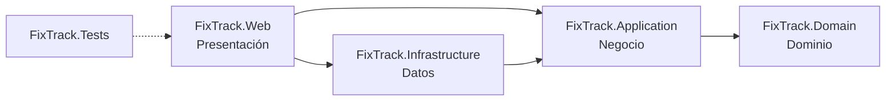

# FixTrack

[](https://github.com/JJMonzon072/fixtrack/actions/workflows/ci.yml)

Sistema web de gestión y seguimiento de órdenes de servicio técnico para un taller dedicado al mantenimiento y la reparación de computadoras, laptops y otros equipos tecnológicos.

Proyecto integrador de Programación II, desarrollado con C# y ASP.NET Core MVC.

## Problema que resuelve

El taller administra sus servicios con hojas de cálculo, mensajes y anotaciones manuales. Esto provoca pérdida de información, órdenes de reparación difíciles de controlar, retrasos en las entregas y falta de trazabilidad. FixTrack centraliza en una sola aplicación la información de clientes, equipos, técnicos y órdenes de servicio, prioriza el trabajo pendiente y controla quién accede a cada función.

## Estado del proyecto

El desarrollo avanza por fases y cada entrega pasa por una revisión de QA.

| Fase | Alcance | Estado |
| --- | --- | --- |
| 1 | Estructura de la solución, arquitectura por capas, sistema de diseño, navegación y páginas base | Aprobada e integrada a `main` (PR #1) |
| 2A | SQL Server con Entity Framework Core, modelo de datos inicial y módulo **Clientes** | Aprobada e integrada a `main` (PR #2) |
| 2B | Módulos **Equipos** y **Técnicos** e integración de equipos en el detalle del cliente | Aprobada e integrada a `main` (PR #3) |
| 3 | **Órdenes de servicio** completas, **algoritmo de priorización** y cola de trabajo, **panel con indicadores reales**, **autenticación y roles**, preparación para **despliegue con Docker** | Aprobada e integrada a `main` (PR #4) |
| 4 | **Endurecimiento y preparación para producción:** claves de sesión cifradas con certificado, inicio de sesión sin enumeración de cuentas, concurrencia en cuentas, clientes, equipos y técnicos, proxy explícito, **historial de asignaciones y auditoría**, resiliencia ante fallos de la base, cola calculada en SQL, **respaldos** y procedimiento de despliegue en Render | **Entregada para revisión** |

La aplicación guarda sus datos en **SQL Server** (FixTrackDB, alojada en Somee), con las nueve migraciones aplicadas. Todavía **no está publicada** en internet.

### Funciones

- **Órdenes de servicio:** recepción con cliente, equipo, problema reportado, prioridad, técnico opcional, entrega comprometida, costo estimado y observaciones. Asignación y reasignación de técnicos con motivo, diagnóstico, planificación, cambios de estado con reglas explícitas y costo final al entregar. La **línea de tiempo** une estados, asignaciones, planificación y diagnóstico, cada uno con su autor, y nada de eso se puede editar ni borrar. Un mismo formulario no registra dos órdenes. Listado con búsqueda, vistas (abiertas, vencidas, cerradas, todas), filtros por estado, prioridad y técnico (incluido "sin asignar") y paginación.
- **Cola de trabajo:** las órdenes abiertas ordenadas por un algoritmo determinista y explicable, separadas en reparaciones, en espera de repuestos y listas para entrega, cada una con su acción recomendada. La base de datos calcula la puntuación y devuelve las 100 primeras de cada lista.
- **Panel:** indicadores calculados en SQL (abiertas, en reparación, listas, vencidas, sin asignar, recientes), distribución por estado y prioridad, acciones recomendadas, próximas entregas, órdenes recientes y carga por técnico. Con la base vacía muestra ceros, no datos de ejemplo.
- **Clientes, Equipos y Técnicos:** registro, búsqueda, edición y desactivación, con aviso si otra persona modificó el registro mientras se editaba. Sus detalles muestran las órdenes relacionadas. No se puede desactivar a un técnico con órdenes abiertas; al desactivar un cliente, el sistema avisa cuántas tiene.
- **Cuentas de acceso:** inicio de sesión, roles Administrador y Operador, administración de cuentas (incluido el desbloqueo) y cambio de contraseña.
- **Auditoría:** el administrador consulta quién hizo cada operación importante y cuándo (`/auditoria`).
- **Operación:** página 503 clara si la base no responde, comprobaciones de salud, respaldo y restauración de la base con comandos.

Documentación detallada:

| Documento | Contenido |
| --- | --- |
| [docs/flujo-de-ordenes.md](docs/flujo-de-ordenes.md) | Ciclo de vida de una orden, transiciones, reglas, concurrencia y algoritmo de priorización con su fórmula y justificación |
| [docs/arquitectura.md](docs/arquitectura.md) | Capas, recorrido de una solicitud, servicios, seguridad, permisos por rol y despliegue |
| [docs/modelo-de-datos.md](docs/modelo-de-datos.md) | Tablas, relaciones, restricciones, migraciones, diagrama entidad-relación y diagrama de clases |
| [docs/referencia-para-el-equipo.md](docs/referencia-para-el-equipo.md) | Resumen para preparar diagramas, manuales y la exposición |

## Requisitos

- **.NET SDK 10.0** (LTS). `global.json` acepta cualquier SDK 10.0.x desde 10.0.100.
- macOS, Windows o Linux. El desarrollo se hace en macOS con Apple Silicon (M4).
- Un navegador moderno: Chrome, Edge, Safari o Firefox en una versión reciente.
- **Para ejecutar la aplicación:** una base SQL Server 2022 (Express o superior) con las migraciones aplicadas, su cadena de conexión y una cuenta de administrador. Consulta [Configurar la base de datos](#configurar-la-base-de-datos) y [Primer administrador](#primer-administrador).
- **Para compilar y ejecutar las pruebas no se necesita base de datos:** casi todas usan SQLite en memoria. Las 23 que necesitan SQL Server real se omiten si no se configura uno (ver [Pruebas](#pruebas)).
- **Docker** solo para construir la imagen de producción o levantar un SQL Server local para esas pruebas. No hace falta Node.js.

Para comprobar la versión instalada:

```bash
dotnet --list-sdks
```

## Inicio rápido

```bash
git clone https://github.com/JJMonzon072/fixtrack.git
cd fixtrack
git switch JJ

dotnet restore
dotnet build -c Release
dotnet test                              # no requiere base de datos
dotnet run --project src/FixTrack.Web    # requiere la cadena de conexión
```

Abre **http://localhost:5104**. La aplicación pide iniciar sesión. Si la base todavía no tiene un administrador, créalo antes con el comando de la sección [Primer administrador](#primer-administrador). Si falta la cadena de conexión, la aplicación se detiene al iniciar con un mensaje que explica cómo configurarla.

### Otras formas de ejecutar

| Objetivo | Comando |
| --- | --- |
| Recargar automáticamente al editar | `dotnet watch --project src/FixTrack.Web` |
| Ejecutar con HTTPS | `dotnet dev-certs https --trust` (solo la primera vez) y después `dotnet run --project src/FixTrack.Web --launch-profile https` → https://localhost:7171 |
| Ejecutar la compilación Release | `dotnet run --project src/FixTrack.Web -c Release` |
| Ejecutar la imagen Docker | Consulta [Despliegue con Docker](#despliegue-en-render) |

### HTTPS por entorno

| Situación | Redirección a HTTPS | HSTS | Cookie de sesión |
| --- | --- | --- | --- |
| Desarrollo con el perfil `http` (predeterminado) | No: el perfil no expone un puerto HTTPS | No | Sin `Secure`, para funcionar en `http://localhost` |
| Desarrollo con el perfil `https` | Sí: `http://localhost:5104` → `https://localhost:7171` | No | `Secure` si la solicitud es HTTPS |
| Producción con un puerto HTTPS configurado | Sí | Sí | Siempre `Secure` |
| Producción en el contenedor detrás de Render | La hace el balanceador de Render | Sí, cuando el proxy de Render está configurado como confiable (la aplicación reconoce HTTPS por su encabezado) | Siempre `Secure` |

La redirección se activa cuando `HttpsEndpoint.IsConfigured` encuentra un puerto HTTPS en las mismas fuentes que usa Kestrel (`ASPNETCORE_URLS`, `--urls`, `HTTPS_PORTS`, `HTTPS_PORT` o la sección `Kestrel:Endpoints`). Sin ese dato no hay a dónde redirigir y el middleware solo registraría una advertencia. Las comprobaciones de salud nunca se redirigen.

Si el certificado de desarrollo no es de confianza, Kestrel muestra `The ASP.NET Core developer certificate is not trusted` al usar el perfil `https`. Para resolverlo, ejecuta una vez `dotnet dev-certs https --trust`.

## Configurar la base de datos

La cadena de conexión se llama `ConnectionStrings:FixTrack` y **nunca se guarda en el repositorio**.

### En desarrollo: dotnet user-secrets

El proyecto `FixTrack.Web` tiene un `UserSecretsId`. Los secretos se guardan en tu perfil de usuario (`~/.microsoft/usersecrets/`), fuera del repositorio. Para registrar la cadena sin que la contraseña quede en pantalla ni en el historial de la terminal:

```bash
read -rs FIXTRACK_DB_PASSWORD        # escribe la contraseña; no se muestra
printf '{"ConnectionStrings:FixTrack":"Server=tcp:FixTrackDB.mssql.somee.com,1433;Database=FixTrackDB;User ID=<usuario>;Password=%s;Encrypt=True;TrustServerCertificate=False;HostNameInCertificate=vb4300.mgmt.somee.com;Connect Timeout=30;Application Name=FixTrack;"}' "$FIXTRACK_DB_PASSWORD" \
  | dotnet user-secrets set --project src/FixTrack.Web > /dev/null
unset FIXTRACK_DB_PASSWORD
```

Si la contraseña contiene comillas, barras invertidas o `;`, hay que escaparla según las reglas de JSON y de las cadenas de conexión de SqlClient.

**TLS:** la conexión va cifrada (`Encrypt=True`) y valida el certificado del servidor (`TrustServerCertificate=False`). Somee publica la base con el alias `FixTrackDB.mssql.somee.com`, pero su certificado de Let's Encrypt está emitido para el servidor compartido `vb4300.mgmt.somee.com`. `HostNameInCertificate` indica ese nombre para que la validación sea completa sin desactivarla. Si Somee mueve la base a otro servidor, la conexión fallará por certificado (no se conecta sin verificar) y habrá que actualizar ese valor.

### Configuración disponible

ASP.NET Core lee la misma configuración desde user-secrets o desde variables de entorno. En las variables, `__` reemplaza a `:`.

| Variable de entorno | Uso | Valor predeterminado |
| --- | --- | --- |
| `ConnectionStrings__FixTrack` | Cadena de conexión a SQL Server. **Secreto** | Ninguno: es obligatoria |
| `ASPNETCORE_ENVIRONMENT` | Entorno | `Production` en la imagen Docker |
| `PORT` | Puerto HTTP. Render lo define (10000) | 8080 en la imagen |
| `DataProtection__Certificate__Base64` y `DataProtection__Certificate__Password` | Certificado PFX (en base64) y su contraseña, que cifran las claves de sesión guardadas en la base. **Secretos.** Obligatorios fuera de Desarrollo | Ninguno |
| `DataProtection__Certificate__Path` | Alternativa a `Base64`: ruta de un archivo PFX (por ejemplo, un *Secret File* de Render) | Ninguna |
| `DataProtection__PreviousCertificates__0__Base64` / `__Password` | Certificado anterior, solo para descifrar durante una rotación | Ninguno |
| `DataProtection__KeyStore` | `Database` (tabla `DataProtectionKeys`) o `Local` (perfil del usuario) | `Local` en Desarrollo, `Database` en los demás |
| `DataProtection__AllowUnprotectedKeys` | `true` permite guardar las claves sin cifrar fuera de Desarrollo. No se recomienda | `false` |
| `ReverseProxy__KnownProxies__0`, `__1`… | Direcciones IP exactas de los proxies confiables | Ninguna |
| `ReverseProxy__KnownNetworks__0`, `__1`… | Redes (CIDR) de los proxies confiables | Ninguna |
| `ReverseProxy__IgnoreForwardedHeaders` | `true` declara que no hay proxy confiable. En producción hay que definir esta variable o alguna de las dos anteriores | `false` |
| `ReverseProxy__ClientIpHeader` | Encabezado con la IP del cliente | `X-Forwarded-For` |
| `Security__LoginAttemptsPerMinute` | Intentos de inicio de sesión (y de cambio de contraseña) por minuto y dirección IP | 10 |
| `Security__FailedLoginMinimumMilliseconds` | Duración mínima de un inicio de sesión fallido, para no revelar si el correo existe | 500 |
| `TZ` | Zona horaria para mostrar fechas (se guardan en UTC) | `America/Guatemala` en la imagen |
| `InitialAdmin__Email`, `InitialAdmin__FullName`, `InitialAdmin__Password` | Solo para el comando `crear-administrador`. La contraseña es un **secreto** y es opcional: si falta, el comando la pide | Ninguno |

Si falta una variable obligatoria (la cadena de conexión, el certificado o la decisión sobre el proxy), la aplicación no arranca y el mensaje dice qué falta.

### Migraciones

El esquema se crea y modifica **solo con migraciones** versionadas en `src/FixTrack.Infrastructure/Persistence/Migrations/`. La aplicación no crea ni modifica tablas al iniciar.

```bash
dotnet tool restore    # instala dotnet-ef 10.0.13 (dotnet-tools.json)

# Hay dos contextos (el del taller y el de las claves de Data Protection): indica siempre --context FixTrackDbContext

# Crear una migración después de cambiar el modelo
dotnet ef migrations add <Nombre> --context FixTrackDbContext --project src/FixTrack.Infrastructure --startup-project src/FixTrack.Web --output-dir Persistence/Migrations

# Revisar el SQL de las migraciones pendientes antes de aplicarlas (desde la última aplicada)
dotnet ef migrations script <ÚltimaAplicada> --context FixTrackDbContext --project src/FixTrack.Infrastructure --startup-project src/FixTrack.Web -o migracion.sql

# Aplicar las migraciones pendientes a la base configurada (cualquiera de las dos formas)
dotnet ef database update --context FixTrackDbContext --project src/FixTrack.Infrastructure --startup-project src/FixTrack.Web
dotnet run --project src/FixTrack.Web -- aplicar-migraciones
```

`aplicar-migraciones` es un comando de la propia aplicación: lista las migraciones pendientes, las aplica y termina, sin iniciar el servidor web. Sirve también con la imagen Docker, donde no está `dotnet-ef`.

Las migraciones reproducen el esquema completo desde cero en cualquier base SQL Server 2022 compatible, incluida la edición Express. Ninguna borra ni modifica datos existentes (una prueba lo comprueba en el script completo). FixTrackDB tiene aplicadas las nueve migraciones.

Procedimiento seguido para aplicar las de la fase 4 a FixTrackDB, recomendado para las siguientes: (1) `exportar-respaldo` de la base real; (2) revisar el script SQL; (3) restaurar el respaldo en una base vacía local (`restaurar-respaldo`) y aplicar ahí las migraciones; (4) aplicarlas a la base real; (5) exportar de nuevo y comparar tabla por tabla con el ensayo.

## Primer administrador

No hay registro público ni cuentas predeterminadas. La primera cuenta de administrador se crea con un comando explícito, que solo funciona mientras **no exista ningún administrador habilitado**. Después, las demás cuentas se crean desde **Administración → Usuarios** (`/usuarios`).

FixTrackDB ya tiene su administrador: lo creó el propietario con este comando. Para una base nueva, desde un equipo con la cadena de conexión configurada en user-secrets:

```bash
dotnet user-secrets set --project src/FixTrack.Web "InitialAdmin:Email" "tu-correo@ejemplo.com"
dotnet user-secrets set --project src/FixTrack.Web "InitialAdmin:FullName" "Tu nombre completo"
dotnet run --project src/FixTrack.Web -- crear-administrador
```

El comando pide la contraseña dos veces sin mostrarla. Debe tener al menos 12 caracteres, con mayúsculas, minúsculas y números. La contraseña no queda guardada en ningún archivo. Si prefieres no escribirla en la terminal, puedes definir `InitialAdmin__Password` como variable de entorno solo durante la ejecución del comando.

| Código de salida | Significado |
| --- | --- |
| 0 | Administrador creado |
| 1 | Datos no válidos (por ejemplo, una contraseña débil) o contraseñas que no coinciden |
| 2 | Faltan el correo o el nombre, o falta la contraseña y no hay una terminal para pedirla |
| 3 | Ya existe un administrador habilitado: no se creó otra cuenta |

Con la imagen Docker: `docker run --rm -it -e ConnectionStrings__FixTrack -e InitialAdmin__Email -e InitialAdmin__FullName fixtrack crear-administrador` (las variables se toman del entorno de tu terminal; no escribas sus valores en el comando).

## Respaldos y recuperación

La cuenta de Somee no puede ejecutar `BACKUP DATABASE`. Hay dos mecanismos complementarios:

1. **Copias de Somee.** Según la [ayuda de Somee](https://somee.com/doka/Help/Article/129), el sistema hace una copia diaria de cada base en el almacenamiento de respaldos de la cuenta, y su panel permite crear una copia (`.bak`), descargarla y restaurarla con "Upload and restore" ([artículo 75](https://somee.com/Doka/Help/Article/75)). **Una base gratuita sin consultas durante 30 días se elimina;** sus copias se conservan y se pueden restaurar en una base nueva. Conviene revisar en el panel que las copias existan y descargar una de vez en cuando.
2. **Respaldo lógico propio,** independiente de Somee:

```bash
# Desde un equipo con la cadena de conexión en user-secrets. La carpeta debe estar FUERA del repositorio.
dotnet run --project src/FixTrack.Web -c Release -- exportar-respaldo ~/FixTrack-respaldos

# Comprobar un archivo (hashes y filas) sin conectarse a ninguna base
dotnet run --project src/FixTrack.Web -c Release -- verificar-respaldo ~/FixTrack-respaldos/fixtrack-respaldo-AAAAMMDD-HHMMSSZ.zip

# Restaurar en una base VACÍA (la de la cadena de conexión configurada)
dotnet run --project src/FixTrack.Web -c Release -- restaurar-respaldo ~/FixTrack-respaldos/fixtrack-respaldo-AAAAMMDD-HHMMSSZ.zip
```

- `exportar-respaldo` **solo lee.** Lee todas las tablas en una transacción (instantánea si la base la permite; si no, serializable, que hace esperar a las escrituras durante unos segundos), así que el respaldo es consistente. Genera un ZIP con `manifiesto.json` (migraciones aplicadas, columnas, filas y SHA-256 de cada tabla) y una línea JSON por fila. Imprime el SHA-256 del archivo.
- `restaurar-respaldo` solo carga en una base **vacía**: si no tiene migraciones, le aplica exactamente las del respaldo; carga todo en una transacción con las restricciones activas y, antes de confirmar, vuelve a leer cada tabla y exige el mismo hash. Si la base de destino ya tiene datos distintos, no modifica nada. Si el respaldo es de una versión anterior, después se ejecuta `aplicar-migraciones`.
- **El archivo es tan sensible como la base:** contiene datos personales, hashes de contraseñas y las claves de Data Protection. El comando lo crea con permisos solo para el dueño y **rechaza carpetas dentro de un repositorio Git**; `.gitignore` y `.dockerignore` excluyen los archivos de respaldo. Guárdalo cifrado (por ejemplo, en una imagen de disco cifrada o un gestor de archivos cifrado) y nunca en GitHub.
- Probado de extremo a extremo: se exportó FixTrackDB, se restauró en un SQL Server local, se le aplicaron las migraciones de la fase 4 y el resultado coincidió tabla por tabla con FixTrackDB después de migrarla.

**Recuperación ante la pérdida de la base:** crear una base nueva vacía (en Somee o en otro SQL Server 2022), restaurar la copia `.bak` de Somee o ejecutar `restaurar-respaldo` con el último respaldo lógico, ejecutar `aplicar-migraciones` y actualizar `ConnectionStrings__FixTrack` si cambió el servidor. Las sesiones siguen siendo válidas si se conservan el certificado de Data Protection y la tabla `DataProtectionKeys`.

## Despliegue en Render

> La aplicación **no está publicada**. Estos son los pasos preparados; no se han ejecutado en Render.

La imagen se construye con el `Dockerfile` de la raíz:

```bash
docker build -t fixtrack .
```

Características de la imagen: compilación multietapa con el SDK de .NET 10; imagen final `aspnet:10.0-noble-chiseled-extra` (sin shell, con ICU y zonas horarias), unos 255 MB; usuario sin privilegios (UID 1654); puerto 8080 o el de `PORT`; sin secretos ni certificados (`.dockerignore` excluye configuraciones locales, certificados, respaldos, pruebas, documentos y evidencias). Con la base inalcanzable, el contenedor escucha a los 7 segundos, responde 503 en milisegundos y usa unos 80 MiB de memoria. GitHub Actions construye la imagen y comprueba que arranca sin privilegios, que `/salud` responde, que las páginas exigen sesión, que sin base responde la página 503 sin inundar la bitácora y que sin certificado termina con un error.

### Plan gratuito de Render: qué implica

Según la [documentación de Render](https://render.com/docs/free): el servicio se suspende tras 15 minutos sin visitas y tarda alrededor de un minuto en volver; hay 750 horas gratuitas al mes por espacio de trabajo; **no hay disco persistente, consola (shell) ni tareas puntuales**. Por eso las claves de sesión viven en la base y los comandos (`aplicar-migraciones`, `proteger-claves`, `crear-administrador`, `exportar-respaldo`) se ejecutan desde un equipo del equipo de desarrollo contra la misma base, no en Render. Render termina TLS en su balanceador y reenvía la solicitud por HTTP al puerto `PORT` (10000 por defecto).

### 1. Preparar el certificado de Data Protection (una vez)

Con OpenSSL 3 (`openssl version`), en una carpeta **fuera del repositorio**:

```bash
read -rs DP_PASSWORD && export DP_PASSWORD        # contraseña del PFX; no se muestra
openssl req -x509 -newkey rsa:3072 -nodes -keyout dp.key -out dp.crt -days 1825 -subj "/CN=FixTrack Data Protection"
openssl pkcs12 -export -inkey dp.key -in dp.crt -out fixtrack-dataprotection.pfx -passout env:DP_PASSWORD
rm dp.key dp.crt
base64 < fixtrack-dataprotection.pfx | tr -d '\n' > fixtrack-dataprotection.b64   # valor de DataProtection__Certificate__Base64
```

Guarda el PFX y su contraseña en un gestor de contraseñas. **Si se pierden,** las claves cifradas no se pueden leer: se genera un certificado nuevo, se ejecuta `proteger-claves --revocar-sin-cifrar` con él y los usuarios vuelven a iniciar sesión; no se pierden datos del taller.

### 2. Antes del primer despliegue, desde un equipo de desarrollo

```bash
dotnet run --project src/FixTrack.Web -c Release -- exportar-respaldo ~/FixTrack-respaldos     # respaldo previo
dotnet run --project src/FixTrack.Web -c Release -- aplicar-migraciones                         # si hay pendientes

# Cifrar las claves de sesión con el certificado. En Desarrollo las claves son locales: se indica que use la base.
export DataProtection__KeyStore=Database
export DataProtection__Certificate__Base64="$(cat fixtrack-dataprotection.b64)"
export DataProtection__Certificate__Password="$DP_PASSWORD"
dotnet run --project src/FixTrack.Web -c Release -- proteger-claves --revocar-sin-cifrar
unset DataProtection__Certificate__Base64 DataProtection__Certificate__Password DP_PASSWORD
```

`proteger-claves` crea una clave cifrada con el certificado y, con `--revocar-sin-cifrar`, revoca las claves que estaban sin cifrar (agrega una revocación, no borra filas): la clave cifrada se usa de inmediato. Las sesiones abiertas con las claves revocadas tienen que iniciarse de nuevo; antes del primer despliegue no hay ninguna que conservar. Sin `--revocar-sin-cifrar`, la clave cifrada empieza a usarse cuando termina su periodo de propagación (48 horas) y después se ejecuta otra vez con la opción. El comando muestra el estado de cada clave, sin su material.

### 3. Crear el servicio en Render

1. **New → Web Service**, conectado al repositorio de GitHub, rama `main` (después de la aprobación de QA), entorno **Docker**, plan **Free**.
2. Variables del servicio (las tres primeras como secretas):
   - `ConnectionStrings__FixTrack`
   - `DataProtection__Certificate__Base64` (el contenido de `fixtrack-dataprotection.b64`) y `DataProtection__Certificate__Password`. Alternativa: subir el PFX como *Secret File* y usar `DataProtection__Certificate__Path`.
   - `ReverseProxy__IgnoreForwardedHeaders=true` para el primer despliegue (ver el paso 5).
3. **Health Check Path:** `/salud`. Render da por sana una respuesta 2xx o 3xx en 5 segundos y reinicia la instancia tras 60 segundos de fallos seguidos ([documentación](https://render.com/docs/health-checks)). Por eso **no** se usa `/salud/bd`: una caída temporal de Somee reiniciaría el servicio sin resolver nada.
4. Desplegar y comprobar: `/salud` responde `Healthy`, `/salud/bd` responde `Healthy`, el inicio de sesión funciona con la cuenta del administrador y la bitácora no muestra errores de configuración.

### 4. Comprobaciones después del primer despliegue

- `curl -sI https://<servicio>.onrender.com/cuenta/iniciar-sesion` responde 200 con `Content-Security-Policy` y `Cache-Control: no-store`.
- `http://` redirige a `https://` (lo hace Render).
- La cookie `FixTrack.Sesion` es `Secure`, `HttpOnly` y `SameSite=Lax`.
- Un Operador recibe 403 en `/usuarios` y `/auditoria`.
- La página de una orden muestra la línea de tiempo con los autores.

### 5. Configurar el proxy de Render como confiable

FixTrack no inventa las direcciones del proxy de Render ni confía en rangos amplios por omisión. Con `ReverseProxy__IgnoreForwardedHeaders=true`, la aplicación funciona, pero no sabe que la solicitud original era HTTPS (no envía HSTS) y ve la dirección del proxy en lugar de la del cliente, así que el límite de 10 intentos de inicio de sesión por minuto se comparte entre todos los usuarios. Para corregirlo:

1. En la bitácora de Render, busca la advertencia `Se ignoraron encabezados reenviados (X-Forwarded-*) recibidos desde <dirección>`. Se registra como máximo una vez cada 15 minutos; revisa varias para ver si la dirección cambia.
2. Reemplaza `ReverseProxy__IgnoreForwardedHeaders` por `ReverseProxy__KnownProxies__0=<dirección>` (o `ReverseProxy__KnownNetworks__0=<red>/<prefijo>`, la más estrecha que cubra las direcciones observadas) y vuelve a desplegar.
3. Comprueba que la respuesta HTTPS incluye `Strict-Transport-Security` y que la advertencia ya no aparece. Si Render cambia sus direcciones, la advertencia vuelve a aparecer y la aplicación sigue funcionando sin confiar en ellas.

### Comprobaciones de salud

| Ruta | Responde | Uso |
| --- | --- | --- |
| `/salud` | `Healthy` (200) mientras el proceso responde | Comprobación de vida para la plataforma |
| `/salud/bd` | `Healthy` (200) si la base responde a `SELECT 1` en 4 segundos; `Unhealthy` (503) si no. El resultado se reutiliza 10 segundos | Diagnóstico de la conexión |

Ninguna exige sesión, ninguna muestra detalles (ni el servidor ni el error) y ninguna se guarda en caché del navegador. Si la base no responde, las páginas muestran "Servicio temporalmente no disponible" (503, con `Retry-After`) y cada solicitud se corta a los 30 segundos como máximo.

## Rutas disponibles

Todas exigen iniciar sesión, salvo el inicio de sesión, las páginas de error, los archivos estáticos y las comprobaciones de salud.

| Ruta | Página | Rol |
| --- | --- | --- |
| `/cuenta/iniciar-sesion` | Inicio de sesión (`?volver=` regresa a la página solicitada, solo si es local) | Público |
| `/cuenta/cerrar-sesion` | Cerrar sesión (solo POST) | Cualquiera |
| `/cuenta/contrasena` | Cambiar la propia contraseña | Cualquiera |
| `/` | Panel general | Administrador, Operador |
| `/cola-de-trabajo` | Cola de trabajo priorizada | Administrador, Operador |
| `/ordenes` | Listado de órdenes: `?buscar=`, `?vista=abiertas\|vencidas\|cerradas\|todas`, `?estado=`, `?prioridad=baja\|normal\|alta\|urgente`, `?tecnico={id}\|sin-asignar`, `?cliente={id}`, `?equipo={id}`, `?pagina=` | Administrador, Operador |
| `/ordenes/nueva` | Registrar una orden; `?cliente={id}` o `?equipo={id}` preseleccionan los datos | Administrador, Operador |
| `/ordenes/{id}` | Detalle de la orden con su línea de tiempo | Administrador, Operador |
| `/ordenes/{id}/estado`, `/asignar`, `/diagnostico`, `/planificacion` | Cambiar de estado (`?a=` sugiere el estado), asignar técnico, registrar el diagnóstico, cambiar prioridad, fecha y costo estimado | Administrador, Operador |
| `/clientes`, `/clientes/nuevo`, `/clientes/{id}`, `/clientes/{id}/editar` | Clientes: listado, registro, detalle (con equipos y órdenes) y edición | Administrador, Operador |
| `/clientes/{id}/desactivar`, `/clientes/{id}/reactivar` | Cambiar el estado (solo POST) | Administrador, Operador |
| `/clientes/opciones?buscar=` | Sugerencias JSON de clientes activos (máximo 8). Sin sesión responde 401 | Administrador, Operador |
| `/clientes/{id}/equipos` | Equipos del cliente en JSON, para el formulario de órdenes | Administrador, Operador |
| `/equipos`, `/equipos/nuevo`, `/equipos/{id}`, `/equipos/{id}/editar` | Equipos: listado con filtro por tipo, registro, detalle (con órdenes) y edición | Administrador, Operador |
| `/tecnicos`, `/tecnicos/{id}` | Técnicos: listado con carga de trabajo y detalle con órdenes abiertas | Administrador, Operador |
| `/tecnicos/nuevo`, `/tecnicos/{id}/editar`, `/tecnicos/{id}/desactivar`, `/tecnicos/{id}/reactivar` | Registrar, editar y cambiar el estado de técnicos | Administrador |
| `/usuarios`, `/usuarios/nueva`, `/usuarios/{id}/editar`, `/usuarios/{id}/contrasena` | Cuentas de acceso: listado, alta, nombre y rol, restablecer contraseña | Administrador |
| `/usuarios/{id}/deshabilitar`, `/usuarios/{id}/habilitar`, `/usuarios/{id}/desbloquear` | Cambiar el estado de una cuenta o quitar un bloqueo por intentos fallidos (solo POST) | Administrador |
| `/auditoria` | Operaciones registradas: `?area=ordenes\|tecnicos\|clientes\|cuentas`, `?pagina=` | Administrador |
| `/salud`, `/salud/bd` | Comprobaciones de salud | Público |
| Cualquier otra | Página 404 con enlace al panel | — |

## Arquitectura

FixTrack sigue una **arquitectura por capas** con las dependencias apuntando hacia el dominio. Cada capa es un proyecto independiente, así que el compilador impide referencias en la dirección incorrecta. El detalle está en [docs/arquitectura.md](docs/arquitectura.md).

```
fixtrack/
├── .github/workflows/ci.yml     Integración continua (pruebas e imagen Docker)
├── Dockerfile, .dockerignore    Imagen de producción
├── FixTrack.sln
├── global.json                  Versión del SDK y runner de pruebas
├── Directory.Build.props        Configuración común (net10.0, nullable, advertencias como errores)
├── Directory.Packages.props     Versiones centralizadas de paquetes NuGet
├── dotnet-tools.json            Herramientas locales (dotnet-ef)
├── docs/                        Arquitectura, flujo de órdenes, modelo de datos y referencia para el equipo
├── src/
│   ├── FixTrack.Domain/         Entidades, reglas, flujo de estados y algoritmo de priorización
│   ├── FixTrack.Application/    Casos de uso y contratos
│   ├── FixTrack.Infrastructure/ EF Core, SQL Server, repositorios, migraciones, cuentas (Identity), disyuntor y respaldos
│   └── FixTrack.Web/            Controladores, vistas, seguridad, Data Protection, alojamiento, estilos y scripts
└── tests/
    └── FixTrack.Tests/          Pruebas unitarias, de integración y contra SQL Server real
```

| Capa lógica | Proyecto | Contenido principal |
| --- | --- | --- |
| Presentación | `FixTrack.Web` | Controladores y vistas de todos los módulos, políticas de autorización, encabezados de seguridad, salud, proxy y comandos de consola. Es la **raíz de composición** |
| Negocio | `FixTrack.Application` | `ICustomerService`, `IDeviceService`, `ITechnicianService`, `IServiceOrderService`, `IDashboardService`; contratos de repositorios, `IUnitOfWork`, `IUserAccountService`, `ICurrentUser`, `IAuditLog` |
| Datos | `FixTrack.Infrastructure` | `FixTrackDbContext`, configuraciones, migraciones, repositorios, `EfUnitOfWork`, `EfAuditLog`, cuentas con ASP.NET Core Identity, disyuntor de la base y respaldos |
| Dominio | `FixTrack.Domain` | `Customer`, `Device`, `Technician`, `ServiceOrder`, `ServiceOrderStatusChange`, `ServiceOrderAssignment`, `AuditEvent`; `ServiceOrderWorkflow`, `ServiceOrderRules`, `WorkPrioritizer` |



Cada capa registra sus servicios con un método de extensión, y `Program.cs` los combina:

```csharp
builder.Services
    .AddApplication()                                    // casos de uso
    .AddInfrastructure(builder.Configuration)            // EF Core, repositorios, Identity
    .AddPresentation()                                   // MVC, vistas, localización
    .AddSecurity(builder.Configuration, builder.Environment)  // cookies, políticas, límite de intentos
    .AddReverseProxySupport(builder.Configuration, builder.Environment)  // solo proxies declarados
    .AddRequestResilience()                              // página 503 y tiempo máximo por solicitud
    .AddHealthEndpoints();                               // /salud y /salud/bd
```

## Decisiones técnicas

- **.NET 10 LTS** con `Nullable`, `ImplicitUsings`, `TreatWarningsAsErrors` y `EnforceCodeStyleInBuild` activados para toda la solución desde `Directory.Build.props`. La solución compila sin advertencias.
- **Versiones de paquetes centralizadas** en `Directory.Packages.props`.
- **Código en inglés, interfaz en español.** Los identificadores de C# siguen las convenciones de .NET. Las rutas (`/ordenes`, `/clientes`…), los textos y los comentarios están en español.
- **Cultura `es`** configurada con `RequestLocalization`: las fechas se muestran como "Lunes, 19 de octubre de 2026" y los montos en quetzales ("Q 1,250.00").
- **Reglas en el dominio.** Las transiciones de estado, las validaciones y el algoritmo de priorización son código del dominio sin dependencias, probado de forma aislada. La interfaz consulta esas mismas reglas para mostrar qué pasos están disponibles.
- **Concurrencia:** optimista por versión en órdenes, clientes, equipos y técnicos; un bloqueo breve de fila (`UPDLOCK`) en el técnico al asignar o desactivar; un bloqueo de aplicación (`sp_getapplock`) en los cambios de cuentas; un identificador por formulario para no registrar dos veces la misma orden. Funciona en SQL Server Express y en Somee. Se explica en [docs/arquitectura.md](docs/arquitectura.md#concurrencia).
- **Trazabilidad:** historial de estados, historial de asignaciones y auditoría de solo inserción (triggers que rechazan `UPDATE` y `DELETE`), con autor, guardados en la misma transacción que el cambio.
- **Consultas en SQL:** el panel cuenta todo en una sola consulta de agregación, la cola de trabajo calcula la puntuación en la base y ninguna página hace consultas por fila (entre 1 y 5 consultas por página).
- **Seguridad por defecto:** una política de autorización de respaldo protege cualquier ruta nueva; CSP con nonce por solicitud; cookies `HttpOnly`, `SameSite=Lax` y `Secure` en producción; inicio de sesión sin enumeración de cuentas; límite de intentos por IP; bloqueo de cuentas; claves de Data Protection en la base, cifradas con un certificado en producción; ningún proxy confiable por omisión.
- **Resiliencia:** tiempos de conexión y de comando acotados, reintentos limitados, disyuntor ante una base caída y página 503 sin detalles técnicos. Se explica en [docs/arquitectura.md](docs/arquitectura.md#resiliencia-ante-fallos-de-la-base).
- **Sin Bootstrap ni jQuery.** Los estilos son CSS propio con variables (tokens). El JavaScript (unas 400 líneas, sin dependencias) se limita a mejoras: menú móvil, tema, buscadores con sugerencias, formulario dependiente de cliente y equipo, envío único de formularios y menú de usuario.
- **Gráficos sin bibliotecas:** las barras del panel son SVG generado en el servidor, compatibles con la política de contenido.
- **Recursos servidos localmente**, sin CDN: fuentes, íconos y estilos funcionan sin conexión. `MapStaticAssets` añade compresión y huellas de versión para la caché.
- **Páginas de error propias** para 403, 404, 429 y las excepciones, integradas en el diseño, y una página 503 estática para cuando la base no responde.
- **Pruebas con xUnit v3 sobre Microsoft.Testing.Platform**, el runner recomendado para `dotnet test` desde el SDK de .NET 10 (se activa en `global.json`).
- **Entity Framework Core 10 con SQL Server** y migraciones explícitas; nunca `EnsureCreated` ni migraciones automáticas al iniciar.
- **Fechas en UTC** en toda la base (`datetime2(3)`); la interfaz las convierte a la hora local y convierte a UTC las fechas que se escriben en los formularios.
- **Búsqueda sin distinguir tildes ni mayúsculas:** los nombres usan la intercalación `Modern_Spanish_100_CI_AI` ("jose" encuentra "José"). La búsqueda usa `LIKE` parametrizado con los comodines escapados.
- **Validación en el servidor** con mensajes en español (los formularios usan `novalidate`), protección antifalsificación global y codificación HTML de todo el contenido ingresado.
- **Dependencias auditadas:** NuGet Audit bloqueó `System.Security.Cryptography.Pkcs 9.0.11` (CVE-2026-84008 y CVE-2026-70162), que llegaba a través de `Microsoft.Data.SqlClient`. Se fijó la versión corregida 10.0.13 con *transitive pinning*.
- **Integración continua con GitHub Actions** (`.github/workflows/ci.yml`). Se ejecuta en cada push a `JJ` y en cada pull request hacia `main`, con tres trabajos: compilar en Release y ejecutar las pruebas; ejecutar las pruebas de SQL Server contra un SQL Server 2022 efímero (imagen fijada por digest, contraseña aleatoria por ejecución); y construir y probar la imagen Docker. Usa permisos de solo lectura, no necesita secretos, no se conecta a Somee y fija las acciones por SHA.

## Sistema de diseño

Toda la interfaz se construye desde `src/FixTrack.Web/wwwroot/css/site.css`, organizado en secciones: fuentes, tokens, base, estructura, menú lateral, barra superior, componentes, páginas (incluidas órdenes, cola, panel y cuentas) y utilidades.

- **Tipografía:** IBM Plex Sans (variable) para la interfaz e IBM Plex Mono para datos técnicos como números de orden y montos.
- **Color:** grises neutros con un único acento verde petróleo (`--color-accent`) y colores propios para cada estado de orden y prioridad, en tema claro y oscuro. Se aplica el tema del sistema operativo y el usuario puede cambiarlo con el botón de la barra superior.
- **Tokens:** espaciado en múltiplos de 4 px, escala tipográfica, radios, sombras sutiles y duraciones de animación definidos como variables CSS.
- **Íconos:** sprite SVG con 71 íconos de [Lucide](https://lucide.dev). En las vistas se usan así: `<icon name="wrench" />`.
- **Componentes:** botones, etiquetas de estado y prioridad, tarjetas, tablas con búsqueda, filtros y paginación (en móvil se convierten en tarjetas), formularios con resumen de errores, avisos, diálogos de confirmación nativos, estados vacíos, buscador con sugerencias (patrón *combobox* de ARIA), línea de tiempo con autores, desglose de puntuación, barras de distribución, registro de auditoría, menú de usuario, página de inicio de sesión y página 503.
- **Responsive:** en escritorio (≥ 1024 px), menú lateral fijo. En tableta y móvil, el menú es un panel deslizable con fondo, foco atrapado, cierre con Escape y bloqueo del desplazamiento. Ninguna página tiene desplazamiento horizontal a 375 px.
- **Accesibilidad:** enlace "Saltar al contenido", foco visible, `aria-current` en la navegación, textos alternativos en los gráficos, contraste AA y respeto de `prefers-reduced-motion`.

## Pruebas

```bash
dotnet test -c Release
```

Hay **595 casos** en `tests/FixTrack.Tests`. Sin configurar un SQL Server pasan **572** y se omiten **23**: las que necesitan SQL Server real (ver más abajo). Con un SQL Server local desechable pasan los **595**. Las demás usan **SQLite en memoria** y funcionan igual en GitHub Actions, sin credenciales.

| Grupo | Archivo | Casos | Qué verifica |
| --- | --- | --- | --- |
| Dominio | `Domain/EntityTests.cs` | 5 | Igualdad de entidades por tipo e identificador |
| Dominio | `Domain/ContactRulesTests.cs` | 28 | Validación y normalización de nombres, teléfonos y correos |
| Dominio | `Domain/CustomerTests.cs` | 7 | Registro, edición, desactivación y reactivación de clientes |
| Dominio | `Domain/DeviceTests.cs` | 12 | Registro solo para clientes activos, normalización, edición sin cambio de propietario |
| Dominio | `Domain/TechnicianTests.cs` | 5 | Especialidad obligatoria, contacto opcional válido, desactivación y reactivación |
| Dominio | `Domain/ServiceOrderTests.cs` | 43 | Recepción, cliente inactivo, fechas y montos, asignación y reasignación con autor y motivo, diagnóstico, planificación, cada transición y sus requisitos, órdenes cerradas inmutables, flujo completo |
| Dominio | `Domain/ServiceOrderWorkflowTests.cs` | 21 | Tabla de transiciones permitidas y prohibidas, estados abiertos y cerrados, explicaciones de bloqueo |
| Dominio | `Domain/WorkPrioritizerTests.cs` | 32 | Puntos por prioridad, bonos de fecha excluyentes, antigüedad con tope, el estado decide la lista y la acción, desempates estables |
| Aplicación | `Application/ModuleCatalogTests.cs` | 8 | Catálogo de módulos |
| Aplicación | `Application/CustomerServiceTests.cs` | 9 | Casos de uso de clientes con repositorios en memoria (`InMemoryFakes.cs`), duplicados detectados por la base, versión desactualizada |
| Aplicación | `Application/DeviceServiceTests.cs` | 13 | Propietario inexistente o inactivo, serie duplicada por marca, edición, versión desactualizada |
| Aplicación | `Application/TechnicianServiceTests.cs` | 11 | Registro, correo duplicado, desactivación bloqueada con órdenes abiertas y con el técnico bloqueado en una transacción, carga de trabajo, versión desactualizada |
| Aplicación | `Application/ServiceOrderServiceTests.cs` | 27 | Registro en transacción, envío repetido, equipo de otro cliente, técnicos inactivos, versión desactualizada, conflictos, transiciones rechazadas, entrega, autores y auditoría |
| Aplicación | `Application/DashboardServiceTests.cs` | 4 | Cola separada en tres listas, máximo por lista con su total real, acciones recomendadas, panel vacío |
| Infraestructura | `Infrastructure/PersistenceModelTests.cs` | 16 | Claves foráneas, índices únicos, restricciones CHECK, fechas UTC, tokens de concurrencia |
| Infraestructura | `Infrastructure/CustomerRepositoryTests.cs` | 9 | Búsqueda, comodines literales, filtro por estado, paginación |
| Infraestructura | `Infrastructure/DeviceRepositoryTests.cs` | 11 | Búsqueda, filtro por tipo, paginación en SQL, órdenes del equipo |
| Infraestructura | `Infrastructure/TechnicianRepositoryTests.cs` | 8 | Búsqueda, filtros y conteo de órdenes abiertas |
| Infraestructura | `Infrastructure/ServiceOrderRepositoryTests.cs` | 23 | Búsqueda, vistas, filtros, orden, conteos, detalle con historial; la puntuación en SQL ordena exactamente como el algoritmo y sus umbrales son parámetros |
| Infraestructura | `Infrastructure/DashboardRepositoryTests.cs` | 3 | Todos los indicadores en una agregación, próximas entregas y recientes, base vacía |
| Infraestructura | `Infrastructure/UnitOfWorkTests.cs` | 6 | Transacciones confirmadas y revertidas, bloqueo del técnico solo dentro de una transacción, conflictos de concurrencia |
| Infraestructura | `Infrastructure/MigrationTests.cs` | 10 | Migraciones sincronizadas con el modelo, sin operaciones destructivas; cada migración de las fases 3 y 4 solo agrega |
| Infraestructura | `Infrastructure/BackupFileTests.cs` | 5 | Respaldos nunca dentro de un repositorio Git; archivos dañados, incompletos o ajenos se rechazan |
| Web | `Web/PageTests.cs` | 19 | Rutas principales, menú activo, panel con números reales, 404 y recursos estáticos |
| Web | `Web/PresentationTests.cs` | 30 | Montos en quetzales, fechas locales y UTC, parámetros de las listas |
| Web | `Web/CustomersPageTests.cs` | 11 | Módulo Clientes completo, aviso de órdenes abiertas al desactivar |
| Web | `Web/DevicesPageTests.cs` | 11 | Módulo Equipos e integración con Clientes |
| Web | `Web/TechniciansPageTests.cs` | 9 | Módulo Técnicos |
| Web | `Web/ServiceOrdersPageTests.cs` | 28 | Módulo Órdenes: registro, validaciones, flujo completo, formulario desactualizado, envío repetido, línea de tiempo con asignaciones y autores |
| Web | `Web/DashboardPageTests.cs` | 4 | Panel y cola de trabajo con datos reales y sin datos |
| Web | `Web/SecurityTests.cs` (y `.Login.cs`, `.Administration.cs`) | 45 | Acceso anónimo, cookies, bloqueo, límite por IP, permisos por rol, **todos los POST de administración rechazados a un Operador**, CSRF, encabezados y CSP, inicio de sesión sin enumeración (mismo mensaje y tiempo), contraseñas fuera de registros |
| Web | `Web/UsersPageTests.cs` | 9 | Cuentas: alta, validaciones, roles, deshabilitar, restablecer y cambiar contraseña, último administrador |
| Web | `Web/AccountAdministrationTests.cs` | 11 | Desbloqueo, edición concurrente de cuentas, cambio de la propia contraseña, auditoría de cuentas sin contraseñas, Operador sin acceso por solicitudes manuales |
| Web | `Web/AuditPageTests.cs` | 3 | Auditoría solo para administradores, con autor y filtros por área; la planificación aparece en la línea de tiempo de la orden |
| Web | `Web/DataProtectionTests.cs` | 11 | Claves cifradas con certificado, arranque rechazado sin certificado, rotación sin perder sesiones, revocación de claves sin cifrar |
| Web | `Web/ResilienceTests.cs` | 16 | Disyuntor, tiempos y reintentos acotados, página 503 y recuperación, una línea de bitácora por solicitud rechazada |
| Web | `Web/InitialAdministratorTests.cs` | 7 | Comando del primer administrador y comandos explícitos |
| Web | `Web/HostingTests.cs` | 18 | Salud sin detalles y con caché, proxy solo si se declara, encabezados falsificados, advertencia acotada, error claro con la configuración incompleta |
| Web | `Web/HttpsTests.cs` | 11 | Detección del puerto HTTPS y redirección por entorno |
| Web | `Web/CompositionTests.cs` | 3 | Servicios de las capas, reloj inyectado y aislamiento de la base real |
| SQL Server | `SqlServer/SqlServerBehaviorTests.cs` | 12 | Triggers de solo inserción (historial, asignaciones y auditoría), bloqueos `UPDLOCK`, concurrencia optimista, intercalación española, indicadores del panel, puntuación de la cola en SQL |
| SQL Server | `SqlServer/AccountConcurrencyTests.cs` | 6 | Administradores que actúan a la vez: nunca quedan sin administrador habilitado, cambios de Identity atómicos |
| SQL Server | `SqlServer/OrderCreationConcurrencyTests.cs` | 1 | Dos envíos simultáneos del mismo formulario registran una sola orden |
| SQL Server | `SqlServer/BackupTests.cs` | 4 | Respaldo y restauración idénticos, rechazo sobre datos existentes, respaldo de la fase 3 restaurado y migrado |
| SQL Server | `SqlServer/DisposableSqlServerDatabaseTests.cs` | 10 | La base desechable solo acepta servidores locales: nunca Somee ni otro servidor remoto (no necesitan SQL Server) |

Las pruebas web levantan la aplicación en memoria con `WebApplicationFactory` e inician sesión con el formulario real. Las cuentas de prueba solo existen en la base SQLite de cada ejecución y sus contraseñas son aleatorias. Las políticas de seguridad no se relajan para las pruebas: solo se eleva el límite de intentos por IP y se quita la espera mínima de los inicios fallidos, cada una con su propia prueba.

### Pruebas contra SQL Server real

SQLite no reproduce todo el comportamiento de SQL Server (triggers, bloqueos, intercalación, transacciones concurrentes). Las pruebas de `SqlServer/` crean una **base desechable** con nombre único (`FixTrackPrueba_…`), le aplican las migraciones, cargan datos ficticios y la eliminan al terminar. Solo aceptan un servidor **local**: nunca se conectan a Somee. En GitHub Actions se ejecutan contra un SQL Server 2022 efímero.

Para ejecutarlas en tu equipo (en Apple Silicon, Docker Desktop emula la imagen con Rosetta):

```bash
read -rs MSSQL_SA_PASSWORD && export MSSQL_SA_PASSWORD     # contraseña fuerte; no se muestra
docker run -d --name fixtrack-sqltest --platform linux/amd64 -e ACCEPT_EULA=Y -e MSSQL_SA_PASSWORD \
  -p 127.0.0.1:14333:1433 mcr.microsoft.com/mssql/server:2022-latest
export FIXTRACK_TEST_SQLSERVER_SERVER="Server=127.0.0.1,14333;User ID=sa;Password=$MSSQL_SA_PASSWORD;Encrypt=True;TrustServerCertificate=True;"
dotnet test -c Release
```

`SqlServerBehaviorTests` también acepta `FIXTRACK_TEST_SQLSERVER` con la cadena de una base ya migrada: en ese caso trabaja **dentro de transacciones que se revierten**, sin dejar ni modificar datos.

## Comprobación visual manual

Con la aplicación en ejecución y una cuenta de administrador:

1. **Inicio de sesión:** sin sesión, cualquier página lleva a `/cuenta/iniciar-sesion`. Prueba una contraseña incorrecta (mensaje genérico) y después la correcta; vuelves a la página que pediste.
2. **Panel:** muestra los indicadores reales, la distribución por estado, las acciones recomendadas, las próximas entregas y la carga por técnico.
3. **Nueva orden:** elige un cliente en el buscador; el selector de equipos muestra solo los suyos. Deja el problema vacío o escribe una fecha comprometida anterior a hoy: aparecen los errores en español.
4. **Flujo de la orden:** desde el detalle, inicia el diagnóstico (pide técnico si no hay), registra el diagnóstico, pasa a reparación, a espera de repuestos (pide la nota), a lista para entrega y a entregada (pide el costo final). La línea de tiempo muestra cada paso y la orden cerrada ya no ofrece formularios.
5. **Concurrencia:** abre la misma orden (o el mismo cliente, equipo o técnico) en dos pestañas, cambia algo en una y envía la otra: aparece el aviso de que otra persona lo modificó.
6. **Listado:** prueba las vistas Abiertas, Vencidas, Cerradas y Todas, los filtros y la búsqueda por número (`OS-000001` o `1`).
7. **Cola de trabajo:** las órdenes aparecen en tres listas con su puntuación desglosada y su acción recomendada.
8. **Técnicos:** intenta desactivar a un técnico con órdenes abiertas: el diálogo explica que primero hay que reasignarlas. Reasigna una orden con un motivo: la línea de tiempo muestra el técnico anterior, el nuevo, el motivo y quién lo hizo.
9. **Clientes:** abre el diálogo para desactivar un cliente con órdenes abiertas: avisa cuántas tiene.
10. **Cuentas:** crea una cuenta Operador, inicia sesión con ella en otra ventana privada y comprueba que no ve Administración ni los botones de técnicos, y que `/usuarios` y `/auditoria` responden 403. Equivoca su contraseña 5 veces: el mensaje es el mismo que con un correo inexistente; como administrador, desbloquéala desde su editor. Deshabilítala: su sesión termina en menos de un minuto.
11. **Auditoría:** `/auditoria` muestra cada operación anterior con su autor; prueba los filtros por área.
12. **Tema, responsive y teclado:** cambia entre tema claro y oscuro, reduce la ventana a 375 px (sin desplazamiento horizontal) y recorre la página con Tab.
13. **Cerrar sesión** desde el menú de usuario.

## Limitaciones conocidas de Somee

La base de desarrollo está en el plan gratuito de Somee. Detectamos lo siguiente:

| Limitación | Efecto en FixTrack |
| --- | --- |
| **30 MB para datos y 30 MB para el log** | Se evitan datos de prueba masivos. Con las tablas de la fase 4 y las órdenes ficticias se usan unos 6 MB de datos. La auditoría crece con el uso: conviene revisar el espacio en el panel. |
| **Una base gratuita sin consultas durante 30 días se elimina** | Somee conserva sus copias diarias y permite restaurarlas. Con la aplicación publicada y en uso, las consultas mantienen la base activa; además existe el respaldo lógico propio ([Respaldos y recuperación](#respaldos-y-recuperación)). |
| No se puede ejecutar `BACKUP DATABASE` | Las copias se hacen desde el panel de Somee o con `exportar-respaldo`. |
| El certificado TLS es del servidor compartido (`vb4300.mgmt.somee.com`), no del alias de la base | Se usa `HostNameInCertificate` para validar el certificado sin desactivar la verificación. Si Somee cambia de servidor, hay que actualizar ese valor. |
| El servidor reporta **SQL Server 2022 Web Edition** (16.0.1000.6, RTM sin actualizaciones acumulativas), no Express | El esquema solo usa características disponibles también en Express: tablas, índices filtrados, restricciones CHECK, un trigger, intercalaciones estándar y bloqueos de fila. |
| `READ_COMMITTED_SNAPSHOT` está desactivado | La estrategia de concurrencia no depende de instantáneas: usa versiones, `UPDLOCK` y `sp_getapplock`. El respaldo lógico lee con aislamiento serializable. |
| El usuario es `db_owner` de su base, pero no tiene permisos de servidor (`VIEW SERVER STATE`) | No se pueden consultar vistas de servidor como `sys.dm_exec_connections`; no afecta a la aplicación. |
| Servidor remoto compartido | La primera consulta tras un periodo de inactividad tarda alrededor de 1 segundo (conexión TLS); las siguientes usan el pool de conexiones. A veces deja de responder unos segundos: EF Core reintenta, el disyuntor evita insistir y el usuario ve la página 503. |

Para desarrollar sin Somee se puede usar cualquier SQL Server 2022 compatible y aplicar las migraciones, incluido el contenedor oficial (en Apple Silicon, con la emulación de Docker Desktop; ver [Pruebas contra SQL Server real](#pruebas-contra-sql-server-real)).

## Limitaciones conocidas de la aplicación

- **No hay rol Técnico.** Solo existen Administrador y Operador. Un rol Técnico correcto exige autorización por registro (cada técnico limitado a sus órdenes). El diseño propuesto está en [docs/arquitectura.md](docs/arquitectura.md#autorización).
- **La clave de Data Protection actual de FixTrackDB todavía está sin cifrar.** El cifrado con certificado está implementado y probado, pero proteger la clave existente requiere el certificado definitivo, que el propietario genera y guarda. Se hace en el paso 2 del [despliegue](#2-antes-del-primer-despliegue-desde-un-equipo-de-desarrollo), antes de publicar.
- **El proxy de Render no está configurado como confiable** hasta conocer su dirección real después del primer despliegue (paso 5). Mientras tanto no se envía HSTS y el límite de intentos de inicio de sesión por IP se comparte entre todos los usuarios.
- **Las reasignaciones anteriores a la fase 4 no se conocen:** esas órdenes muestran solo su asignación vigente, con la nota correspondiente. Los cambios de estado anteriores no tienen autor.
- **La auditoría no registra las ediciones de datos de contacto** de clientes, equipos y técnicos (sí su desactivación y reactivación): son frecuentes y guardarían copias de datos personales.
- **Los respaldos lógicos no se programan solos:** se ejecutan a mano (o con una tarea programada en el equipo del propietario). Somee hace además sus copias diarias.
- **Cada lista de la cola muestra como máximo 100 órdenes:** la base calcula la puntuación de todas las órdenes abiertas de la lista y devuelve las 100 más altas. La página indica el total y dónde ver las demás.
- **Los buscadores con sugerencias y el selector de equipos de una nueva orden requieren JavaScript.** Sin JavaScript, se puede registrar desde el detalle del cliente o del equipo, que preseleccionan los datos.
- **Un POST a una ruta inexistente responde 405** en lugar de 404.
- **No incluye** facturación, cobros, inventario de repuestos, notificaciones al cliente ni reportes exportables: quedan fuera del alcance de la fase.

## Flujo de trabajo con Git

- `main`: rama principal. No recibe commits directos.
- `JJ`: rama de desarrollo. Cada fase se entrega aquí para revisión antes de integrarse a `main`.
- Nunca se versionan secretos: la cadena de conexión y las contraseñas viven en user-secrets o en variables de entorno.
- Las capturas de las revisiones se guardan en `qa-evidence/`, que está excluida del repositorio.

## Licencias de terceros

- IBM Plex Sans e IBM Plex Mono, bajo SIL Open Font License 1.1 (`src/FixTrack.Web/wwwroot/fonts/OFL.txt`).
- Íconos de Lucide, bajo licencia ISC (`src/FixTrack.Web/wwwroot/icons/LICENSE`).
