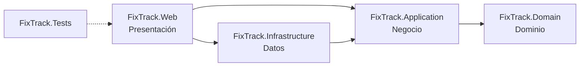

# FixTrack

Sistema web de gestión y seguimiento de órdenes de servicio técnico para un taller dedicado al mantenimiento y la reparación de computadoras, laptops y otros equipos tecnológicos.

Proyecto integrador de Programación II, desarrollado con C# y ASP.NET Core MVC.

## Problema que resuelve

El taller administra sus servicios con hojas de cálculo, mensajes y anotaciones manuales. Esto provoca pérdida de información, órdenes de reparación difíciles de controlar, retrasos en las entregas y falta de trazabilidad. FixTrack centraliza en una sola aplicación la información de clientes, equipos, técnicos y órdenes de servicio.

## Estado del proyecto

El desarrollo avanza por fases y cada entrega pasa por una revisión de QA.

| Fase | Alcance | Estado |
| --- | --- | --- |
| 1 | Estructura de la solución, arquitectura por capas, sistema de diseño, navegación y páginas base | **Entregada para revisión** |
| Siguientes | Clientes y equipos, órdenes de servicio, técnicos, estados y prioridades, costos, historial, panel con indicadores reales y algoritmo de priorización | Planificadas |

En esta fase **no hay persistencia**. Los módulos de Órdenes, Clientes, Equipos y Técnicos se pueden visitar, pero muestran una página "En preparación" con las funciones previstas. El panel no muestra datos inventados: los indicadores aparecen vacíos ("—") hasta que exista el módulo de órdenes.

## Requisitos

- **.NET SDK 10.0** (LTS). `global.json` acepta cualquier SDK 10.0.x desde 10.0.100.
- macOS, Windows o Linux. El desarrollo se hace en macOS con Apple Silicon (M4).
- Un navegador moderno: Chrome, Edge, Safari o Firefox en una versión reciente.

No necesitas Node.js, Docker ni una base de datos para esta fase.

Para comprobar la versión instalada:

```bash
dotnet --list-sdks
```

## Inicio rápido

```bash
git clone https://github.com/JJMonzon072/fixtrack.git
cd fixtrack
git switch JJ

dotnet restore
dotnet build -c Release
dotnet test
dotnet run --project src/FixTrack.Web
```

Abre **http://localhost:5104** en el navegador.

### Otras formas de ejecutar

| Objetivo | Comando |
| --- | --- |
| Recargar automáticamente al editar | `dotnet watch --project src/FixTrack.Web` |
| Ejecutar con HTTPS | `dotnet dev-certs https --trust` (solo la primera vez) y después `dotnet run --project src/FixTrack.Web --launch-profile https` → https://localhost:7171 |
| Ejecutar la compilación Release | `dotnet run --project src/FixTrack.Web -c Release` |

Con el perfil `http` aparece en la consola la advertencia `Failed to determine the https port for redirect`. Es esperada: el perfil no expone un puerto HTTPS y la aplicación sigue funcionando.

## Rutas disponibles

| Ruta | Página |
| --- | --- |
| `/` | Panel general |
| `/ordenes` | Órdenes de servicio (en preparación) |
| `/clientes` | Clientes (en preparación) |
| `/equipos` | Equipos (en preparación) |
| `/tecnicos` | Técnicos (en preparación) |
| Cualquier otra | Página 404 con enlace de regreso al panel |

## Arquitectura

FixTrack sigue una **arquitectura por capas** con las dependencias apuntando hacia el dominio. Cada capa es un proyecto independiente, así que el compilador impide referencias en la dirección incorrecta.

```
fixtrack/
├── FixTrack.sln
├── global.json                  Versión del SDK y runner de pruebas
├── Directory.Build.props        Configuración común (net10.0, nullable, advertencias como errores)
├── Directory.Packages.props     Versiones centralizadas de paquetes NuGet
├── src/
│   ├── FixTrack.Domain/         Entidades y reglas del dominio
│   ├── FixTrack.Application/    Lógica de negocio y contratos
│   ├── FixTrack.Infrastructure/ Acceso a datos y servicios externos
│   └── FixTrack.Web/            ASP.NET Core MVC: controladores, vistas y estilos
└── tests/
    └── FixTrack.Tests/          Pruebas unitarias y de integración
```

### Correspondencia con las capas lógicas

| Capa lógica | Proyecto | Responsabilidad | Contenido actual |
| --- | --- | --- | --- |
| Presentación | `FixTrack.Web` | Recibir solicitudes HTTP, preparar modelos de vista y renderizar la interfaz. Es la **raíz de composición**: conecta todas las capas. | Controladores, vistas Razor, menú lateral (`SidebarViewComponent`), `IconTagHelper`, CSS y JS |
| Negocio | `FixTrack.Application` | Casos de uso y contratos (interfaces) que la presentación consume y la infraestructura implementa. | `IModuleCatalog`: catálogo de módulos y su disponibilidad |
| Datos | `FixTrack.Infrastructure` | Implementaciones técnicas: persistencia con SQL Server y servicios del sistema. | Registro del reloj del sistema (`TimeProvider`). La persistencia llega en una fase posterior. |
| Dominio | `FixTrack.Domain` | Entidades y reglas del negocio. No depende de ningún otro proyecto ni de ASP.NET Core. | Clase base `Entity` con igualdad por identidad |

### Dependencias entre proyectos



- `Domain` no conoce ninguna otra capa.
- `Application` define interfaces (por ejemplo, futuros repositorios) sin saber cómo se implementan.
- `Infrastructure` implementa esas interfaces. Así se cumple el principio de inversión de dependencias (la D de SOLID).
- `Web` referencia a `Infrastructure` solo para registrar sus servicios en `Program.cs`. Los controladores dependen únicamente de interfaces de `Application`.

### Inyección de dependencias

Cada capa expone un método de extensión que registra sus servicios, y `Program.cs` los combina:

```csharp
builder.Services
    .AddApplication()      // FixTrack.Application/DependencyInjection.cs
    .AddInfrastructure()   // FixTrack.Infrastructure/DependencyInjection.cs
    .AddPresentation();    // FixTrack.Web/DependencyInjection.cs
```

| Servicio | Ciclo de vida | Registrado en | Uso |
| --- | --- | --- | --- |
| `IModuleCatalog` → `ModuleCatalog` | Singleton | Application | Fuente única de los módulos. Alimenta el menú lateral, el panel y las páginas de cada módulo. |
| `TimeProvider` → `TimeProvider.System` | Singleton | Infrastructure | Fecha actual. Se inyecta en lugar de usar `DateTime.Now` para poder fijarla en las pruebas. |
| `ApplicationInfo` | Singleton | Web | Versión, entorno y plataforma reales que se muestran en la interfaz. |

Cuando un módulo se implemente, basta con cambiar su estado a `ModuleStatus.Available` en `ModuleCatalog`. La etiqueta "Pronto" del menú y el contador de módulos habilitados se actualizan solos.

## Decisiones técnicas

- **.NET 10 LTS** con `Nullable`, `ImplicitUsings`, `TreatWarningsAsErrors` y `EnforceCodeStyleInBuild` activados para toda la solución desde `Directory.Build.props`. La solución compila sin advertencias.
- **Versiones de paquetes centralizadas** en `Directory.Packages.props`.
- **Código en inglés, interfaz en español.** Los identificadores de C# siguen las convenciones de .NET. Las rutas (`/ordenes`, `/clientes`…), los textos y los comentarios están en español.
- **Cultura `es`** configurada con `RequestLocalization`: las fechas se muestran como "Lunes, 19 de octubre de 2026". El codificador HTML permite caracteres Unicode para que tildes y eñes no se conviertan en entidades numéricas.
- **Sin Bootstrap ni jQuery.** La plantilla MVC los incluía y se eliminaron. Los estilos son CSS propio, organizado con variables (tokens), y el único JavaScript es el del menú móvil y el cambio de tema (unas 90 líneas, sin dependencias).
- **Recursos servidos localmente**, sin CDN: fuentes, íconos y estilos funcionan sin conexión. `MapStaticAssets` añade compresión y huellas de versión para la caché.
- **Páginas de error propias** para el código 404 y las excepciones (`UseStatusCodePagesWithReExecute` y `UseExceptionHandler`), integradas en el diseño.
- **Pruebas con xUnit v3 sobre Microsoft.Testing.Platform**, el runner recomendado para `dotnet test` desde el SDK de .NET 10 (se activa en `global.json`).

## Sistema de diseño

Toda la interfaz se construye desde `src/FixTrack.Web/wwwroot/css/site.css`, organizado en secciones: fuentes, tokens, base, estructura, menú lateral, barra superior, componentes, páginas y utilidades.

- **Tipografía:** IBM Plex Sans (variable) para la interfaz e IBM Plex Mono para datos técnicos como versiones y números.
- **Color:** grises neutros con un único acento verde petróleo (`--color-accent`). Hay tema claro y oscuro: se aplica el del sistema operativo y el usuario puede cambiarlo con el botón de la barra superior, que guarda la preferencia.
- **Tokens:** espaciado en múltiplos de 4 px, escala tipográfica, radios, sombras sutiles y duraciones de animación definidos como variables CSS.
- **Íconos:** sprite SVG con íconos de [Lucide](https://lucide.dev). En las vistas se usan así: `<icon name="wrench" />`.
- **Componentes:** botones (primario, secundario y deshabilitado), botones de ícono, etiquetas de estado, tarjetas, tabla de datos, estado vacío, avisos y listas de datos.
- **Responsive:** en escritorio (≥ 1024 px), menú lateral fijo y panel de contenido elevado. En tableta y móvil, el menú es un panel deslizable con fondo, foco atrapado, cierre con Escape y bloqueo del desplazamiento.
- **Accesibilidad:** enlace "Saltar al contenido", foco visible en todos los elementos interactivos, `aria-current` en la navegación, contraste AA en textos y respeto de `prefers-reduced-motion`.

## Pruebas

```bash
dotnet test
```

Hay 35 pruebas en `tests/FixTrack.Tests`:

| Grupo | Archivo | Qué verifica |
| --- | --- | --- |
| Dominio | `Domain/EntityTests.cs` | Igualdad de entidades por tipo e identificador |
| Aplicación | `Application/ModuleCatalogTests.cs` | El catálogo registra cada módulo una sola vez, devuelve el módulo pedido y documenta las funciones previstas |
| Web (integración) | `Web/PageTests.cs` | Cada ruta responde 200 con HTML en español, el menú marca solo el módulo actual, los módulos pendientes muestran su estado vacío con la acción deshabilitada, el panel no presenta datos de ejemplo, una ruta inexistente devuelve 404 y los recursos estáticos se sirven con el tipo correcto |
| Web (composición) | `Web/CompositionTests.cs` | Los servicios de las tres capas están registrados y el panel usa el reloj inyectado |

Las pruebas de integración levantan la aplicación en memoria con `WebApplicationFactory`; no hace falta ejecutarla aparte.

## Comprobación visual manual

Con la aplicación en ejecución (`dotnet run --project src/FixTrack.Web`):

1. **Navegación:** entra a cada módulo desde el menú lateral. El elemento actual queda resaltado y la ruta de la barra superior cambia.
2. **Módulos pendientes:** Órdenes, Clientes, Equipos y Técnicos muestran la etiqueta "En preparación", las columnas previstas, las funciones planificadas y un botón deshabilitado que no reacciona al clic.
3. **Panel:** los indicadores muestran "—" con el aviso "No se muestran datos de ejemplo". "Estado del sistema" muestra la versión, el entorno y la plataforma reales. Los pasos de "Puesta en marcha" llevan a cada módulo.
4. **Tema:** el botón de luna o sol cambia entre tema claro y oscuro, y la preferencia se mantiene al recargar.
5. **Responsive:** reduce el ancho de la ventana por debajo de 1024 px o usa el modo dispositivo de las herramientas de desarrollo (por ejemplo, iPhone, 375 px). El menú se abre con el botón ☰ y se cierra con ✕, con Escape o tocando fuera. No debe aparecer desplazamiento horizontal.
6. **Teclado:** recorre la página con Tab. El primer elemento es "Saltar al contenido" y todos los controles muestran un contorno de foco visible.
7. **Error 404:** visita una ruta inexistente, por ejemplo `/abc`. Aparece la página "Página no encontrada" con un enlace al panel.

## Base de datos (fase posterior)

La base de datos prevista es **SQL Server Express**. Las imágenes oficiales de SQL Server para contenedores Linux son x86-64, y Microsoft no da soporte oficial a su ejecución emulada en Apple Silicon. Por eso esta fase no inicia SQL Server ni usa Docker. La forma de ejecutar la base de datos en el equipo de desarrollo se evaluará y documentará en la fase de persistencia.

## Flujo de trabajo con Git

- `main`: rama principal. No recibe commits directos.
- `JJ`: rama de desarrollo. Cada fase se entrega aquí para revisión antes de integrarse a `main`.

## Licencias de terceros

- IBM Plex Sans e IBM Plex Mono, bajo SIL Open Font License 1.1 (`src/FixTrack.Web/wwwroot/fonts/OFL.txt`).
- Íconos de Lucide, bajo licencia ISC (`src/FixTrack.Web/wwwroot/icons/LICENSE`).
