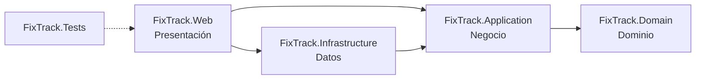

# FixTrack

[](https://github.com/JJMonzon072/fixtrack/actions/workflows/ci.yml)

Sistema web de gestión y seguimiento de órdenes de servicio técnico para un taller dedicado al mantenimiento y la reparación de computadoras, laptops y otros equipos tecnológicos.

Proyecto integrador de Programación II, desarrollado con C# y ASP.NET Core MVC.

## Problema que resuelve

El taller administra sus servicios con hojas de cálculo, mensajes y anotaciones manuales. Esto provoca pérdida de información, órdenes de reparación difíciles de controlar, retrasos en las entregas y falta de trazabilidad. FixTrack centraliza en una sola aplicación la información de clientes, equipos, técnicos y órdenes de servicio.

## Estado del proyecto

El desarrollo avanza por fases y cada entrega pasa por una revisión de QA.

| Fase | Alcance | Estado |
| --- | --- | --- |
| 1 | Estructura de la solución, arquitectura por capas, sistema de diseño, navegación y páginas base | Aprobada e integrada a `main` (PR #1) |
| 2A | SQL Server con Entity Framework Core, modelo de datos inicial y módulo **Clientes** funcional | Aprobada e integrada a `main` (PR #2) |
| 2B | Módulos **Equipos** y **Técnicos** funcionales e integración de equipos en el detalle del cliente | **Entregada para revisión** |
| Siguientes | Órdenes de servicio, estados y prioridades, costos, historial, panel con indicadores reales, algoritmo de priorización, autenticación | Planificadas |

La aplicación guarda sus datos en **SQL Server** (FixTrackDB, alojada en Somee).

- **Clientes:** registro, búsqueda, edición, desactivación y reactivación.
- **Equipos:** registro a nombre de un cliente activo, búsqueda por marca, modelo, serie o cliente, filtro por tipo, detalle y edición. El propietario de un equipo no cambia.
- **Técnicos:** registro, búsqueda, edición, desactivación y reactivación. No se puede desactivar a un técnico con órdenes abiertas.
- **Órdenes de servicio:** ya tienen sus tablas y reglas, pero su pantalla sigue "En preparación". El panel no muestra datos inventados.

> La aplicación todavía **no tiene autenticación**: no debe publicarse en internet hasta implementar el control de acceso.

## Requisitos

- **.NET SDK 10.0** (LTS). `global.json` acepta cualquier SDK 10.0.x desde 10.0.100.
- macOS, Windows o Linux. El desarrollo se hace en macOS con Apple Silicon (M4).
- Un navegador moderno: Chrome, Edge, Safari o Firefox en una versión reciente.
- **Para ejecutar la aplicación:** acceso a una base SQL Server 2022 (Express o superior) y su cadena de conexión. Consulta [Configurar la base de datos](#configurar-la-base-de-datos).
- **Para compilar y ejecutar las pruebas no se necesita base de datos:** las pruebas usan SQLite en memoria.

No necesitas Node.js ni Docker.

Para comprobar la versión instalada:

```bash
dotnet --list-sdks
```

## Inicio rápido

```bash
git clone https://github.com/JJMonzon072/fixtrack.git
cd fixtrack
git switch JJ

dotnet restore
dotnet build -c Release
dotnet test                              # no requiere base de datos
dotnet run --project src/FixTrack.Web    # requiere la cadena de conexión
```

Abre **http://localhost:5104** en el navegador. Si falta la cadena de conexión, la aplicación se detiene al iniciar con un mensaje que explica cómo configurarla.

### Otras formas de ejecutar

| Objetivo | Comando |
| --- | --- |
| Recargar automáticamente al editar | `dotnet watch --project src/FixTrack.Web` |
| Ejecutar con HTTPS | `dotnet dev-certs https --trust` (solo la primera vez) y después `dotnet run --project src/FixTrack.Web --launch-profile https` → https://localhost:7171 |
| Ejecutar la compilación Release | `dotnet run --project src/FixTrack.Web -c Release` |

### HTTPS por entorno

| Entorno | Redirección a HTTPS | HSTS |
| --- | --- | --- |
| Desarrollo con el perfil `http` (predeterminado) | No: el perfil no expone un puerto HTTPS al cual redirigir | No |
| Desarrollo con el perfil `https` | Sí: `http://localhost:5104` → `https://localhost:7171` | No |
| Cualquier otro entorno (Producción, Preproducción) | Siempre | Sí |

La decisión se toma en `Program.cs` con `HttpsEndpoint.IsConfigured`. Esa función revisa las mismas fuentes que Kestrel: `ASPNETCORE_URLS`, `--urls`, `HTTPS_PORTS`, `HTTPS_PORT` y la sección `Kestrel:Endpoints`. Así el perfil `http` arranca sin la advertencia `Failed to determine the https port for redirect`.

Si el certificado de desarrollo no es de confianza, Kestrel muestra `The ASP.NET Core developer certificate is not trusted` al usar el perfil `https`. Para resolverlo, ejecuta una vez `dotnet dev-certs https --trust`.

## Configurar la base de datos

La cadena de conexión se llama `ConnectionStrings:FixTrack` y **nunca se guarda en el repositorio**.

### En desarrollo: dotnet user-secrets

El proyecto `FixTrack.Web` tiene un `UserSecretsId`. Los secretos se guardan en tu perfil de usuario (`~/.microsoft/usersecrets/`), fuera del repositorio. Para registrar la cadena sin que la contraseña quede en pantalla ni en el historial de la terminal:

```bash
read -rs FIXTRACK_DB_PASSWORD        # escribe la contraseña; no se muestra
printf '{"ConnectionStrings:FixTrack":"Server=tcp:FixTrackDB.mssql.somee.com,1433;Database=FixTrackDB;User ID=<usuario>;Password=%s;Encrypt=True;TrustServerCertificate=False;HostNameInCertificate=vb4300.mgmt.somee.com;Connect Timeout=30;Application Name=FixTrack;"}' "$FIXTRACK_DB_PASSWORD" \
  | dotnet user-secrets set --project src/FixTrack.Web > /dev/null
unset FIXTRACK_DB_PASSWORD
```

Si la contraseña contiene comillas, barras invertidas o `;`, hay que escaparla según las reglas de JSON y de las cadenas de conexión de SqlClient.

**TLS:** la conexión va cifrada (`Encrypt=True`) y valida el certificado del servidor (`TrustServerCertificate=False`). Somee publica la base con el alias `FixTrackDB.mssql.somee.com`, pero su certificado de Let's Encrypt está emitido para el servidor compartido `vb4300.mgmt.somee.com`. `HostNameInCertificate` indica ese nombre para que la validación sea completa sin desactivarla. Si Somee mueve la base a otro servidor, la conexión fallará por certificado (no se conecta sin verificar) y habrá que actualizar ese valor.

### En un servidor (por ejemplo, Render): variables de entorno

ASP.NET Core lee la misma configuración desde variables de entorno; `__` reemplaza a `:`.

| Variable | Valor |
| --- | --- |
| `ConnectionStrings__FixTrack` | La misma cadena de conexión, guardada como secreto del servicio |
| `ASPNETCORE_ENVIRONMENT` | `Production` |
| `TZ` | Zona horaria para mostrar fechas, por ejemplo `America/Guatemala` (las fechas se guardan en UTC) |

Antes de un despliegue público faltan: autenticación y autorización, configurar los encabezados reenviados del proxy de Render (`UseForwardedHeaders`) para que HTTPS se detecte correctamente y aplicar las migraciones como paso de despliegue.

### Migraciones

El esquema se crea y modifica **solo con migraciones** versionadas en `src/FixTrack.Infrastructure/Persistence/Migrations/`. La aplicación no crea ni modifica tablas al iniciar.

```bash
dotnet tool restore    # instala dotnet-ef 10.0.13 (dotnet-tools.json)

# Crear una migración después de cambiar el modelo
dotnet ef migrations add <Nombre> --project src/FixTrack.Infrastructure --startup-project src/FixTrack.Web --output-dir Persistence/Migrations

# Revisar el SQL antes de aplicarlo (script idempotente)
dotnet ef migrations script --idempotent --project src/FixTrack.Infrastructure --startup-project src/FixTrack.Web -o migracion.sql

# Aplicar las migraciones pendientes a la base configurada
dotnet ef database update --project src/FixTrack.Infrastructure --startup-project src/FixTrack.Web
```

Las migraciones reproducen el esquema completo desde cero en cualquier base SQL Server 2022 compatible, incluida la edición Express. El modelo de datos está documentado en [docs/modelo-de-datos.md](docs/modelo-de-datos.md).

## Rutas disponibles

| Ruta | Página |
| --- | --- |
| `/` | Panel general |
| `/ordenes` | Órdenes de servicio (en preparación) |
| `/clientes` | Listado de clientes con búsqueda (`?buscar=`), filtro por estado (`?estado=activos\|inactivos\|todos`) y paginación (`?pagina=`) |
| `/clientes/nuevo` | Registrar un cliente |
| `/clientes/{id}` | Detalle de un cliente |
| `/clientes/{id}/editar` | Editar un cliente |
| `/clientes/{id}/desactivar`, `/clientes/{id}/reactivar` | Cambiar el estado (solo POST, con token antifalsificación) |
| `/clientes/opciones?buscar=` | Sugerencias en JSON de clientes **activos** para el selector de propietario (máximo 8) |
| `/equipos` | Listado de equipos con búsqueda (`?buscar=`), filtro por tipo (`?tipo=laptop\|escritorio\|todo-en-uno\|tableta\|impresora\|monitor\|otro`) y paginación |
| `/equipos/nuevo` | Registrar un equipo; `?cliente={id}` preselecciona al propietario |
| `/equipos/{id}`, `/equipos/{id}/editar` | Detalle y edición de un equipo |
| `/tecnicos` | Listado de técnicos con búsqueda, filtro por estado y paginación |
| `/tecnicos/nuevo` | Registrar un técnico |
| `/tecnicos/{id}`, `/tecnicos/{id}/editar` | Detalle y edición de un técnico |
| `/tecnicos/{id}/desactivar`, `/tecnicos/{id}/reactivar` | Cambiar el estado (solo POST, con token antifalsificación) |
| Cualquier otra | Página 404 con enlace de regreso al panel |

## Arquitectura

FixTrack sigue una **arquitectura por capas** con las dependencias apuntando hacia el dominio. Cada capa es un proyecto independiente, así que el compilador impide referencias en la dirección incorrecta.

```
fixtrack/
├── .github/workflows/ci.yml     Integración continua (GitHub Actions)
├── FixTrack.sln
├── global.json                  Versión del SDK y runner de pruebas
├── Directory.Build.props        Configuración común (net10.0, nullable, advertencias como errores)
├── Directory.Packages.props     Versiones centralizadas de paquetes NuGet
├── dotnet-tools.json            Herramientas locales (dotnet-ef)
├── docs/modelo-de-datos.md      Modelo de datos y relaciones
├── src/
│   ├── FixTrack.Domain/         Entidades y reglas del dominio
│   ├── FixTrack.Application/    Lógica de negocio y contratos
│   ├── FixTrack.Infrastructure/ Acceso a datos y servicios externos
│   └── FixTrack.Web/            ASP.NET Core MVC: controladores, vistas y estilos
└── tests/
    └── FixTrack.Tests/          Pruebas unitarias y de integración
```

### Correspondencia con las capas lógicas

| Capa lógica | Proyecto | Responsabilidad | Contenido actual |
| --- | --- | --- | --- |
| Presentación | `FixTrack.Web` | Recibir solicitudes HTTP, preparar modelos de vista y renderizar la interfaz. Es la **raíz de composición**: conecta todas las capas. | Controladores y vistas de Clientes, Equipos y Técnicos; vistas parciales compartidas (`_FormField`, `_ErrorSummary`, `_StatusTabs`, `_Pagination`); menú lateral, CSS y JS |
| Negocio | `FixTrack.Application` | Casos de uso y contratos (interfaces) que la presentación consume y la infraestructura implementa. | `ICustomerService`, `IDeviceService`, `ITechnicianService`; contratos `ICustomerRepository`, `IDeviceRepository`, `ITechnicianRepository` e `IUnitOfWork`; `IModuleCatalog` |
| Datos | `FixTrack.Infrastructure` | Implementaciones técnicas: persistencia con SQL Server y servicios del sistema. | `FixTrackDbContext` (EF Core), configuraciones de tablas, migraciones, repositorios de clientes, equipos y técnicos, `EfUnitOfWork` |
| Dominio | `FixTrack.Domain` | Entidades y reglas del negocio. No depende de ningún otro proyecto ni de ASP.NET Core. | `Customer`, `Device`, `Technician`, `ServiceOrder`, `ServiceOrderStatusChange` y reglas de validación (`ContactRules`, `CustomerRules`, `DeviceRules`, `TechnicianRules`) |

### Dependencias entre proyectos



- `Domain` no conoce ninguna otra capa.
- `Application` define interfaces (como `ICustomerRepository`) sin saber cómo se implementan y no depende de Entity Framework Core.
- `Infrastructure` implementa esas interfaces. Así se cumple el principio de inversión de dependencias (la D de SOLID).
- `Web` referencia a `Infrastructure` solo para registrar sus servicios en `Program.cs`. Los controladores dependen únicamente de interfaces de `Application`.

### Inyección de dependencias

Cada capa expone un método de extensión que registra sus servicios, y `Program.cs` los combina:

```csharp
builder.Services
    .AddApplication()      // FixTrack.Application/DependencyInjection.cs
    .AddInfrastructure(builder.Configuration)   // FixTrack.Infrastructure/DependencyInjection.cs
    .AddPresentation();    // FixTrack.Web/DependencyInjection.cs
```

| Servicio | Ciclo de vida | Registrado en | Uso |
| --- | --- | --- | --- |
| `IModuleCatalog` → `ModuleCatalog` | Singleton | Application | Fuente única de los módulos. Alimenta el menú lateral, el panel y las páginas de cada módulo. |
| `ICustomerService` → `CustomerService` | Scoped | Application | Casos de uso de clientes: validación, unicidad del correo, desactivación, reactivación y sugerencias de clientes activos. |
| `IDeviceService` → `DeviceService` | Scoped | Application | Casos de uso de equipos: propietario activo, unicidad de la serie por marca, edición sin cambio de propietario. |
| `ITechnicianService` → `TechnicianService` | Scoped | Application | Casos de uso de técnicos: validación, unicidad del correo, desactivación solo sin órdenes abiertas. |
| `FixTrackDbContext` | Scoped | Infrastructure | Contexto de EF Core con SQL Server (reintentos ante fallos transitorios). |
| `ICustomerRepository`, `IDeviceRepository`, `ITechnicianRepository` | Scoped | Infrastructure | Consultas parametrizadas; búsqueda, filtros y paginación se resuelven en SQL, sin N+1. |
| `IUnitOfWork` → `EfUnitOfWork` | Scoped | Infrastructure | Guarda los cambios y traduce los duplicados de SQL Server en un error de la aplicación. |
| `DateDisplay` | Singleton | Web | Muestra en español y en hora local las fechas guardadas en UTC. |
| `TimeProvider` → `TimeProvider.System` | Singleton | Infrastructure | Fecha actual. Se inyecta en lugar de usar `DateTime.Now` para poder fijarla en las pruebas. |
| `ApplicationInfo` | Singleton | Web | Versión, entorno y plataforma reales que se muestran en la interfaz. |

Cuando un módulo se implemente, basta con cambiar su estado a `ModuleStatus.Available` en `ModuleCatalog`. La etiqueta "Pronto" del menú y el contador de módulos habilitados se actualizan solos.

## Decisiones técnicas

- **.NET 10 LTS** con `Nullable`, `ImplicitUsings`, `TreatWarningsAsErrors` y `EnforceCodeStyleInBuild` activados para toda la solución desde `Directory.Build.props`. La solución compila sin advertencias.
- **Versiones de paquetes centralizadas** en `Directory.Packages.props`.
- **Código en inglés, interfaz en español.** Los identificadores de C# siguen las convenciones de .NET. Las rutas (`/ordenes`, `/clientes`…), los textos y los comentarios están en español.
- **Cultura `es`** configurada con `RequestLocalization`: las fechas se muestran como "Lunes, 19 de octubre de 2026". El codificador HTML permite caracteres Unicode para que tildes y eñes no se conviertan en entidades numéricas.
- **Sin Bootstrap ni jQuery.** La plantilla MVC los incluía y se eliminaron. Los estilos son CSS propio, organizado con variables (tokens), y el único JavaScript es el del menú móvil y el cambio de tema (unas 90 líneas, sin dependencias).
- **Recursos servidos localmente**, sin CDN: fuentes, íconos y estilos funcionan sin conexión. `MapStaticAssets` añade compresión y huellas de versión para la caché.
- **Páginas de error propias** para el código 404 y las excepciones (`UseStatusCodePagesWithReExecute` y `UseExceptionHandler`), integradas en el diseño.
- **Pruebas con xUnit v3 sobre Microsoft.Testing.Platform**, el runner recomendado para `dotnet test` desde el SDK de .NET 10 (se activa en `global.json`).
- **Entity Framework Core 10 con SQL Server** y migraciones explícitas; nunca `EnsureCreated` ni migraciones automáticas al iniciar.
- **Fechas en UTC** en toda la base (`datetime2(3)`); un conversor de EF Core las marca como UTC al leerlas y la interfaz las convierte a la hora local.
- **Búsqueda sin distinguir tildes ni mayúsculas:** los nombres usan la intercalación `Modern_Spanish_100_CI_AI` ("jose" encuentra "José"). La búsqueda usa `LIKE` parametrizado con los comodines escapados.
- **Validación en el servidor** con mensajes en español (el formulario usa `novalidate` para no depender de los mensajes del navegador), protección antifalsificación global (`AutoValidateAntiforgeryToken`) y codificación HTML de todo el contenido ingresado.
- **Selector de propietario con búsqueda en el servidor:** al registrar un equipo, el cliente se busca por nombre, teléfono o correo, y el servidor devuelve como máximo 8 clientes activos. Así sigue siendo rápido aunque crezca el número de clientes.
- **El equipo no cambia de propietario:** el formulario de edición ignora cualquier `CustomerId` enviado (protección contra asignación masiva) y el dominio no expone ese cambio.
- **Dependencias auditadas:** NuGet Audit bloqueó `System.Security.Cryptography.Pkcs 9.0.11` (CVE-2026-84008 y CVE-2026-70162), que llegaba a través de `Microsoft.Data.SqlClient`. Se fijó la versión corregida 10.0.13 con *transitive pinning*.
- **Integración continua con GitHub Actions** (`.github/workflows/ci.yml`). Se ejecuta en cada push a `JJ` y en cada pull request hacia `main`: instala .NET 10, restaura, compila en Release y ejecuta todas las pruebas. Usa permisos de solo lectura, no necesita secretos y fija las acciones por SHA.

## Sistema de diseño

Toda la interfaz se construye desde `src/FixTrack.Web/wwwroot/css/site.css`, organizado en secciones: fuentes, tokens, base, estructura, menú lateral, barra superior, componentes, páginas y utilidades.

- **Tipografía:** IBM Plex Sans (variable) para la interfaz e IBM Plex Mono para datos técnicos como versiones y números.
- **Color:** grises neutros con un único acento verde petróleo (`--color-accent`). Hay tema claro y oscuro: se aplica el del sistema operativo y el usuario puede cambiarlo con el botón de la barra superior, que guarda la preferencia.
- **Tokens:** espaciado en múltiplos de 4 px, escala tipográfica, radios, sombras sutiles y duraciones de animación definidos como variables CSS.
- **Íconos:** sprite SVG con íconos de [Lucide](https://lucide.dev). En las vistas se usan así: `<icon name="wrench" />`.
- **Componentes:** botones (primario, secundario, peligro y deshabilitado), botones de ícono, etiquetas de estado, tarjetas, tabla de datos con búsqueda, filtro segmentado y paginación, formularios con resumen de errores, avisos, diálogo de confirmación nativo (`<dialog>`), estados vacíos, listas de datos, lista desplegable con el estilo de los campos, buscador con sugerencias (patrón *combobox* de ARIA) y listas de registros relacionados. En móvil, las tablas se convierten en tarjetas. Los formularios, el filtro de estado y la paginación son vistas parciales compartidas por todos los módulos.
- **Responsive:** en escritorio (≥ 1024 px), menú lateral fijo y panel de contenido elevado. En tableta y móvil, el menú es un panel deslizable con fondo, foco atrapado, cierre con Escape y bloqueo del desplazamiento.
- **Accesibilidad:** enlace "Saltar al contenido", foco visible en todos los elementos interactivos, `aria-current` en la navegación, contraste AA en textos y respeto de `prefers-reduced-motion`.

## Pruebas

```bash
dotnet test
```

Hay 206 casos de prueba en `tests/FixTrack.Tests`. **Ninguno usa la base de datos real**: las pruebas de persistencia y de integración usan **SQLite en memoria**, y una prueba verifica que el proveedor activo sea SQLite. Funcionan igual en GitHub Actions, sin credenciales.

| Grupo | Archivo | Casos | Qué verifica |
| --- | --- | --- | --- |
| Dominio | `Domain/EntityTests.cs` | 5 | Igualdad de entidades por tipo e identificador |
| Dominio | `Domain/ContactRulesTests.cs` | 28 | Validación y normalización de nombres, teléfonos y correos |
| Dominio | `Domain/CustomerTests.cs` | 7 | Registro, edición, desactivación y reactivación de clientes; fechas en UTC |
| Dominio | `Domain/DeviceTests.cs` | 12 | Registro solo para clientes activos, normalización y validación, edición sin cambio de propietario |
| Dominio | `Domain/TechnicianTests.cs` | 5 | Especialidad obligatoria, contacto opcional válido, edición, desactivación y reactivación |
| Dominio | `Domain/ServiceOrderTests.cs` | 10 | Historial de estados, transiciones permitidas, cierre de órdenes, montos, asignación solo a técnicos activos |
| Aplicación | `Application/ModuleCatalogTests.cs` | 8 | Catálogo de módulos |
| Aplicación | `Application/CustomerServiceTests.cs` | 8 | Casos de uso de clientes con repositorios en memoria (`InMemoryFakes.cs`): errores por campo, correo duplicado, no encontrado, criterios de búsqueda |
| Aplicación | `Application/DeviceServiceTests.cs` | 12 | Propietario inexistente o inactivo, validaciones, serie duplicada por marca, edición, no encontrado |
| Aplicación | `Application/TechnicianServiceTests.cs` | 8 | Registro, validaciones, correo duplicado, edición, desactivación bloqueada con órdenes abiertas |
| Infraestructura | `Infrastructure/PersistenceModelTests.cs` | 11 | Claves foráneas, índices únicos (correo, serie por marca), restricciones CHECK, fechas UTC y conservación del historial al desactivar |
| Infraestructura | `Infrastructure/CustomerRepositoryTests.cs` | 9 | Búsqueda por nombre, teléfono o correo, comodines tratados literalmente, filtro por estado, paginación |
| Infraestructura | `Infrastructure/DeviceRepositoryTests.cs` | 11 | Búsqueda por marca, modelo, serie o cliente, filtro por tipo, paginación en SQL, equipos por cliente, órdenes del equipo |
| Infraestructura | `Infrastructure/TechnicianRepositoryTests.cs` | 8 | Búsqueda, filtros por estado, conteo de órdenes abiertas |
| Infraestructura | `Infrastructure/MigrationTests.cs` | 3 | Las migraciones están sincronizadas con el modelo y no contienen `DROP TABLE`, `DROP COLUMN`, `TRUNCATE`, `DELETE`, `UPDATE` ni borrado en cascada; la migración de la fase 2B no rellena datos en silencio |
| Web (integración) | `Web/PageTests.cs` | 17 | Rutas principales, menú activo, página en preparación, panel, 404 y recursos estáticos |
| Web (integración) | `Web/CustomersPageTests.cs` | 10 | Módulo Clientes completo: registro, rechazo sin token antifalsificación, validaciones, correo duplicado, edición, desactivación y reactivación, búsqueda, codificación HTML, 404 |
| Web (integración) | `Web/DevicesPageTests.cs` | 11 | Módulo Equipos e integración con Clientes: registro, preselección del propietario, cliente inactivo, validaciones, serie duplicada, edición que no cambia el propietario aunque se altere el formulario, búsqueda y filtros, sugerencias JSON, rechazo sin token, 404 |
| Web (integración) | `Web/TechniciansPageTests.cs` | 9 | Módulo Técnicos: registro, validaciones, correo duplicado, edición, desactivación y reactivación, estado no modificable por el formulario, rechazo sin token, 404 |
| Web (composición) | `Web/CompositionTests.cs` | 3 | Servicios de las tres capas, reloj inyectado y aislamiento de la base real |
| Web (HTTPS) | `Web/HttpsTests.cs` | 11 | Redirección a HTTPS según el entorno |

Las pruebas de integración levantan la aplicación en memoria con `WebApplicationFactory`; no hace falta ejecutarla aparte.

**Verificaciones con la base real.** Las pruebas contra FixTrackDB se hacen de forma controlada y manual, no en la suite automática. Consisten en recorrer los módulos en el navegador, revisar la base con consultas de metadatos y probar las restricciones dentro de transacciones revertidas. Nunca se ejecutan pruebas que borren o alteren datos reales.

SQLite no reproduce exactamente a SQL Server: no aplica la intercalación sin distinción de mayúsculas y tildes, ni el trigger del historial. Por eso esos casos se verifican directamente en SQL Server; por ejemplo, que `DELL / dl-01` choque con `Dell / DL-01` en el índice único de series.

## Comprobación visual manual

Con la aplicación en ejecución (`dotnet run --project src/FixTrack.Web`):

1. **Navegación:** entra a cada módulo desde el menú lateral. El elemento actual queda resaltado y la ruta de la barra superior cambia.
2. **Módulo pendiente:** Órdenes muestra la etiqueta "En preparación", las columnas previstas, las funciones planificadas y un botón deshabilitado que no reacciona al clic.
3. **Clientes:**
   - registra un cliente y comprueba el mensaje de éxito y su detalle;
   - envía el formulario con datos inválidos (nombre de una letra, teléfono corto, correo incompleto): aparece el resumen de errores y cada campo marcado;
   - intenta repetir un correo;
   - busca por nombre sin tildes, por teléfono o por correo;
   - edita un cliente;
   - desactívalo desde el diálogo de confirmación, verifica que aparezca en "Inactivos" y reactívalo.
   - en su detalle, la sección Equipos lista sus equipos; "Registrar equipo" abre el formulario con el propietario ya elegido. En un cliente inactivo los equipos se ven, pero no aparece esa opción.
4. **Equipos:**
   - registra un equipo eligiendo al propietario en el buscador (escribe parte del nombre, teléfono o correo; usa ↑ ↓ y Enter o el mouse). Los clientes inactivos no aparecen;
   - intenta repetir un número de serie de la misma marca (por ejemplo, en minúsculas): se rechaza. Con otra marca se acepta;
   - busca por marca, modelo, serie o cliente y filtra por tipo;
   - edita un equipo: el propietario se muestra, pero no puede cambiarse.
5. **Técnicos:**
   - registra un técnico (la especialidad es obligatoria) y prueba el correo duplicado;
   - edítalo, desactívalo desde el diálogo (también se cierra con Escape), comprueba que aparezca en "Inactivos" y reactívalo.
6. **Panel:** los indicadores muestran "—" con el aviso "No se muestran datos de ejemplo". "Estado del sistema" muestra la versión, el entorno y la plataforma reales. Los pasos de "Puesta en marcha" llevan a cada módulo.
7. **Tema:** el botón de luna o sol cambia entre tema claro y oscuro, y la preferencia se mantiene al recargar.
8. **Responsive:** reduce el ancho de la ventana por debajo de 1024 px o usa el modo dispositivo de las herramientas de desarrollo (por ejemplo, iPhone, 375 px). El menú se abre con el botón ☰ y se cierra con ✕, con Escape o tocando fuera. No debe aparecer desplazamiento horizontal.
9. **Teclado:** recorre la página con Tab. El primer elemento es "Saltar al contenido" y todos los controles muestran un contorno de foco visible.
10. **Error 404:** visita una ruta inexistente, por ejemplo `/abc`. Aparece la página "Página no encontrada" con un enlace al panel.

## Limitaciones conocidas de Somee

La base de desarrollo está en el plan gratuito de Somee. Detectamos lo siguiente:

| Limitación | Efecto en FixTrack |
| --- | --- |
| **30 MB para datos y 30 MB para el log** | Se evitan datos de prueba masivos. Tras la migración y los datos de prueba se usan unos 3.3 MB de datos. |
| El certificado TLS es del servidor compartido (`vb4300.mgmt.somee.com`), no del alias de la base | Se usa `HostNameInCertificate` para validar el certificado sin desactivar la verificación. Si Somee cambia de servidor, hay que actualizar ese valor. |
| El servidor reporta **SQL Server 2022 Web Edition** (16.0.1000.6, RTM sin actualizaciones acumulativas), no Express | El esquema solo usa características disponibles también en Express: tablas, índices filtrados, restricciones CHECK, un trigger e intercalaciones estándar. |
| El usuario es `db_owner` de su base, pero no tiene permisos de servidor (`VIEW SERVER STATE`) | No se pueden consultar vistas de servidor como `sys.dm_exec_connections`; no afecta a la aplicación. |
| Servidor remoto compartido | La primera consulta tras un periodo de inactividad tarda alrededor de 1 segundo (conexión TLS); las siguientes usan el pool de conexiones. EF Core reintenta automáticamente ante fallos transitorios. |

## Limitaciones conocidas de la aplicación

- **Sin autenticación ni autorización.** Ninguna página, ni el endpoint JSON de sugerencias de clientes, debe exponerse públicamente todavía.
- **Sin control de concurrencia optimista.** Si dos personas editan el mismo registro a la vez, prevalece el último guardado.
- **La regla "no desactivar técnicos con órdenes abiertas" se verifica en la aplicación**, no con una restricción de base de datos. Una asignación que ocurra en el mismo instante que la desactivación no queda cubierta; se revisará al implementar el módulo Órdenes.
- **El buscador de propietario requiere JavaScript.** Sin JavaScript, solo funciona el registro iniciado desde el detalle del cliente (propietario preseleccionado).

Para desarrollar sin Somee se puede usar cualquier SQL Server 2022 compatible y aplicar las migraciones. En Apple Silicon no hay imagen oficial de SQL Server para contenedores, así que conviene una instancia en Windows, una máquina virtual o un servicio en la nube.

## Flujo de trabajo con Git

- `main`: rama principal. No recibe commits directos.
- `JJ`: rama de desarrollo. Cada fase se entrega aquí para revisión antes de integrarse a `main`.
- Nunca se versionan secretos: la cadena de conexión vive en user-secrets o en variables de entorno.

## Licencias de terceros

- IBM Plex Sans e IBM Plex Mono, bajo SIL Open Font License 1.1 (`src/FixTrack.Web/wwwroot/fonts/OFL.txt`).
- Íconos de Lucide, bajo licencia ISC (`src/FixTrack.Web/wwwroot/icons/LICENSE`).
