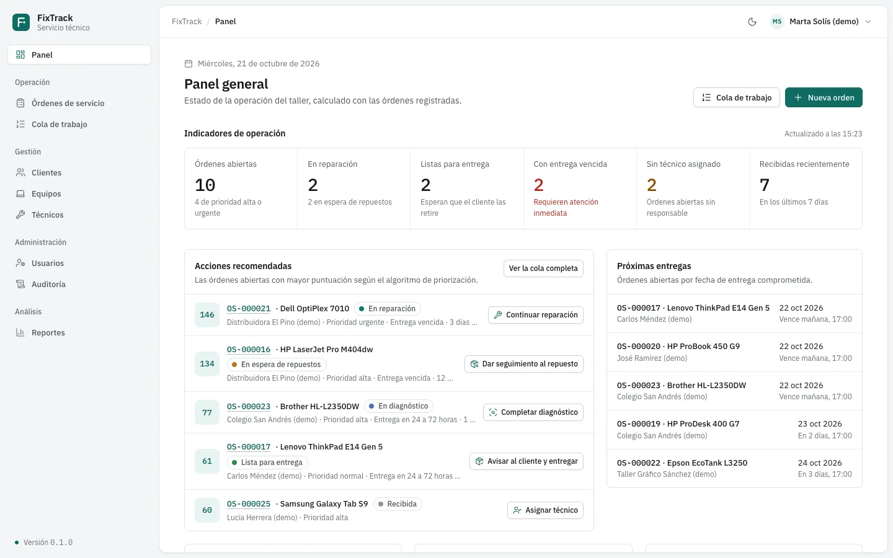
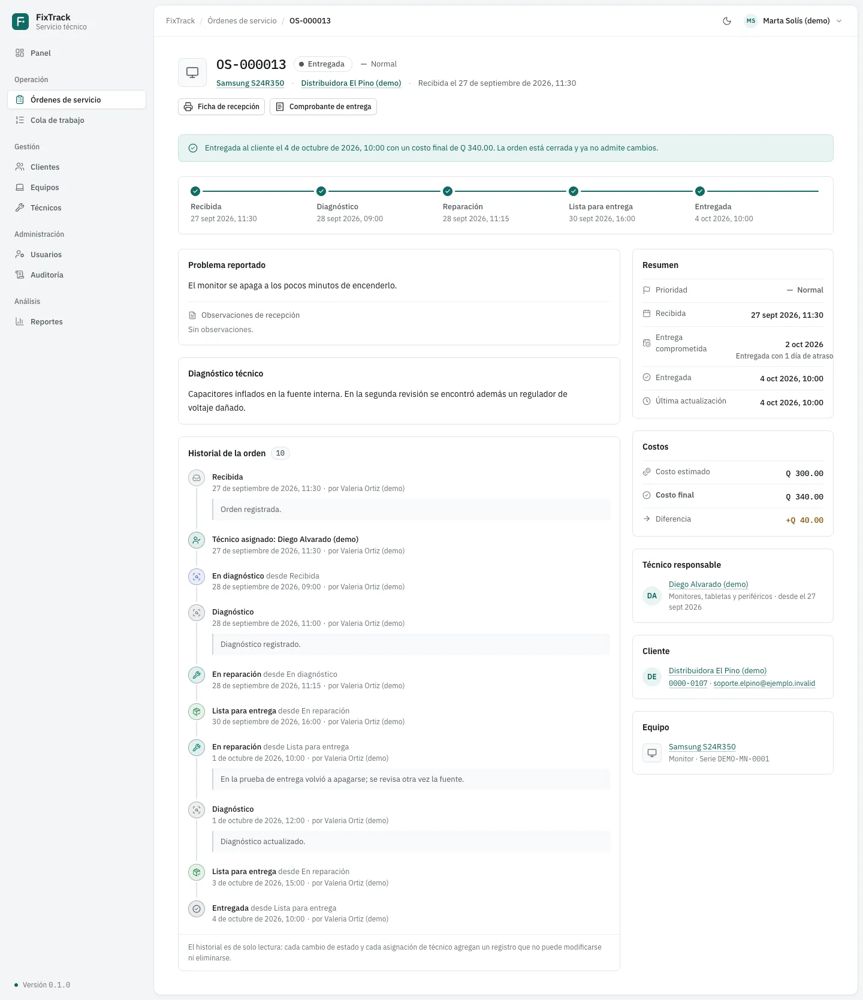
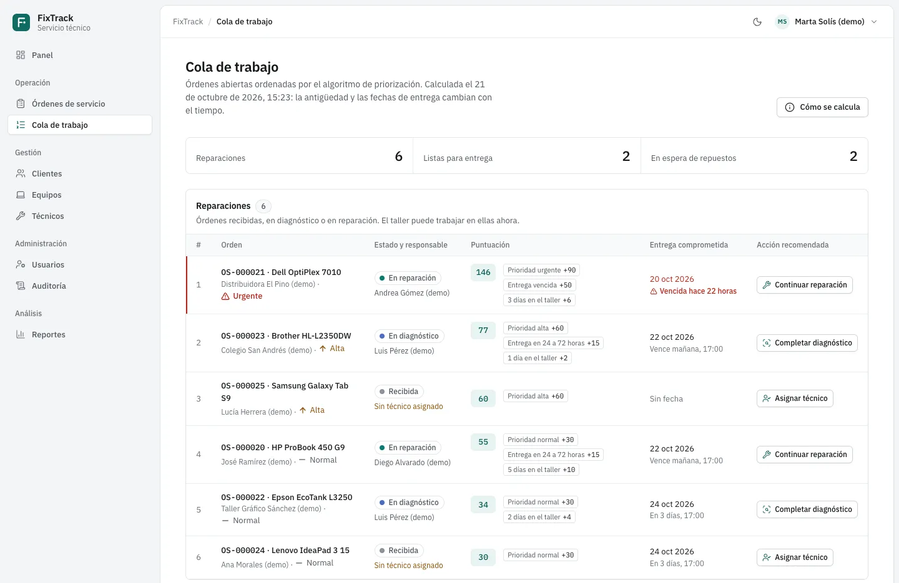
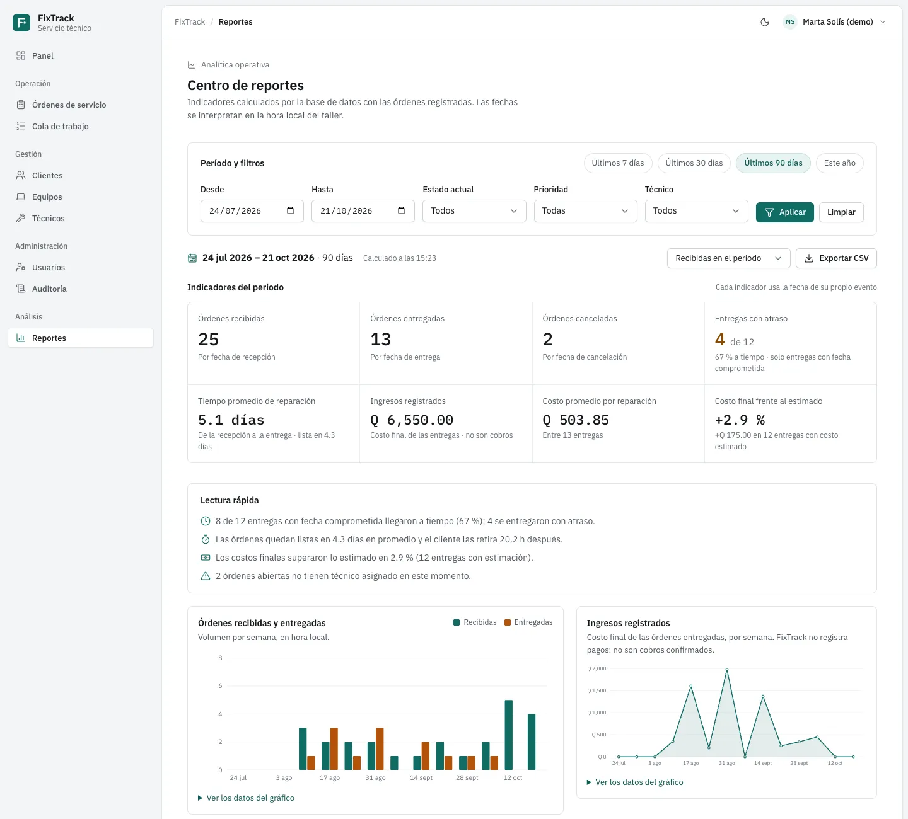
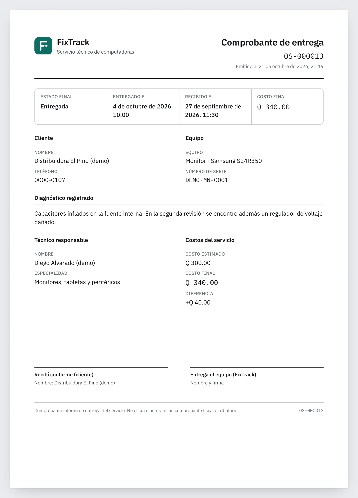
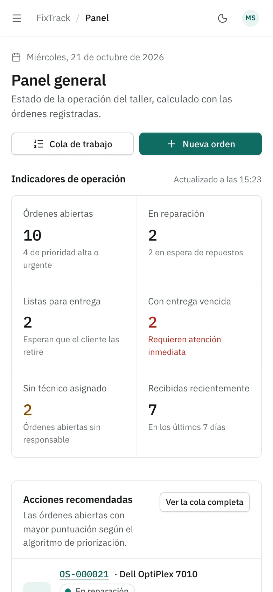
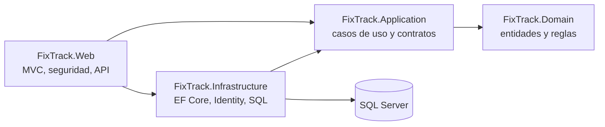

# FixTrack

**Órdenes de servicio técnico, de la recepción a la entrega, con cada cambio registrado.**

FixTrack es una aplicación web para un taller de reparación de computadoras. Registra lo que entra al taller, ordena el trabajo pendiente con un algoritmo explicable, controla quién puede hacer qué y deja un historial que nadie puede editar.

[](https://github.com/JJMonzon072/fixtrack/actions/workflows/ci.yml)

C# · .NET 10 · ASP.NET Core MVC · Entity Framework Core 10 · SQL Server 2022 · Docker · GitHub Actions

> **Contexto.** Es el proyecto integrador de Programación II, desarrollado por fases con revisión de QA, y ampliado después como proyecto de portafolio. No es un producto comercial ni tiene clientes reales. Todas las capturas salen de la demostración local, con datos ficticios.

<picture>
  <source media="(prefers-color-scheme: dark)" srcset="docs/images/panel-oscuro.webp">
  
</picture>

## Pruébalo en tu equipo

Con Docker en ejecución:

```bash
git clone https://github.com/JJMonzon072/fixtrack.git
cd fixtrack
./demo/demo.sh iniciar
```

El script levanta un SQL Server propio en un contenedor, crea el esquema con las migraciones, carga un taller ficticio con los servicios de la aplicación y abre FixTrack en **http://localhost:8080** con los extras habilitados. Al terminar muestra tres cuentas (Administrador, Operador y Consulta) con contraseñas generadas para ese entorno. Nunca se conecta a la base real del proyecto.

- **Requisitos:** Docker Desktop o Docker Engine con Compose v2, y al menos 2 GB de memoria para Docker (los pide SQL Server). En un Mac con Apple Silicon, SQL Server corre emulado con Rosetta.
- **Navegador:** probado con Chrome y Edge. La sesión usa una cookie `Secure`, como en producción; un navegador que no trate `http://localhost` como origen seguro (Safari puede ser el caso) no la guarda y no deja iniciar sesión.
- **Otros comandos:** `credenciales`, `verificar`, `detener` (conserva los datos), `reiniciar` (entorno y contraseñas nuevos) y `eliminar`.

El recorrido de cinco minutos y los detalles están en [docs/demo-portafolio.md](docs/demo-portafolio.md).

## El problema

Muchos talleres pequeños llevan su trabajo en hojas de cálculo, mensajes y notas. Así se pierde el rastro de quién recibió un equipo, quién lo está reparando, qué se le prometió al cliente y por qué una orden lleva dos semanas abierta. Nadie puede responder con datos cuánto tarda una reparación ni qué tan seguido se cumplen las fechas.

## Qué hace

- **Órdenes de servicio** con un flujo de estados explícito: recibida, en diagnóstico, en reparación, en espera de repuestos, lista para entrega, entregada o cancelada. Cada transición tiene sus requisitos (un técnico para diagnosticar, una nota para esperar repuestos, el costo final para entregar).
- **Línea de tiempo de solo inserción.** Estados, asignaciones, diagnósticos y cambios de plan quedan registrados con su autor y su fecha. La base rechaza cualquier intento de modificarlos.
- **Cola de trabajo priorizada** por prioridad, vencimiento y antigüedad, con la puntuación desglosada y la acción recomendada para cada orden.
- **Panel** con indicadores calculados en SQL: órdenes abiertas, vencidas, sin técnico, próximas entregas y carga por técnico.
- **Clientes, equipos y técnicos**, con aviso si otra persona modificó el registro mientras lo editabas y desactivación en lugar de borrado.
- **Cuentas y roles:** Administrador, Operador y Consulta (solo lectura), con auditoría de las operaciones importantes.
- **Extras de portafolio**, desactivados por defecto para no alterar la versión académica:
  - un centro de reportes con exportación CSV;
  - fichas A4 imprimibles;
  - una API REST de solo lectura.

## Recorrido visual

**Historial de una orden.** La OS-000013 volvió a reparación porque falló la prueba de entrega. La línea de tiempo muestra cada paso, quién lo registró y la diferencia entre el costo estimado y el final.



**Cola de trabajo.** La puntuación suma prioridad, vencimiento y antigüedad. Cada orden muestra de dónde sale su número y qué conviene hacer.



**Centro de reportes** (extra). Indicadores de los últimos 90 días calculados en la base, con una lectura rápida en lenguaje natural y gráficos SVG generados en el servidor.



| Comprobante de entrega (extra) | En el teléfono |
| --- | --- |
|  |  |

## Arquitectura

Cuatro proyectos en capas, con las dependencias apuntando hacia el dominio. Las reglas del negocio (flujo de estados, validaciones y priorización) son código sin dependencias externas, y la interfaz las consulta para decidir qué acciones mostrar.



El recorrido de una solicitud, la persistencia, la concurrencia y el despliegue están resumidos para entrevistas técnicas en [docs/arquitectura-tecnica.md](docs/arquitectura-tecnica.md).

## Decisiones técnicas

**SQL Server y EF Core.** El esquema se crea solo con migraciones versionadas (10 hasta ahora), nunca al iniciar la aplicación. Las consultas pesadas son agregaciones y proyecciones en SQL: el panel cuenta todo en una consulta, y la cola calcula la puntuación en la base y devuelve las 100 primeras de cada lista. Los nombres usan la intercalación `Modern_Spanish_100_CI_AI` ("jose" encuentra "José") y todas las fechas se guardan en UTC.

**Trazabilidad.** El historial de estados, el de asignaciones y la auditoría son tablas de solo inserción, protegidas por triggers. Cada registro se guarda en la misma transacción que el cambio que describe: no puede existir uno sin el otro.

**Concurrencia y transacciones.** Las ediciones usan concurrencia optimista con una columna de versión. Al asignar o desactivar un técnico, una transacción breve lo bloquea con `UPDLOCK`. Los cambios de cuentas se serializan con `sp_getapplock`, para que siempre quede un administrador habilitado. Un identificador con índice único evita que un doble clic registre dos órdenes. Nada de esto depende de `READ_COMMITTED_SNAPSHOT`, así que funciona igual en SQL Server Express.

**Priorización explicable.** La puntuación es determinista:

- **prioridad:** baja 10, normal 30, alta 60, urgente 90;
- **un solo bono por fecha:** vencida +50, menos de 24 horas +30, entre 24 y 72 horas +15;
- **antigüedad:** +2 por día completo en el taller, hasta 30.

El estado no suma puntos: decide en qué lista aparece la orden. Los empates se resuelven por fecha comprometida, antigüedad y número. La misma fórmula existe en C# y en SQL, y una prueba compara ambos órdenes sobre más de 300 casos límite ([flujo-de-ordenes.md](docs/flujo-de-ordenes.md)).

**Reportes, documentos y API** (extras opcionales):

- **Reportes:** se calculan en 8 consultas fijas, sin importar el volumen de datos. Cada indicador usa la fecha de su propio evento, en períodos medidos en la hora local del taller.
- **CSV:** protegido contra la inyección de fórmulas y sin datos de contacto.
- **Fichas A4:** se imprimen con CSS de impresión; el navegador genera el PDF.
- **API REST v1:** de solo lectura, con contratos explícitos, paginación con límites, Problem Details y límite de solicitudes por sesión.

```http
GET /api/v1/ordenes?porPagina=1&orden=-prioridad
```

```json
{
  "datos": [
    {
      "numero": "OS-000021",
      "estado": { "codigo": "en-reparacion", "nombre": "En reparación" },
      "prioridad": { "codigo": "urgente", "nombre": "Urgente" },
      "cliente": { "id": 1, "nombre": "Distribuidora El Pino (demo)" },
      "entregaComprometidaEn": "2026-10-20T23:00:00Z",
      "atrasada": true
    }
  ],
  "paginacion": { "pagina": 1, "porPagina": 1, "total": 25, "totalPaginas": 25 }
}
```

*(Respuesta recortada.)*

**Seguridad y protección de datos.**

- **Rutas:** una política de autorización de respaldo protege cualquier ruta nueva aunque se olvide el atributo.
- **Rol Consulta:** solo puede enviar GET o HEAD, y el servidor responde 403 a cualquier otro envío aunque lleve un token válido.
- **Inicio de sesión:** no revela qué correos existen (mismo mensaje y mismo tiempo), limita los intentos por IP y bloquea la cuenta tras cinco fallos.
- **Claves de sesión:** las claves de Data Protection viven en la base, cifradas con un certificado X.509. Si el certificado no puede descifrarlas, la aplicación no arranca.
- **Navegador:** CSP con nonce y sin `unsafe-inline`, tokens antifalsificación y cookies `HttpOnly`, `SameSite` y `Secure`.
- **Secretos y exportaciones:** los secretos nunca están en el repositorio, y las exportaciones y la API omiten teléfonos, correos y cuentas.

## Calidad

- **867 pruebas automatizadas** (xUnit v3) en cuatro capas:
  - el dominio, con repositorios en memoria;
  - la infraestructura, con SQLite en memoria;
  - las páginas completas, con `WebApplicationFactory` e inicio de sesión real;
  - triggers, bloqueos, concurrencia y traducción de consultas, contra un SQL Server real en un contenedor desechable.
- **Sin SQL Server configurado** pasan 839 y se omiten las 28 que lo necesitan.
- **Accesibilidad:** axe-core (WCAG 2.1 A y AA) no encontró incumplimientos en las pantallas revisadas, en escritorio y móvil y con ambos temas. Los gráficos tienen texto alternativo y su tabla de datos.
- **GitHub Actions** ejecuta cuatro trabajos en cada push, sin secretos y sin acceso a la base real:
  - compila en Release y prueba;
  - prueba contra un SQL Server 2022 efímero;
  - construye la imagen Docker y la prueba sin base y sin certificado;
  - levanta esta misma demostración con Docker Compose, verifica los permisos de cada rol, la reinicia y la elimina.

## Ejecutar sin la demostración

Para trabajar con tu propio SQL Server 2022 (Express o superior):

```bash
dotnet restore
dotnet test -c Release                       # no necesita base de datos
dotnet run --project src/FixTrack.Web        # http://localhost:5104
```

| Configuración | Para qué |
| --- | --- |
| `ConnectionStrings__FixTrack` | Cadena de conexión. En desarrollo va en `dotnet user-secrets`; nunca en el repositorio |
| `DataProtection__Certificate__Base64` (o `__Path`) y `__Password` | Certificado que cifra las claves de sesión. Obligatorio fuera de Desarrollo |
| `ReverseProxy__KnownProxies__0`, `__KnownNetworks__0` o `__IgnoreForwardedHeaders` | Decisión explícita sobre el proxy. Sin ella, producción no arranca |

Los comandos de la aplicación (`aplicar-migraciones`, `crear-administrador`, `crear-cuenta-consulta`, `exportar-respaldo`…), todas las variables, el despliegue en Render con Docker, las rutas y las pruebas contra SQL Server están en la **[guía de instalación y operación](docs/guia-de-operacion.md)**.

## Documentación

| Documento | Para qué sirve |
| --- | --- |
| [demo-portafolio.md](docs/demo-portafolio.md) | Ejecutar la demostración, recorrerla en cinco minutos y presentar el proyecto en una entrevista |
| [arquitectura-tecnica.md](docs/arquitectura-tecnica.md) | Resumen técnico con diagramas: componentes, solicitudes, persistencia, concurrencia, seguridad y despliegue |
| [guia-de-operacion.md](docs/guia-de-operacion.md) | Instalación, configuración, comandos, respaldos, despliegue, rutas, pruebas y limitaciones |
| [portfolio-extras.md](docs/portfolio-extras.md) | Reportes, fichas imprimibles y API: activación, diseño, seguridad y pruebas |
| [arquitectura.md](docs/arquitectura.md), [flujo-de-ordenes.md](docs/flujo-de-ordenes.md), [modelo-de-datos.md](docs/modelo-de-datos.md) | Documentación académica detallada: capas, reglas de las órdenes, algoritmo y modelo de datos |
| [checklist-lanzamiento.md](docs/checklist-lanzamiento.md) | Publicación en Render: requisitos, certificado, respaldos y verificaciones |
| [referencia-para-el-equipo.md](docs/referencia-para-el-equipo.md) | Resumen para los diagramas, el manual y la exposición del curso |

## Limitaciones

- **Alcance académico:** no hay facturación, cobros, inventario de repuestos ni notificaciones al cliente. Los ingresos de los reportes son costos finales registrados, no pagos.
- **No existe un rol Técnico.** Hacerlo bien exige autorización por registro (cada técnico limitado a sus órdenes); el diseño propuesto está en [arquitectura.md](docs/arquitectura.md#autorización).
- **La demostración usa SQL Server x86-64.** En Apple Silicon corre emulado: funciona, pero es más lento que en un equipo x86.
- **Los datos ficticios se fechan desde el momento de la carga:** la demo siempre luce actual, pero dos cargas en días distintos no tienen las mismas fechas.
- **El hospedaje gratuito tarda en despertar.** En el plan gratuito de Render, la primera visita después de 15 minutos sin uso espera a que la instancia arranque.

La lista completa está en la [guía de operación](docs/guia-de-operacion.md#limitaciones-conocidas-de-la-aplicación).

## Licencias de terceros

- IBM Plex Sans e IBM Plex Mono, bajo SIL Open Font License 1.1 (`src/FixTrack.Web/wwwroot/fonts/OFL.txt`).
- Íconos de Lucide, bajo licencia ISC (`src/FixTrack.Web/wwwroot/icons/LICENSE`).
