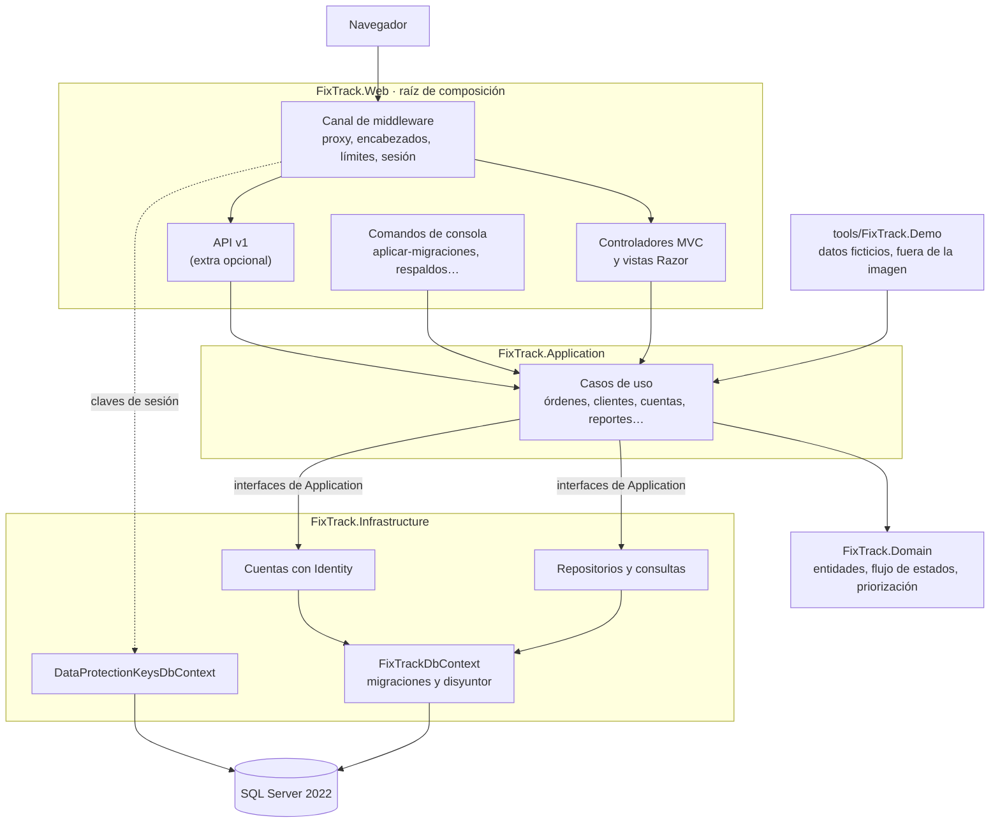
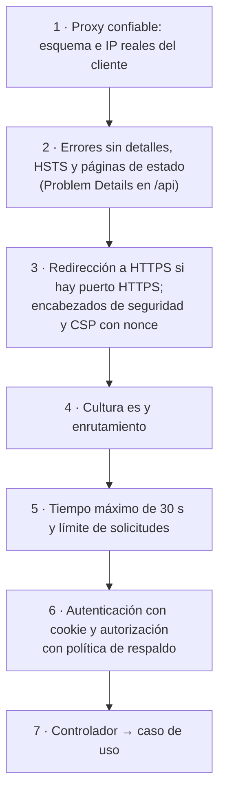
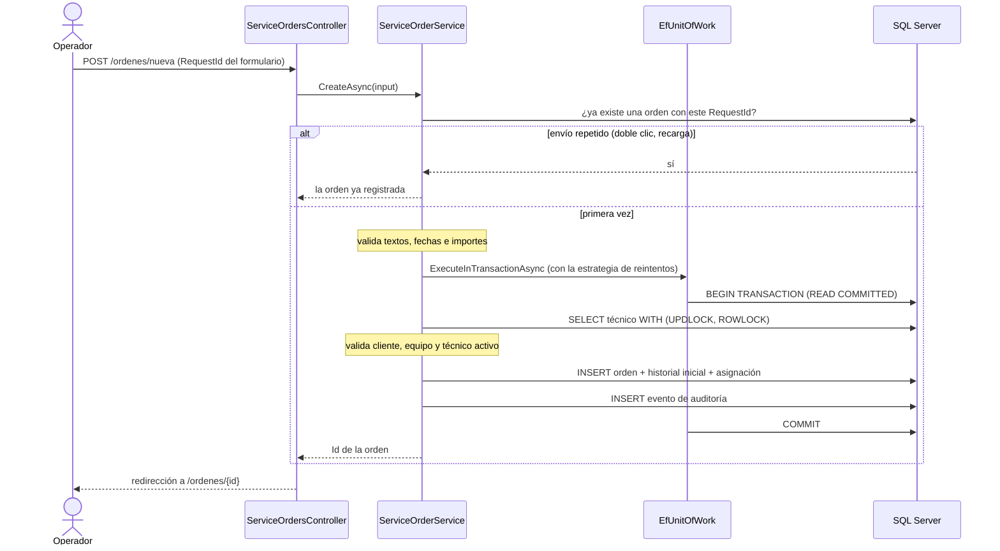
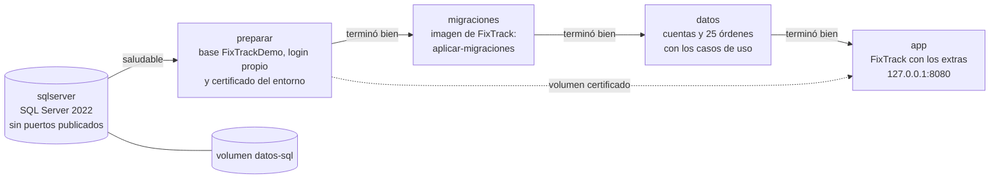

# Arquitectura técnica de FixTrack

Resumen para una entrevista técnica: cómo está construido FixTrack, por qué, y dónde mirar en el código. Cada sección termina con un enlace al detalle. No repite la documentación académica:

- [arquitectura.md](arquitectura.md): capas, servicios registrados, permisos y despliegue en Render;
- [flujo-de-ordenes.md](flujo-de-ordenes.md): estados, transiciones y algoritmo de priorización;
- [modelo-de-datos.md](modelo-de-datos.md): tablas, diagramas entidad-relación y de clases;
- [portfolio-extras.md](portfolio-extras.md): reportes, fichas y API.

## Contenido

1. [Componentes](#1-componentes)
2. [Una solicitud HTTP de principio a fin](#2-una-solicitud-http-de-principio-a-fin)
3. [Comunicación entre capas](#3-comunicación-entre-capas)
4. [Persistencia con EF Core](#4-persistencia-con-ef-core)
5. [Transacciones y concurrencia](#5-transacciones-y-concurrencia)
6. [Roles y autorización](#6-roles-y-autorización)
7. [Historial y auditoría](#7-historial-y-auditoría)
8. [Reportes en SQL](#8-reportes-en-sql)
9. [API REST v1](#9-api-rest-v1)
10. [Seguridad](#10-seguridad)
11. [Despliegue con Docker](#11-despliegue-con-docker)
12. [Decisiones y alternativas descartadas](#12-decisiones-y-alternativas-descartadas)

## 1. Componentes

Una sola aplicación ASP.NET Core MVC (.NET 10), un SQL Server y nada más: sin colas, sin caché distribuida ni servicios externos. Es el tamaño que pide un taller con un puñado de usuarios, y deja la complejidad donde importa (reglas, consistencia y trazabilidad).

- **El dominio no conoce a nadie.** `ServiceOrder` valida sus propias transiciones, `ServiceOrderWorkflow` define cuáles existen y `WorkPrioritizer` puntúa. La interfaz pregunta a esas mismas clases qué botones mostrar.
- **Application define interfaces; Infrastructure las implementa.** Los casos de uso llaman a repositorios, `IUnitOfWork`, `IAuditLog` e `IUserAccountService` sin saber que detrás hay EF Core. Los controladores solo ven interfaces de Application; Web referencia a Infrastructure únicamente para registrar servicios en `Program.cs`.
- **Los comandos de consola** son la misma aplicación con otro punto de entrada: comparten configuración, servicios y validaciones. Así, migrar, crear el primer administrador o respaldar no necesita herramientas aparte.
- **La herramienta de la demostración** reutiliza Application e Infrastructure con su propio reloj y su propio autor (sección 11).

Detalle: [arquitectura.md, Capas](arquitectura.md#capas).

## 2. Una solicitud HTTP de principio a fin

El orden del canal de middleware (`src/FixTrack.Web/Program.cs`) no es accidental: cada paso depende de lo que resolvió el anterior.

- **El proxy va primero** porque todo lo demás (HSTS, cookies `Secure`, la IP del límite de intentos) depende de saber si la solicitud llegó por HTTPS y desde dónde. Por omisión no se confía en ningún proxy: producción no arranca sin una decisión explícita.
- **El límite de solicitudes va antes de la autenticación.** Por eso la API reparte su límite según la huella SHA-256 de la cookie de sesión, sin leer su contenido. Una solicitud sin sesión válida termina en 401 de todos modos.
- **La autorización usa una política de respaldo:** un controlador nuevo queda protegido aunque nadie le ponga `[Authorize]`.
- **Los errores no filtran detalles:** una base caída produce una página 503 estática con `Retry-After` (o Problem Details en la API), sin trazas.

Dentro del controlador, el patrón es siempre el mismo: validar el formulario, llamar a un caso de uso, traducir su `CommandResult` (éxito, errores por campo, no encontrado o conflicto) y redirigir según Post/Redirect/Get. Los errores de usuario no se modelan como excepciones.

## 3. Comunicación entre capas

| De → a | Mediante | Ejemplo |
| --- | --- | --- |
| Controlador → caso de uso | Interfaz de Application y modelos de entrada propios (no entidades) | `ServiceOrdersController` → `IServiceOrderService.ChangeStatusAsync(id, input, version)` |
| Caso de uso → dominio | Métodos de la entidad, que protegen sus invariantes | `order.ChangeStatus(nuevo, ahora, nota, costo, autor)` |
| Caso de uso → persistencia | Contratos de repositorio, `IUnitOfWork` e `IAuditLog` | `unitOfWork.ExecuteInTransactionAsync(...)` |
| Caso de uso → contexto | `ICurrentUser` (quién) y `TimeProvider` (cuándo) | La web lee la sesión; la demostración fija un autor y una fecha por operación |
| Persistencia → lectura | Proyecciones a modelos de lectura, sin cargar entidades | `ServiceOrderListItem`, `OpenOrderSnapshot`, `OperationsReport` |

Inyectar el reloj y el autor no es un detalle de pruebas. Gracias a eso, la demostración carga 75 días de historia con los mismos casos de uso que la web: cada orden pasa por las mismas validaciones, transiciones y auditoría, con fechas creíbles.

## 4. Persistencia con EF Core

- **Esquema solo por migraciones** (`src/FixTrack.Infrastructure/Persistence/Migrations`). La aplicación nunca crea ni modifica tablas al iniciar; el comando `aplicar-migraciones` lo hace de forma explícita. Una prueba exige que ninguna migración elimine o modifique datos existentes.
- **Configuración explícita por entidad:**
  - fechas `datetime2(3)` en UTC, con un conversor que fija `DateTimeKind.Utc`;
  - importes `decimal(10,2)` con restricciones `CHECK`;
  - intercalación `Modern_Spanish_100_CI_AI` en los nombres;
  - índices filtrados y una columna `Version` como token de concurrencia.
- **Dos contextos:**
  - `FixTrackDbContext`, con conexión y comandos de 15 s y tres reintentos;
  - `DataProtectionKeysDbContext`, con 5 s y un reintento, para que una base lenta no bloquee el arranque.
- **Disyuntor:** dos interceptores cuentan las conexiones fallidas y los comandos que agotan su tiempo. Tras tres fallos seguidos, la aplicación deja de intentar durante 15 s y responde 503 de inmediato, en lugar de acumular esperas contra una base caída.
- **Consultas que no crecen con los datos:** los listados son proyecciones paginadas en SQL, el panel es una sola agregación y la cola calcula la puntuación en la base. Ninguna página consulta fila por fila.
- **Lo que EF Core no traduce, se mapea.** Restar fechas dentro de una agregación no se traduce, así que `ReportSql.UnixSeconds` es una función mapeada por proveedor: `DATEDIFF_BIG` en SQL Server y `unixepoch` en SQLite. Las mismas pruebas corren en ambos motores.

Detalle: [modelo-de-datos.md](modelo-de-datos.md) y [arquitectura.md, Consultas y rendimiento](arquitectura.md#consultas-y-rendimiento).

## 5. Transacciones y concurrencia

Registrar una orden muestra casi todos los mecanismos juntos:

| Riesgo | Mecanismo | Por qué así |
| --- | --- | --- |
| Dos personas editan el mismo registro | **Concurrencia optimista:** el formulario envía la `Version` que vio; si cambió, se informa sin sobrescribir | No bloquea a nadie mientras edita, y en un taller pequeño los conflictos son raros |
| Asignar un técnico mientras otro lo desactiva | `UPDLOCK, ROWLOCK` sobre la fila del técnico dentro de la transacción | Serializa solo esas dos operaciones; las lecturas normales no esperan |
| Dos administradores se deshabilitan entre sí | `sp_getapplock` sobre las cuentas, más la comprobación de que quien actúa sigue siendo administrador | La regla "siempre queda un administrador" abarca varias filas: un bloqueo de fila no alcanza |
| Doble envío del mismo formulario | `RequestId` con índice único; si el índice rechaza el segundo `INSERT`, se devuelve la orden ya creada | Funciona aunque se haya perdido la confirmación del `COMMIT` |
| Fallos transitorios de red | La estrategia de reintentos de EF Core repite la transacción completa y limpia el seguimiento de cambios entre intentos | Reintentar solo el `SaveChanges` dejaría la transacción a medias |

Ninguno depende de `SERIALIZABLE` ni de `READ_COMMITTED_SNAPSHOT` (desactivado en el hosting gratuito). Las pruebas de `tests/FixTrack.Tests/SqlServer` los ejercitan contra un SQL Server real: sin el bloqueo de aplicación, la mitad de las pruebas de concurrencia de cuentas fallan.

Detalle: [arquitectura.md, Concurrencia](arquitectura.md#concurrencia).

## 6. Roles y autorización

| Rol | Puede |
| --- | --- |
| Administrador | Todo, incluidas las cuentas, los técnicos y la auditoría |
| Operador | Clientes, equipos y órdenes; consulta técnicos y reportes |
| Consulta | Ver todas las pantallas; ningún envío |

- **Políticas con nombre:** `Taller` (Administrador u Operador), `GestionarTecnicos` y `GestionarCuentas` (solo Administrador), más la política de respaldo.
- **Un solo requisito, `RoleAccessRequirement`:** los roles de la política pueden todo y el rol Consulta pasa solo con GET o HEAD. Así, una acción nueva queda protegida para Consulta sin declarar nada. Una prueba recorre todos los POST con la sesión y el token válidos de una cuenta Consulta y comprueba el 403 y que ninguna tabla cambió.
- **La interfaz oculta lo que el rol no permite, pero la decisión es del servidor:** cada envío se vuelve a autorizar.

Detalle: [arquitectura.md, Autorización](arquitectura.md#autorización).

## 7. Historial y auditoría

- **Tres registros:**
  - historial de estados (`ServiceOrderStatusHistory`);
  - asignaciones de técnico (`ServiceOrderAssignments`);
  - eventos de auditoría (`AuditEvents`).
- **Solo inserción en la base.** Un trigger rechaza `UPDATE` y `DELETE` en cada tabla: ni un error de programación ni un acceso directo pueden reescribir la historia.
- **La misma transacción que el cambio.** `IAuditLog.Record` agrega el evento al contexto en curso: si el cambio falla, el evento no queda; si el evento no puede guardarse, el cambio tampoco.
- **El autor se copia.** `Actor` guarda el Id y el nombre de la cuenta en ese momento, sin clave foránea, así que renombrar o deshabilitar una cuenta no altera el pasado.
- **Sin datos sensibles:** los eventos nunca incluyen contraseñas, hashes ni tokens. Tampoco se auditan las ediciones de datos de contacto, que guardarían copias de datos personales.

## 8. Reportes en SQL

El centro de reportes (extra opcional) muestra cómo evitar que la analítica degrade la aplicación:

- **8 consultas fijas** por reporte, con `COUNT` y `SUM` condicionales. Una prueba comprueba que el número no cambia al triplicar los datos.
- **Cada indicador usa la fecha de su propio evento:** recibidas por recepción, entregadas por entrega y canceladas por cancelación. Mezclarlas produce porcentajes falsos.
- **Los períodos son intervalos `[inicio, fin)` en UTC,** calculados día por día en la zona horaria del taller. Las series se agrupan en SQL sumando el desfase local por tramos.
- **"Sin datos" no es cero:** un promedio sin entregas no se inventa.

Detalle: [portfolio-extras.md, Centro de reportes](portfolio-extras.md#4-centro-de-reportes).

## 9. API REST v1

- **Solo lectura** (`/api/v1/ordenes`, `/equipos`, `/metricas`), con DTO explícitos en español. Nunca expone entidades, ni datos de contacto, cuentas o auditoría.
- **Misma sesión que la web:** usa la cookie, sin tokens nuevos. Los otros orígenes no tienen CORS, así que un sitio ajeno no puede leerla con la sesión del usuario.
- **Contratos predecibles:**
  - paginación con límites (`porPagina` de 1 a 100);
  - ordenamiento con lista blanca;
  - errores 400, 401, 403, 404, 429 y 503 como Problem Details (RFC 9457), sin trazas.
- **Límite de solicitudes por sesión**, configurable.
- **Desactivada, no existe:** una convención de MVC quita sus controladores antes de construir las rutas. Responder 404 después de autorizar revelaría que la ruta existe.

Detalle: [portfolio-extras.md, API REST v1](portfolio-extras.md#7-api-rest-v1).

## 10. Seguridad

| Amenaza | Defensa |
| --- | --- |
| Robo o falsificación de sesión | Cookie `HttpOnly`, `SameSite=Lax` y `Secure` fuera de Desarrollo. Claves de Data Protection en la base, cifradas con un certificado X.509. El sello de seguridad se revalida cada minuto |
| Certificado equivocado en un despliegue | Antes de servir, la aplicación comprueba que el certificado descifra las claves guardadas; si no, no arranca y no escribe nada |
| Enumeración de cuentas y fuerza bruta | Mismo mensaje y mismo tiempo para cualquier fallo, límite de intentos por IP y bloqueo tras cinco intentos |
| CSRF y XSS | Token antifalsificación global, CSP con nonce sin `unsafe-inline` y codificación de Razor |
| Asignación masiva | Modelos de formulario propios: el número, el estado inicial, el autor o el propietario no se aceptan desde el navegador |
| Inyección de fórmulas en CSV | Se neutralizan las celdas que empiezan con `=`, `+`, `-` o `@` (también sus variantes de ancho completo) o con tabulador o salto de línea |
| Secretos en el repositorio | `user-secrets` y variables de entorno; la imagen Docker no contiene secretos ni certificados; CI no usa ninguno |

Detalle: [arquitectura.md, Seguridad](arquitectura.md#seguridad).

## 11. Despliegue con Docker

**La imagen de producción** (`Dockerfile`) se construye en varias etapas:

- compila con ReadyToRun para la arquitectura de destino;
- termina en `aspnet:10.0-noble-chiseled-extra`, sin shell ni gestor de paquetes;
- se ejecuta como un usuario sin privilegios;
- usa la misma imagen para servir y para los comandos de consola.

El despliegue en Render y sus pasos están en [arquitectura.md](arquitectura.md#alojamiento-y-despliegue) y en la [checklist de lanzamiento](checklist-lanzamiento.md).

**La demostración local** (`demo/compose.yaml`) usa la misma imagen y agrega lo mínimo para que cualquiera la levante sin credenciales:

- **Aislamiento:** SQL Server no publica puertos y la aplicación escucha solo en `127.0.0.1`. La herramienta rechaza cualquier servidor que no sea local y cualquier base cuyo nombre no empiece con `FixTrackDemo`.
- **Mínimo privilegio:** `sa` solo crea la base y un login propio. Las migraciones, la carga y la aplicación usan ese login, dueño de su base y nada más (una prueba contra SQL Server lo verifica).
- **Secretos por entorno:** `demo.sh` genera contraseñas aleatorias en `demo/.env` (ignorado por Git, permisos 600). El certificado de Data Protection se crea dentro de un volumen y solo lo puede leer el usuario de la imagen.
- **Datos por los casos de uso, no por SQL:** la carga recorre una línea de tiempo y ejecuta cada operación con su fecha y su autor. Al final crea la cuenta de consulta, que marca la carga como completa: volver a iniciar no duplica nada, y una carga interrumpida se detecta.
- **Apple Silicon:** la imagen de SQL Server solo existe para x86-64 y Docker la emula con Rosetta. Las imágenes de FixTrack se construyen nativas para arm64.
- **Probada en CI:** un trabajo de GitHub Actions ejecuta `./demo/demo.sh iniciar`, `verificar` (permisos de cada rol con curl), `detener`, de nuevo `iniciar` y `eliminar`.

## 12. Decisiones y alternativas descartadas

| Decisión | Alternativa | Por qué |
| --- | --- | --- |
| MVC con Razor renderizado en el servidor | SPA con una API | Formularios con validación en el servidor, sin duplicar reglas en el cliente, con una CSP estricta y poco JavaScript propio, sin dependencias |
| Capas con interfaces simples | CQRS, MediatR o repositorio genérico | El dominio es pequeño: más indirección no compraba claridad. Las lecturas ya son proyecciones separadas de las escrituras |
| Puntuación de la cola en SQL | Cargar las órdenes abiertas y ordenar en memoria | Ordenar en memoria obliga a traer todas las órdenes abiertas. La fórmula está en el dominio y el repositorio la reproduce en SQL con los mismos umbrales como parámetros; una prueba compara ambos órdenes |
| `UPDLOCK` y `sp_getapplock` | `SERIALIZABLE` o instantáneas | Funcionan en SQL Server Express y en el hosting, y no bloquean las consultas normales |
| Claves de Data Protection en la base, cifradas | Archivos en disco | El plan gratuito de Render no tiene disco persistente; sin cifrar, leer la tabla bastaría para falsificar sesiones |
| Cookie de sesión también para la API | JWT o tokens de API | La API es de solo lectura y del mismo origen. Los tokens de servidor a servidor quedan como mejora futura |
| Extras detrás de feature flags, quitados del enrutamiento | Ramas separadas o compilación condicional | Una sola base de código. Con las flags apagadas, el HTML de las pantallas académicas es idéntico byte a byte al de la versión base |
| Datos de demostración con los casos de uso y un reloj inyectado | Scripts SQL de inserción | Los scripts saltarían las reglas y producirían historiales imposibles; así, los datos son coherentes por construcción |
