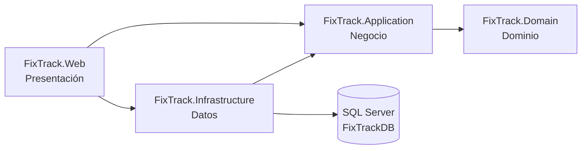
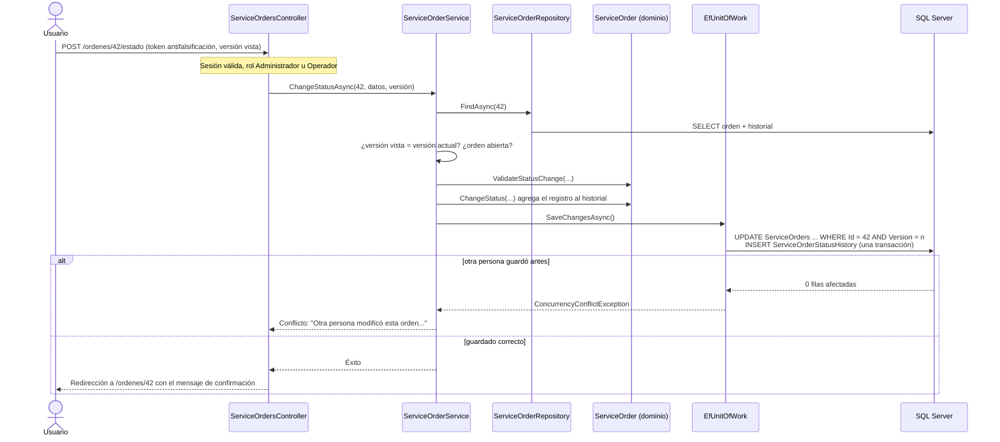
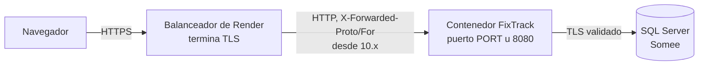

# Arquitectura de FixTrack

Este documento describe cómo está organizado el código, cómo viaja una solicitud entre las capas y qué decisiones técnicas se tomaron para la seguridad, la concurrencia y el despliegue. Para el modelo de datos, consulta [modelo-de-datos.md](modelo-de-datos.md). Para las reglas de las órdenes y el algoritmo de priorización, consulta [flujo-de-ordenes.md](flujo-de-ordenes.md).

## Capas

FixTrack es una aplicación ASP.NET Core MVC (.NET 10) con **arquitectura por capas**. Cada capa es un proyecto, y las referencias entre proyectos impiden dependencias en la dirección incorrecta.

| Capa | Proyecto | Responsabilidad | Contenido principal |
| --- | --- | --- | --- |
| Dominio | `FixTrack.Domain` | Entidades y reglas del negocio, sin dependencias externas | `Customer`, `Device`, `Technician`, `ServiceOrder`, `ServiceOrderStatusChange`; reglas `ContactRules`, `CustomerRules`, `DeviceRules`, `TechnicianRules`, `ServiceOrderRules`; flujo `ServiceOrderWorkflow`; algoritmo `WorkPrioritizer` |
| Negocio | `FixTrack.Application` | Casos de uso y contratos (interfaces) | Servicios de clientes, equipos, técnicos, órdenes y panel; interfaces de repositorios, `IUnitOfWork` e `IUserAccountService`; modelos de entrada y de consulta |
| Datos | `FixTrack.Infrastructure` | Persistencia con EF Core y SQL Server, cuentas con ASP.NET Core Identity | `FixTrackDbContext`, configuraciones, migraciones, repositorios, `EfUnitOfWork`, `UserAccountService` |
| Presentación | `FixTrack.Web` | HTTP, vistas Razor, seguridad y alojamiento. Es la raíz de composición | Controladores, vistas y modelos de vista, políticas de autorización, encabezados de seguridad, salud, proxy y comandos de consola |

Reglas de dependencia:

- `Domain` no conoce ninguna otra capa ni ASP.NET Core.
- `Application` define interfaces (`IServiceOrderRepository`, `IUnitOfWork`) sin saber cómo se implementan, y no depende de EF Core. Es el principio de inversión de dependencias (la D de SOLID).
- `Infrastructure` implementa esas interfaces.
- Los controladores de `Web` dependen solo de interfaces de `Application`. `Web` referencia a `Infrastructure` únicamente para registrar sus servicios en `Program.cs`.

## Recorrido de una solicitud: cambiar el estado de una orden

Los servicios devuelven un `CommandResult` (éxito, errores por campo, conflicto o no encontrado) en lugar de lanzar excepciones por errores de usuario. El controlador lo traduce en la vista con los errores en español o en una redirección (patrón Post/Redirect/Get).

## Servicios registrados

Cada capa expone un método de extensión y `Program.cs` los combina: `AddApplication()`, `AddInfrastructure(configuration)`, `AddPresentation()`, `AddSecurity(...)`, `AddReverseProxySupport(...)` y `AddHealthEndpoints()`.

| Servicio | Ciclo de vida | Capa | Uso |
| --- | --- | --- | --- |
| `IModuleCatalog` | Singleton | Application | Módulos del menú y del panel |
| `ICustomerService`, `IDeviceService`, `ITechnicianService` | Scoped | Application | Casos de uso de clientes, equipos y técnicos |
| `IServiceOrderService` | Scoped | Application | Registro, búsqueda, detalle, asignación, diagnóstico, planificación, cambio de estado y cola de trabajo |
| `IDashboardService` | Scoped | Application | Indicadores y listas del panel |
| `FixTrackDbContext` | Scoped | Infrastructure | EF Core con SQL Server y reintentos ante fallos transitorios (3) |
| Repositorios de clientes, equipos, técnicos, órdenes y panel | Scoped | Infrastructure | Consultas parametrizadas; filtros, conteos y paginación en SQL |
| `IUnitOfWork` → `EfUnitOfWork` | Scoped | Infrastructure | Guardado, transacciones con la estrategia de reintentos y traducción de duplicados y conflictos de concurrencia |
| `IUserAccountService` → `UserAccountService` | Scoped | Infrastructure | Cuentas de acceso sobre `UserManager` de Identity |
| `TimeProvider` | Singleton | Infrastructure | Hora actual. Las pruebas la fijan |
| `DateDisplay`, `ApplicationInfo` | Singleton | Web | Fechas en español y hora local; versión y entorno |

## Consultas y rendimiento

- Búsquedas, filtros, conteos por vista y paginación se resuelven en SQL con proyecciones a modelos de lectura. Las páginas de listado no cargan entidades completas ni hacen consultas por fila (sin N+1).
- El panel obtiene todos sus indicadores con **una sola consulta de agregación** (conteos condicionales agrupados por una constante). Las listas (próximas entregas, recientes, cola y carga por técnico) suman otras cuatro consultas. Si todavía no hay órdenes, solo se consultan los indicadores y la carga por técnico.
- Cada página de los módulos hace entre 1 y 5 consultas. Se comprobó con el registro de SQL de EF Core.
- La búsqueda usa `LIKE` parametrizado con los comodines escapados y la intercalación `Modern_Spanish_100_CI_AI`, que no distingue mayúsculas ni tildes.

## Concurrencia

| Situación | Estrategia |
| --- | --- |
| Dos personas modifican la misma orden | **Optimista:** columna `Version` como token de concurrencia. El formulario envía la versión que se vio; si no coincide, o si otro guardado se adelanta, se informa sin sobrescribir |
| Desactivar a un técnico mientras se le asigna una orden | **Pesimista y breve:** ambas operaciones leen al técnico con `UPDLOCK, ROWLOCK` dentro de una transacción `READ COMMITTED` (`IUnitOfWork.ExecuteInTransactionAsync`). La segunda espera a la primera y ve su resultado |
| Fallos transitorios de red con Somee | La estrategia de reintentos de EF Core repite la transacción completa; el seguimiento de cambios se limpia antes de cada intento |

Se eligió `UPDLOCK` en lugar de aislamiento `SERIALIZABLE` o de instantáneas porque funciona en SQL Server Express, no depende de `READ_COMMITTED_SNAPSHOT` (desactivado en Somee), bloquea una sola fila y no bloquea las consultas normales. Las pruebas de `SqlServerBehaviorTests` lo verifican contra SQL Server real.

## Seguridad

### Autenticación

- **ASP.NET Core Identity** con cookie de sesión. No hay registro público: las cuentas las crea un administrador.
- Inicio de sesión en `/cuenta/iniciar-sesion` y cierre solo por POST (`/cuenta/cerrar-sesion`).
- **Contraseñas:** mínimo 12 caracteres, con mayúsculas, minúsculas y números, y al menos 5 caracteres distintos. Se guardan como hash (PBKDF2) y nunca se escriben en registros ni en páginas.
- **Bloqueo:** 5 intentos fallidos bloquean la cuenta 15 minutos.
- **Mensajes:** un correo sin cuenta y una contraseña incorrecta reciben el mismo mensaje ("El correo o la contraseña no son correctos."). Una cuenta bloqueada o deshabilitada recibe un aviso de bloqueo, para que el personal sepa por qué no puede entrar.
- **Límite por dirección IP:** 10 intentos de inicio de sesión por minuto (`Security:LoginAttemptsPerMinute`). Al superarlo se responde 429.
- **Cookie `FixTrack.Sesion`:** `HttpOnly`, `SameSite=Lax`, `Secure` fuera de Desarrollo, de sesión (se borra al cerrar el navegador), con 2 horas de expiración deslizante.
- El sello de seguridad se revalida cada minuto. Si una cuenta se deshabilita, cambia de rol o cambia su contraseña, sus sesiones abiertas terminan o se actualizan en menos de un minuto.
- Las claves de **Data Protection** (cookie y tokens antifalsificación) se guardan en la tabla `DataProtectionKeys`, para que las sesiones sobrevivan a reinicios del contenedor.

### Autorización

Toda ruta exige una cuenta con rol, salvo el inicio de sesión, las páginas de error, los archivos estáticos y `/salud`. La regla está en una **política de respaldo** (`FallbackPolicy`), así que un controlador nuevo queda protegido aunque se olvide el atributo. También protege el endpoint JSON `/clientes/opciones`.

| Función | Administrador | Operador |
| --- | :---: | :---: |
| Panel y cola de trabajo | ✓ | ✓ |
| Clientes: consultar, registrar, editar, desactivar y reactivar | ✓ | ✓ |
| Equipos: consultar, registrar y editar | ✓ | ✓ |
| Órdenes: registrar, asignar, diagnosticar, planificar y cambiar de estado | ✓ | ✓ |
| Técnicos: consultar | ✓ | ✓ |
| Técnicos: registrar, editar, desactivar y reactivar | ✓ | — |
| Cuentas de acceso: crear, editar rol, deshabilitar, habilitar y restablecer contraseña | ✓ | — |
| Cambiar la propia contraseña | ✓ | ✓ |

Las políticas son `Taller` (Administrador u Operador), `GestionarTecnicos` y `GestionarCuentas` (solo Administrador). La interfaz oculta lo que el rol no permite y el servidor lo rechaza con 403 aunque se llame directamente. Una solicitud JSON sin sesión recibe 401, no una redirección.

Reglas de las cuentas: un administrador no puede deshabilitarse ni cambiar su propio rol, y siempre debe quedar al menos un administrador habilitado. Una cuenta deshabilitada no se elimina, para conservar la trazabilidad.

**Rol Técnico: no se implementó.** Un rol Técnico que solo vea y modifique sus propias órdenes exige autorización por registro: filtrar cada consulta y verificar cada cambio contra el técnico de la cuenta, y vincular cuentas con técnicos. Hacerlo a medias habría dado una falsa sensación de control. El diseño propuesto para una fase posterior:

1. Agregar `AspNetUsers.TechnicianId` (opcional, único) que vincule la cuenta con un técnico activo.
2. Agregar una política `TecnicoAsignado` con un `AuthorizationHandler` basado en recursos que compare `ServiceOrder.TechnicianId` con el técnico de la cuenta.
3. Filtrar en `IServiceOrderRepository` las búsquedas y la cola de trabajo por técnico cuando el usuario tenga ese rol.
4. Limitar las acciones del técnico a diagnóstico y cambios de estado de sus órdenes. Asignar, planificar y entregar seguirían en manos del Operador.

### Protección de la aplicación web

- **CSRF:** todos los formularios llevan token antifalsificación, validado de forma global (`AutoValidateAntiforgeryToken`).
- **Encabezados:** `Content-Security-Policy` (solo recursos propios; el único script en línea lleva un nonce distinto por solicitud), `X-Content-Type-Options: nosniff`, `X-Frame-Options: DENY`, `Referrer-Policy`, `Permissions-Policy` y `Cross-Origin-Opener-Policy`. HSTS fuera de Desarrollo.
- **Caché:** las páginas HTML y las respuestas JSON llevan `Cache-Control: no-store`, porque los equipos del taller pueden ser compartidos.
- **Codificación:** Razor codifica todo el contenido ingresado por los usuarios.
- **Asignación masiva:** los formularios usan modelos propios. El número, el estado inicial, la fecha de recepción y el propietario de un equipo no se pueden enviar desde el navegador.

## Alojamiento y despliegue

La aplicación está preparada para un contenedor (por ejemplo, en Render) pero **no está publicada**.

- **Imagen Docker** multietapa: el SDK compila y publica; la imagen final es `aspnet:10.0-noble-chiseled-extra`, sin shell, con ICU y zonas horarias, y se ejecuta con un usuario sin privilegios (UID 1654). No contiene secretos.
- **Puerto:** 8080 por defecto. Si la plataforma define `PORT`, se usa ese.
- **Proxy confiable:** `X-Forwarded-For` y `X-Forwarded-Proto` solo se aceptan si la conexión viene de `ReverseProxy:KnownNetworks` (`10.0.0.0/8` en la imagen). Se procesan de derecha a izquierda hasta la primera dirección no confiable, así que un cliente no puede hacerse pasar por HTTPS ni falsificar su IP. Sin redes configuradas, los encabezados se ignoran.
- **HTTPS:** la aplicación redirige a HTTPS cuando conoce un puerto HTTPS. Detrás de Render, el balanceador ya hace esa redirección; la aplicación detecta HTTPS por el encabezado del proxy confiable, marca la cookie como `Secure` y envía HSTS.
- **Salud:** `/salud` indica que el proceso responde y `/salud/bd` comprueba además la base de datos (máximo 4 segundos). Ambas responden solo `Healthy` o `Unhealthy`, sin detalles, no se guardan en caché y no se redirigen a HTTPS.
- **Migraciones y primer administrador:** comandos explícitos `aplicar-migraciones` y `crear-administrador`. La aplicación nunca modifica el esquema al iniciar. Los pasos están en el README.
- **Zona horaria:** las fechas se guardan en UTC y se muestran en la hora local del servidor (`TZ=America/Guatemala` en la imagen).

## Pruebas

- **Unitarias:** dominio, servicios de aplicación con repositorios en memoria, algoritmo de priorización con fechas fijas.
- **Integración:** repositorios y migraciones sobre SQLite en memoria; páginas completas con `WebApplicationFactory`, iniciando sesión por el formulario real con cuentas de prueba de contraseña aleatoria. Las políticas de producción no se relajan para las pruebas; solo se sube el límite de intentos por IP, que tiene su propia prueba.
- **SQL Server real (opcionales):** comportamientos que SQLite no reproduce (trigger, bloqueos, intercalación, concurrencia). Se activan con la variable `FIXTRACK_TEST_SQLSERVER` y todo ocurre dentro de transacciones revertidas. En GitHub Actions se omiten.
- **CI:** GitHub Actions compila, ejecuta las pruebas y construye y prueba la imagen Docker, sin conectarse a ninguna base real.
