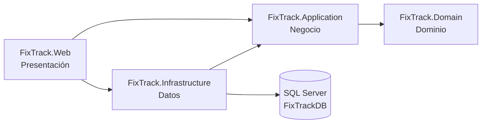
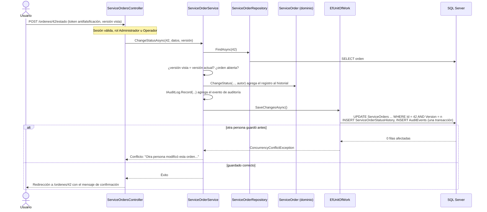
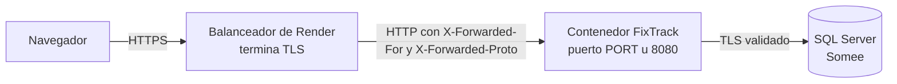

# Arquitectura de FixTrack

Este documento describe cómo está organizado el código, cómo viaja una solicitud entre las capas y qué decisiones técnicas se tomaron para la seguridad, la trazabilidad, la concurrencia, la resiliencia y el despliegue. Para el modelo de datos, consulta [modelo-de-datos.md](modelo-de-datos.md). Para las reglas de las órdenes y el algoritmo de priorización, consulta [flujo-de-ordenes.md](flujo-de-ordenes.md).

## Capas

FixTrack es una aplicación ASP.NET Core MVC (.NET 10) con **arquitectura por capas**. Cada capa es un proyecto, y las referencias entre proyectos impiden dependencias en la dirección incorrecta.

| Capa | Proyecto | Responsabilidad | Contenido principal |
| --- | --- | --- | --- |
| Dominio | `FixTrack.Domain` | Entidades y reglas del negocio, sin dependencias externas | `Customer`, `Device`, `Technician`, `ServiceOrder`, `ServiceOrderStatusChange`, `ServiceOrderAssignment`, `AuditEvent`, `Actor`; reglas `ContactRules`, `CustomerRules`, `DeviceRules`, `TechnicianRules`, `ServiceOrderRules`; flujo `ServiceOrderWorkflow`; algoritmo `WorkPrioritizer` |
| Negocio | `FixTrack.Application` | Casos de uso y contratos (interfaces) | Servicios de clientes, equipos, técnicos, órdenes y panel; interfaces de repositorios, `IUnitOfWork`, `IUserAccountService`, `ICurrentUser`, `IAuditLog` e `IAuditTrail`; modelos de entrada y de consulta |
| Datos | `FixTrack.Infrastructure` | Persistencia con EF Core y SQL Server, cuentas con ASP.NET Core Identity | `FixTrackDbContext`, `DataProtectionKeysDbContext`, configuraciones, migraciones, repositorios, `EfUnitOfWork`, `EfAuditLog`, `UserAccountService`, bloqueos de aplicación, disyuntor de la base (`Resilience/`) y respaldos lógicos (`Backups/`) |
| Presentación | `FixTrack.Web` | HTTP, vistas Razor, seguridad y alojamiento. Es la raíz de composición | Controladores, vistas y modelos de vista, políticas de autorización, encabezados de seguridad, Data Protection, proxy, salud, página 503 y comandos de consola |

Reglas de dependencia:

- `Domain` no conoce ninguna otra capa ni ASP.NET Core.
- `Application` define interfaces (`IServiceOrderRepository`, `IUnitOfWork`, `IAuditLog`, `ICurrentUser`) sin saber cómo se implementan, y no depende de EF Core. Es el principio de inversión de dependencias (la D de SOLID).
- `Infrastructure` implementa esas interfaces.
- Los controladores de `Web` dependen solo de interfaces de `Application`. `Web` referencia a `Infrastructure` para registrar sus servicios en `Program.cs`, para los comandos de consola y para la página 503.

## Recorrido de una solicitud: cambiar el estado de una orden

Los servicios devuelven un `CommandResult` (éxito, errores por campo, conflicto o no encontrado) en lugar de lanzar excepciones por errores de usuario. El controlador lo traduce en la vista con los errores en español o en una redirección (patrón Post/Redirect/Get).

El autor de cada cambio sale de `ICurrentUser` (`HttpCurrentUser` lee la cuenta de la cookie; los comandos de consola usan `Actor.System`). El dominio guarda el Id y el nombre del autor en el historial, en las asignaciones y en la auditoría.

## Servicios registrados

Cada capa expone un método de extensión y `Program.cs` los combina: `AddApplication()`, `AddInfrastructure(configuration)`, `AddPresentation()`, `AddSecurity(...)`, `AddReverseProxySupport(...)`, `AddRequestResilience()` y `AddHealthEndpoints()`.

| Servicio | Ciclo de vida | Capa | Uso |
| --- | --- | --- | --- |
| `IModuleCatalog` | Singleton | Application | Módulos del menú y del panel |
| `ICustomerService`, `IDeviceService`, `ITechnicianService` | Scoped | Application | Casos de uso de clientes, equipos y técnicos |
| `IServiceOrderService` | Scoped | Application | Registro, búsqueda, detalle, asignación, diagnóstico, planificación, cambio de estado y cola de trabajo |
| `IDashboardService` | Scoped | Application | Indicadores y listas del panel |
| `FixTrackDbContext` | Scoped | Infrastructure | EF Core con SQL Server: conexión de 15 s como máximo, comandos de 15 s, 3 reintentos ante fallos transitorios y el disyuntor |
| `DataProtectionKeysDbContext` | Scoped | Infrastructure | Solo la tabla `DataProtectionKeys`, con tiempos de 5 s y 1 reintento: si la base no responde, falla rápido |
| Repositorios de clientes, equipos, técnicos, órdenes, panel y auditoría | Scoped | Infrastructure | Consultas parametrizadas; filtros, conteos, paginación y puntuación de la cola en SQL |
| `IUnitOfWork` → `EfUnitOfWork` | Scoped | Infrastructure | Guardado, transacciones con la estrategia de reintentos y traducción de duplicados y conflictos de concurrencia |
| `IAuditLog` → `EfAuditLog` | Scoped | Infrastructure | Agrega eventos de auditoría al mismo guardado que el cambio |
| `IUserAccountService` → `UserAccountService` | Scoped | Infrastructure | Cuentas de acceso sobre `UserManager` de Identity, con bloqueo de aplicación |
| `DatabaseAvailability`, `DatabaseCircuitInterceptor`, `DatabaseCommandMonitor` | Singleton | Infrastructure | Disyuntor de la base: conexiones y comandos que fallan o agotan su tiempo |
| `DataProtectionKeyCheck` | Singleton | Web | Antes de iniciar, comprueba que el certificado descifra las claves guardadas |
| `DatabaseBackup` | Scoped | Infrastructure | Comandos de respaldo y restauración |
| `ICurrentUser` → `HttpCurrentUser` | Scoped | Web | Autor de los cambios |
| `FailedLoginEqualizer` | Scoped | Web | Iguala el tiempo de los inicios de sesión fallidos |
| `TimeProvider` | Singleton | Infrastructure | Hora actual. Las pruebas la fijan |
| `DateDisplay`, `ApplicationInfo` | Singleton | Web | Fechas en español y hora local; versión y entorno |

## Consultas y rendimiento

- Búsquedas, filtros, conteos por vista y paginación se resuelven en SQL con proyecciones a modelos de lectura. Las páginas de listado no cargan entidades completas ni hacen consultas por fila (sin N+1).
- **Cola de trabajo:** la base calcula la misma puntuación que `WorkPrioritizer` (con los umbrales de fecha como parámetros) y devuelve solo las 100 órdenes de mayor puntuación de cada lista, con los mismos desempates. Los totales de cada lista salen de un conteo agrupado por estado. Una prueba compara el orden de la base con el de `WorkPrioritizer` sobre más de 300 órdenes en los bordes de la fórmula, en SQLite y en SQL Server.
- **Panel:** todos los indicadores salen de **una sola consulta de agregación**. Las acciones recomendadas piden a la base las 5 órdenes de mayor puntuación entre todas las abiertas; las demás listas suman otras tres consultas.
- Cada página hace entre 1 y 5 consultas (medido en la fase 4 con el registro de SQL de EF Core: el panel 5, la cola 4, el detalle de una orden 3, los listados 2 o 3).
- La búsqueda usa `LIKE` parametrizado con los comodines escapados y la intercalación `Modern_Spanish_100_CI_AI`, que no distingue mayúsculas ni tildes.
- No se agregaron índices en la fase 4: con el volumen del taller, los índices existentes cubren los filtros por estado, fecha y técnico, y las migraciones no eliminan índices.

## Concurrencia

| Situación | Estrategia |
| --- | --- |
| Dos personas modifican la misma orden, cliente, equipo o técnico | **Optimista:** columna `Version` como token de concurrencia. El formulario envía la versión que vio; si no coincide, o si otro guardado se adelanta, se informa sin sobrescribir |
| Un mismo formulario de orden se envía dos veces (doble clic, recarga) | Cada formulario lleva un identificador (`CreationRequestId`) con índice único: el segundo envío no crea otra orden y lleva a la ya registrada. Además, el navegador envía cada formulario POST una sola vez |
| Desactivar a un técnico mientras se le asigna una orden | **Pesimista y breve:** ambas operaciones leen al técnico con `UPDLOCK, ROWLOCK` dentro de una transacción (`IUnitOfWork.ExecuteInTransactionAsync`). La segunda espera a la primera y ve su resultado |
| Dos administradores cambian cuentas a la vez (por ejemplo, se deshabilitan entre sí) | Cada cambio de cuentas toma el bloqueo de aplicación `FixTrack:cuentas` (`sp_getapplock`, 10 s) dentro de una transacción. La regla "siempre queda un administrador habilitado" se evalúa sin carreras, los pasos de Identity se aplican todos o ninguno y se comprueba que quien actúa siga siendo un administrador habilitado |
| Fallos transitorios de red con Somee | La estrategia de reintentos de EF Core repite la transacción completa; el seguimiento de cambios se limpia antes de cada intento |

Se eligieron `UPDLOCK` y `sp_getapplock` en lugar de aislamiento `SERIALIZABLE` o de instantáneas porque funcionan en SQL Server Express, no dependen de `READ_COMMITTED_SNAPSHOT` (desactivado en Somee) y no bloquean las consultas normales. Las pruebas de `SqlServer/` lo verifican contra SQL Server real; sin el bloqueo de cuentas, 3 de las 6 pruebas de concurrencia de cuentas fallan.

## Seguridad

### Autenticación

- **ASP.NET Core Identity** con cookie de sesión. No hay registro público: las cuentas las crea un administrador.
- Inicio de sesión en `/cuenta/iniciar-sesion` y cierre solo por POST (`/cuenta/cerrar-sesion`).
- **Contraseñas:** mínimo 12 caracteres, con mayúsculas, minúsculas y números, y al menos 5 caracteres distintos. Se guardan como hash (PBKDF2) y nunca se escriben en registros ni en páginas.
- **Bloqueo:** 5 intentos fallidos bloquean la cuenta 15 minutos. Un administrador puede desbloquearla antes desde el editor de la cuenta.
- **Sin enumeración de cuentas:** un correo sin cuenta, una contraseña incorrecta, una cuenta bloqueada y una deshabilitada reciben el **mismo mensaje** y tardan lo mismo: si el correo no existe o la cuenta no puede entrar, se calcula un hash equivalente, y toda respuesta fallida tarda al menos `Security:FailedLoginMinimumMilliseconds` (500 ms). El motivo real solo queda en la bitácora, con el Id de la cuenta y sin el correo.
- **Límite por dirección IP:** 10 intentos de inicio de sesión por minuto (`Security:LoginAttemptsPerMinute`), también en el cambio de contraseña. Al superarlo se responde 429. Los envíos sin token antifalsificación se rechazan antes y no cuentan.
- **Cookie `FixTrack.Sesion`:** `HttpOnly`, `SameSite=Lax`, `Secure` fuera de Desarrollo, de sesión (se borra al cerrar el navegador), con 2 horas de expiración deslizante.
- El sello de seguridad se revalida cada minuto. Si una cuenta se deshabilita, cambia de rol o cambia su contraseña, sus sesiones abiertas terminan o se actualizan en menos de un minuto.

### Claves de Data Protection

Las claves que cifran la cookie de sesión y los tokens antifalsificación se guardan en la tabla `DataProtectionKeys`, para que las sesiones sobrevivan a reinicios del contenedor.

- **Fuera de Desarrollo, las claves nuevas se cifran con un certificado X.509** (`DataProtection:Certificate`, como PFX en base64 o en un archivo, con su contraseña). Así, leer la tabla no basta para falsificar una sesión. Sin certificado, la aplicación **no arranca** en producción, salvo que se declare `DataProtection:AllowUnprotectedKeys=true`.
- `DataProtection:PreviousCertificates:N` permite descifrar claves de un certificado anterior durante una rotación.
- El comando `proteger-claves` crea una clave cifrada sin borrar las anteriores. Data Protection no la usa por defecto mientras haya otra clave válida durante su periodo de propagación (48 horas). Con `--revocar-sin-cifrar`, revoca las claves sin cifrar (agrega un registro de revocación, no borra filas) y la clave cifrada se usa de inmediato; las sesiones emitidas con las claves revocadas deben iniciarse de nuevo. En un primer despliegue, sin sesiones que conservar, ambos pasos pueden hacerse juntos.
- **Comprobación al iniciar (`DataProtectionKeyCheck`):** con un certificado que no corresponde a las claves guardadas, Data Protection no se detiene. Registra errores, invalida todas las sesiones y crea una clave nueva cifrada con ese certificado, que sigue fallando aunque después se corrija la configuración (se comprobó con la imagen de producción). Por eso, entre `Build()` y `Run()` (antes de que Data Protection cargue o cree claves), la aplicación comprueba que los certificados configurados descifran todas las claves vigentes. Si no, **no arranca**, no escribe nada y explica cómo corregirlo; en Render, el despliegue falla y queda la versión anterior. Si la base no responde, no bloquea el arranque.
- **Vencimiento:** Data Protection no valida la vigencia del certificado; uno vencido sigue cifrando y descifrando (hay una prueba). La aplicación avisa en la bitácora desde 90 días antes.
- **`proteger-claves` con un certificado que no lee las claves** no hace nada, salvo que se indique `--revocar-ilegibles` (certificado perdido o filtrado): revoca esas claves y crea una nueva cifrada con el certificado actual.
- **Revocaciones con la aplicación publicada:** la instancia en ejecución conserva su anillo de claves en memoria y sigue aceptando las sesiones de las claves revocadas hasta reiniciarse (se comprobó). Después de revocar, hay que reiniciarla.
- **Recuperación:** el certificado definitivo (RSA 3072, vigente hasta el 2031-10-20) y su contraseña se guardan fuera del repositorio y de la imagen: en una imagen de disco cifrada, con una copia de recuperación cifrada aparte, y con las contraseñas en el Llavero del propietario ([checklist-lanzamiento.md](checklist-lanzamiento.md#2-materiales-y-dónde-están)). Si se pierde, se configura uno nuevo y se ejecuta `proteger-claves --revocar-ilegibles`: los usuarios vuelven a iniciar sesión, sin pérdida de datos del taller.
- En Desarrollo, las claves se guardan en el perfil del usuario (no en la base).

### Autorización

Toda ruta exige una cuenta con rol, salvo el inicio de sesión, las páginas de error, los archivos estáticos y las comprobaciones de salud. La regla está en una **política de respaldo** (`FallbackPolicy`), así que un controlador nuevo queda protegido aunque se olvide el atributo. También protege los endpoints JSON.

| Función | Administrador | Operador | Consulta |
| --- | :---: | :---: | :---: |
| Panel y cola de trabajo | ✓ | ✓ | Ver |
| Clientes: consultar, registrar, editar, desactivar y reactivar | ✓ | ✓ | Solo consultar |
| Equipos: consultar, registrar y editar | ✓ | ✓ | Solo consultar |
| Órdenes: registrar, asignar, diagnosticar, planificar y cambiar de estado | ✓ | ✓ | Solo consultar |
| Técnicos: consultar | ✓ | ✓ | ✓ |
| Técnicos: registrar, editar, desactivar y reactivar | ✓ | — | Solo ver los formularios |
| Cuentas de acceso: crear, editar rol, deshabilitar, habilitar, desbloquear y restablecer contraseña | ✓ | — | Solo ver la lista y los formularios |
| Auditoría (`/auditoria`) | ✓ | — | ✓ |
| Cambiar la propia contraseña | ✓ | ✓ | — |

Las políticas son `Taller` (Administrador u Operador), `GestionarTecnicos` y `GestionarCuentas` (solo Administrador). La interfaz oculta lo que el rol no permite y el servidor lo rechaza con 403 aunque se llame directamente.

**Consulta (solo lectura).** Las tres políticas, incluida la de respaldo, usan el mismo requisito (`RoleAccessRequirement`, en `Web/Security/RoleAccess.cs`): los roles de la política pueden todo y el rol Consulta pasa solo si la solicitud es GET o HEAD. Por eso una acción nueva queda protegida para Consulta sin declararlo, y abrir una página nunca cambia datos. Cerrar sesión (`[Authorize]`, solo exige sesión) es el único POST que puede enviar. Cuando una vista consulta una política sin recurso (para decidir qué enlaces mostrar), la cuenta de consulta los ve; cualquier envío se vuelve a evaluar con la solicitud y recibe 403, con una página que explica que la cuenta es de solo consulta. Una prueba recorre **todos** los POST de la aplicación con la sesión y el token válidos de una cuenta Consulta (también el intento de ascenderse con su propio Id) y comprueba el 403 en cada uno y que ninguna tabla cambió; otra abre todas las páginas GET y comprueba el 200 y el aviso. Una prueba recorre **todos** los POST protegidos por las políticas de administración (los actuales y los que se agreguen) y los envía con la sesión y el token antifalsificación válidos de un Operador, usando su propio Id (el intento de ascenderse a Administrador): comprueba el 403 en cada uno y que ninguna cuenta ni técnico cambió. Una solicitud JSON sin sesión recibe 401, no una redirección.

Reglas de las cuentas: un administrador no puede deshabilitarse ni cambiar su propio rol desde la administración de usuarios (para su contraseña usa "Cambiar mi contraseña"), y siempre debe quedar al menos un administrador habilitado. Una cuenta deshabilitada no se elimina, para conservar la trazabilidad.

**Rol Técnico: no se implementó.** Un rol Técnico que solo vea y modifique sus propias órdenes exige autorización por registro: filtrar cada consulta y verificar cada cambio contra el técnico de la cuenta, y vincular cuentas con técnicos. Hacerlo a medias habría dado una falsa sensación de control. El diseño propuesto para una fase posterior:

1. Agregar `AspNetUsers.TechnicianId` (opcional, único) que vincule la cuenta con un técnico activo.
2. Agregar una política `TecnicoAsignado` con un `AuthorizationHandler` basado en recursos que compare `ServiceOrder.TechnicianId` con el técnico de la cuenta.
3. Filtrar en `IServiceOrderRepository` las búsquedas y la cola de trabajo por técnico cuando el usuario tenga ese rol.
4. Limitar las acciones del técnico a diagnóstico y cambios de estado de sus órdenes. Asignar, planificar y entregar seguirían en manos del Operador.

### Protección de la aplicación web

- **CSRF:** todos los formularios llevan token antifalsificación, validado de forma global (`AutoValidateAntiforgeryToken`). La cookie del token es `HttpOnly`, `SameSite=Strict` y `Secure` cuando la solicitud es HTTPS (también detrás de un proxy confiable). No puede ser `Secure` siempre, como la de sesión: con esa opción, Antiforgery responde 500 a toda solicitud que la aplicación ve como HTTP, y así llegan las de Render mientras se ignoran sus encabezados reenviados. Una prueba lo impide.
- **Encabezados:** `Content-Security-Policy` (solo recursos propios; el único script en línea lleva un nonce distinto por solicitud), `X-Content-Type-Options: nosniff`, `X-Frame-Options: DENY`, `Referrer-Policy`, `Permissions-Policy` y `Cross-Origin-Opener-Policy`. HSTS fuera de Desarrollo, en respuestas HTTPS (ASP.NET Core nunca lo envía a `localhost`). Kestrel no envía el encabezado `Server`.
- **Caché:** las páginas HTML y las respuestas JSON llevan `Cache-Control: no-store`, porque los equipos del taller pueden ser compartidos.
- **Codificación:** Razor codifica todo el contenido ingresado por los usuarios.
- **Asignación masiva:** los formularios usan modelos propios. El número, el estado inicial, la fecha de recepción, el autor y el propietario de un equipo no se pueden enviar desde el navegador.

## Auditoría y trazabilidad

| Registro | Qué guarda | Dónde se ve |
| --- | --- | --- |
| Historial de estados (`ServiceOrderStatusHistory`) | Cada cambio de estado con su nota, su fecha y su autor | Línea de tiempo de la orden |
| Asignaciones (`ServiceOrderAssignments`) | Cada asignación y reasignación de técnico: técnico anterior, técnico nuevo, motivo, fecha y autor | Línea de tiempo de la orden |
| Auditoría (`AuditEvents`) | Operaciones importantes: registro de órdenes, asignaciones, estados, cancelaciones y entregas, planificación y diagnóstico; desactivación y reactivación de técnicos y clientes; alta, edición, deshabilitación, habilitación, desbloqueo y restablecimiento de contraseña de cuentas | `/auditoria` (solo Administrador), con filtros por área; planificación y diagnóstico también en la línea de tiempo |

Las tres tablas son **de solo inserción**: un trigger de SQL Server rechaza `UPDATE` y `DELETE`. Cada registro se guarda en la **misma transacción** que el cambio que describe, así que no puede haber un cambio sin su registro ni un registro sin su cambio. Los eventos nunca incluyen contraseñas ni hashes. No se auditan las ediciones de datos de contacto de clientes, equipos y técnicos: son frecuentes y guardarían copias de datos personales.

## Resiliencia ante fallos de la base

Somee es un servidor compartido y gratuito: a veces tarda o deja de responder unos segundos.

- **Tiempos acotados:** conexión de 15 s como máximo, comandos de 15 s, 3 reintentos con espera creciente (máximo 5 s). Las claves de Data Protection usan 5 s y 1 reintento. Cada solicitud se corta a los **30 s** con un 503.
- **Disyuntor (`DatabaseAvailability`):** tras 3 fallos seguidos, durante 15 s no se intenta conectar: cada solicitud falla de inmediato en lugar de esperar el tiempo de conexión y los reintentos (lo que multiplicaría los intentos contra una base caída). Después, la siguiente solicitud vuelve a probar. Cuentan como fallos las conexiones que fallan y también los **comandos que agotan su tiempo** (`DatabaseCommandMonitor`). Es el caso de un servidor que acepta la conexión pero no responde: los comandos esperan sobre conexiones del pool ya abiertas, sin ningún fallo de conexión. Solo un comando que termina bien restablece el disyuntor; abrir una conexión del pool no lo hace, porque no llega al servidor.
- **Página 503:** si la base no está disponible, el usuario ve "Servicio temporalmente no disponible" con `Retry-After`, sin detalles técnicos. Es una página estática: no necesita la sesión ni las claves, que también están en la base. Se envía aunque el token de la solicitud ya esté cancelado (por ejemplo, por el límite de 30 s); antes, en ese caso la conexión se cortaba sin respuesta.
- **Bitácora:** la caída se registra con su detalle una vez, al abrirse el disyuntor, y una línea cuando la base vuelve a responder. Cada solicitud rechazada deja una sola línea breve (por ejemplo, `Base de datos no disponible (SQL Server 258): se respondió 503 a GET /clientes.`).
- **Vida y disponibilidad:** `/salud` solo indica que el proceso responde (no consulta la base) y es la comprobación de la plataforma. `/salud/bd` ejecuta `SELECT 1` con un máximo de 4 s y guarda el resultado 10 s, para que consultarla seguido no cargue la base.

Medido con la imagen de producción:

- **Base inalcanzable:** el contenedor escucha a los 7 s y la página 503 responde en milisegundos con el disyuntor abierto. Cada solicitud rechazada deja 2 líneas en la bitácora.
- **Base que no responde** (SQL Server pausado, como Somee cuando se congela): la primera solicitud recibe 503 a los 20 s (15 s del comando y 5 s de la cancelación de SqlClient) y la segunda a los 15 s. A partir de ahí, con el disyuntor abierto, en milisegundos, también con solicitudes simultáneas. Al volver la base, se recupera sola en unos 20 s y las sesiones siguen valiendo.

## Respaldos

La cuenta de Somee no puede ejecutar `BACKUP DATABASE` y la base es pequeña (límite de 30 MB). La estrategia combina dos mecanismos:

1. **Copias automáticas de Somee:** según su documentación, Somee hace una copia diaria (`.bak`) de cada base en el almacenamiento de respaldos de la cuenta, y su panel permite crear una copia, descargarla y restaurarla ("Upload and restore"). Si una base gratuita pasa **30 días sin consultas**, Somee la elimina; las copias se conservan y se puede restaurar en una base nueva.
2. **Respaldo lógico propio** (`exportar-respaldo`), independiente de Somee: lee todas las tablas en una sola transacción y genera un ZIP con un manifiesto (migraciones aplicadas, columnas, filas y SHA-256 de cada tabla) y una línea JSON por fila. `verificar-respaldo` comprueba el archivo sin conectarse a ninguna base, y `restaurar-respaldo` lo carga solo en una base **vacía**: aplica las migraciones del respaldo, carga todo en una transacción con las restricciones activas y, antes de confirmar, vuelve a leer cada tabla y exige el mismo hash. Si la base de destino tiene otros datos, no modifica nada.

El archivo contiene datos personales, hashes de contraseñas y las claves de Data Protection: el comando lo escribe con permisos solo para el dueño, **rechaza carpetas dentro de un repositorio Git** y `.gitignore` excluye los archivos de respaldo. Se guarda cifrado y fuera de GitHub.

## Alojamiento y despliegue

La aplicación está preparada para un contenedor en Render (plan gratuito, sin IIS) pero **no está publicada**.

- **Imagen Docker** multietapa: el SDK compila y publica con **ReadyToRun** (código nativo para la arquitectura de destino, que entrega Docker como `TARGETARCH`: amd64 en Render, arm64 en un Mac); la imagen final es `aspnet:10.0-noble-chiseled-extra`, sin shell, con ICU y zonas horarias, y se ejecuta con un usuario sin privilegios (UID 1654). No contiene secretos ni certificados. Con los recursos de Render Free (0.1 CPU y 512 MB), ReadyToRun bajó el arranque de 23 s a 16–18 s, el primer inicio de sesión de 23 s a 15 s y la memoria de 92 MiB a 74 MiB.
- **Puerto:** 8080 por defecto. Si la plataforma define `PORT`, se usa ese.
- **Proxy confiable:** la aplicación no confía en ningún proxy por omisión (ni siquiera en loopback). En producción es obligatorio elegir: `ReverseProxy:KnownProxies` / `ReverseProxy:KnownNetworks` con las direcciones reales del proxy, o `ReverseProxy:IgnoreForwardedHeaders=true`. Sin una de las dos, no arranca. `X-Forwarded-For` se procesa de derecha a izquierda hasta la primera dirección no confiable, así que un cliente no puede hacerse pasar por HTTPS ni falsificar su IP. Si llegan encabezados reenviados desde una dirección no confiable, se registra una advertencia con esa dirección y con los **nombres** de los encabezados presentes, nunca sus valores (como máximo una cada 15 minutos). Así se averigua la dirección del proxy de Render después del primer despliegue sin confiar en ella antes. Las direcciones IPv4 escritas en notación IPv6 (`::ffff:a.b.c.d`, como las muestra Docker) se registran y se aceptan en IPv4. `ReverseProxy:ClientIpHeader` permite usar un encabezado de un solo valor si el borde lo reescribe. Los inicios de sesión fallidos registran la IP del cliente resuelta: con un intento fallido propio se comprueba que la aplicación ve la IP pública del visitante y no la del balanceador.
- **HTTPS:** la aplicación redirige a HTTPS cuando conoce un puerto HTTPS. Detrás de Render, el balanceador ya hace esa redirección; con el proxy configurado, la aplicación detecta HTTPS por el encabezado reenviado, marca la cookie como `Secure` y envía HSTS.
- **Errores de configuración:** si falta la cadena de conexión, el certificado de Data Protection o la decisión sobre el proxy, la aplicación no arranca y el mensaje nombra lo que falta. Como proceso 1 de un contenedor, .NET quedaba girando y consumiendo CPU tras una excepción al iniciar, sin terminar; `Program.cs` escribe el error y termina con código 1, para que la plataforma muestre el fallo. GitHub Actions lo comprueba.
- **Migraciones, respaldos y primer administrador:** comandos explícitos (`aplicar-migraciones`, `exportar-respaldo`, `crear-administrador`…). La aplicación nunca modifica el esquema al iniciar. Los pasos están en el README.
- **Zona horaria:** las fechas se guardan en UTC y se muestran en la hora local del servidor (`TZ=America/Guatemala` en la imagen).

## Pruebas

- **Unitarias:** dominio, servicios de aplicación con repositorios en memoria, algoritmo de priorización con fechas fijas, disyuntor, bitácora de caídas y formato de respaldos.
- **Integración:** repositorios y migraciones sobre SQLite en memoria; páginas completas con `WebApplicationFactory`, iniciando sesión por el formulario real con cuentas de prueba de contraseña aleatoria. Las políticas de producción no se relajan para las pruebas; solo se sube el límite de intentos por IP y se quita la espera mínima de los inicios fallidos, cada una con su propia prueba.
- **SQL Server real:** comportamientos que SQLite no reproduce (triggers, bloqueos, intercalación, concurrencia real con transacciones confirmadas, puntuación de la cola, respaldo y restauración). Se ejecutan contra una **base desechable** que la prueba crea, migra, llena con datos ficticios y elimina al terminar, en un SQL Server local (`FIXTRACK_TEST_SQLSERVER_SERVER`). Solo aceptan servidores locales: nunca se conectan a Somee.
- **CI:** GitHub Actions compila y ejecuta las pruebas; en otro trabajo levanta un SQL Server 2022 efímero (imagen fijada por digest, contraseña aleatoria por ejecución) para las pruebas de SQL Server; y construye y prueba la imagen Docker: usuario sin privilegios, arranque sin base, página 503 y bitácora acotada, y salida con error si falta el certificado. No usa secretos ni se conecta a ninguna base real.
