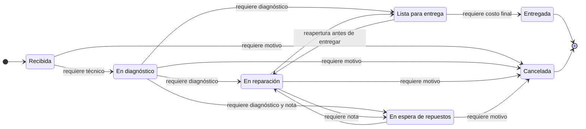

# Flujo de una orden de servicio y algoritmo de priorización

Este documento explica cómo avanza una orden de servicio en FixTrack, qué reglas se aplican en cada paso y cómo se calcula la prioridad de trabajo. Las reglas viven en el dominio (`src/FixTrack.Domain/ServiceOrders/`), de modo que se cumplen igual desde cualquier pantalla.

## 1. Recepción

Una persona del taller registra la orden en **Órdenes → Nueva orden** (`/ordenes/nueva`), o desde el detalle de un cliente o de un equipo, que preseleccionan los datos.

| Dato | Obligatorio | Regla |
| --- | --- | --- |
| Cliente | Sí | Debe estar **activo**. Un cliente inactivo conserva sus órdenes, pero no recibe nuevas |
| Equipo | Sí | Debe existir y **pertenecer al cliente elegido**. El servidor lo comprueba, aunque se altere el formulario |
| Problema reportado | Sí | Hasta 1000 caracteres |
| Prioridad | Sí | Baja, Normal, Alta o Urgente |
| Técnico | No | Si se elige, debe estar **activo** |
| Entrega comprometida | No | No puede ser anterior a la recepción ni estar a más de 365 días de ella |
| Costo estimado | No | En quetzales, no negativo, con dos decimales como máximo y hasta Q 99,999,999.99 |
| Observaciones de recepción | No | Hasta 500 caracteres (estado físico, accesorios entregados) |

La **fecha de recepción** la pone el servidor y no se puede elegir. El **número** visible (`OS-000042`) se obtiene del identificador y tampoco se puede elegir. Toda orden nace en estado **Recibida** y con su primer registro en el historial ("Orden registrada.").

## 2. Estados y transiciones



| Desde | Puede pasar a | Condiciones |
| --- | --- | --- |
| Recibida | En diagnóstico, Cancelada | En diagnóstico exige un técnico asignado |
| En diagnóstico | En reparación, En espera de repuestos, Lista para entrega, Cancelada | Salir del diagnóstico exige haber registrado el diagnóstico; En reparación exige técnico |
| En reparación | En espera de repuestos, Lista para entrega, Cancelada | — |
| En espera de repuestos | En reparación, Cancelada | — |
| Lista para entrega | Entregada, En reparación | Entregada exige el costo final |
| Entregada | — | Estado final |
| Cancelada | — | Estado final |

Datos que se piden al cambiar de estado:

- **En espera de repuestos:** una nota que indique qué repuesto se espera.
- **Cancelada:** una nota con el motivo.
- **Entregada:** el costo final (no negativo, dos decimales). También se registra la fecha de entrega.
- En los demás cambios, la nota es opcional (hasta 500 caracteres).

Transiciones que **no** existen, a propósito:

- Volver a Recibida.
- Entregar sin pasar por Lista para entrega.
- Cancelar una orden lista para entrega: el trabajo ya se hizo; si el cliente no la retira, se reabre o se entrega.
- Cualquier cambio sobre una orden Entregada o Cancelada.

Si una transición no es posible, la pantalla de cambio de estado explica por qué, por ejemplo "Asigna un técnico antes de iniciar el diagnóstico." (`ServiceOrderWorkflow.TransitionBlocker`). El detalle de la orden muestra los siguientes pasos posibles y marca los que aún no están disponibles.

## 3. Trabajo sobre una orden abierta

| Acción | Ruta | Reglas |
| --- | --- | --- |
| Asignar o reasignar técnico | `/ordenes/{id}/asignar` | Solo técnicos activos y distintos del actual. Se guarda la fecha de asignación |
| Registrar o corregir el diagnóstico | `/ordenes/{id}/diagnostico` | Solo en diagnóstico, en reparación o en espera de repuestos. Hasta 2000 caracteres |
| Planificación | `/ordenes/{id}/planificacion` | Prioridad, entrega comprometida y costo estimado. Una nueva fecha comprometida no puede quedar en el pasado |
| Cambiar de estado | `/ordenes/{id}/estado` | Según la tabla anterior |

Una orden cerrada (Entregada o Cancelada) no ofrece formularios. Si alguien envía uno de todos modos, el dominio lo rechaza: "La orden está cerrada (entregada o cancelada) y no admite cambios."

### Historial

Cada cambio de estado agrega un registro con el estado anterior, el nuevo, la fecha y la nota. El estado y su registro se guardan en la **misma transacción**: no puede existir uno sin el otro. El historial es de solo inserción: el dominio solo agrega registros y la tabla tiene el trigger `TR_ServiceOrderStatusHistory_AppendOnly`, que rechaza `UPDATE` y `DELETE`. El detalle de la orden lo muestra como una línea de tiempo.

### Costos

- El **costo estimado** se puede cambiar mientras la orden está abierta.
- El **costo final** se registra únicamente al entregar y es obligatorio en ese momento. La base de datos lo garantiza con `CK_ServiceOrders_FinalCost_OnDelivery`.
- Ambos se guardan como `decimal(10,2)` y se muestran en quetzales ("Q 1,250.00"). El formulario acepta, por ejemplo, "1250", "1,250.50", "1250,50" o "Q 1,250.50", y rechaza textos como "doscientos" o "1e5".
- El detalle muestra la diferencia entre el costo final y el estimado.

### Fechas vencidas

Una orden está **vencida** si sigue abierta y su entrega comprometida ya pasó. Se marca en los listados, tiene su propia vista (`/ordenes?vista=vencidas`) y suma puntos en la priorización.

## 4. Concurrencia: dos personas sobre la misma orden

Cada orden tiene un número de versión (`Version`) que aumenta con cada cambio. Los formularios envían la versión que vio la persona. Si la orden cambió mientras tanto, el cambio se rechaza sin modificar nada y aparece este mensaje: "Otra persona modificó esta orden mientras la revisabas. Revisa los datos actuales y vuelve a intentarlo." EF Core además usa `Version` como token de concurrencia: si dos guardados coinciden en el mismo instante, el segundo falla con el mismo mensaje.

Asignar un técnico y desactivarlo son operaciones que pueden coincidir. Ambas bloquean la fila del técnico (`UPDLOCK, ROWLOCK`) dentro de una transacción `READ COMMITTED`:

- La asignación comprueba que el técnico siga activo y guarda la orden mientras mantiene el bloqueo.
- La desactivación cuenta las órdenes abiertas del técnico mientras mantiene el mismo bloqueo.

La segunda operación espera a que termine la primera y ve su resultado. Así nunca queda una orden abierta asignada a un técnico inactivo. Las consultas normales no se bloquean. La estrategia funciona en SQL Server Express y en Somee, donde `READ_COMMITTED_SNAPSHOT` está desactivado. Una prueba contra SQL Server real lo comprueba (`A_deactivation_waits_for_a_concurrent_assignment_and_then_sees_its_result`).

## 5. Algoritmo de priorización

La **cola de trabajo** (`/cola-de-trabajo`) y las **acciones recomendadas** del panel ordenan las órdenes abiertas con el algoritmo de `WorkPrioritizer`. Es **determinista**: los mismos datos y la misma hora producen siempre el mismo orden. También es **explicable**: cada punto tiene una descripción que se muestra en pantalla.

### Fórmula

```
puntuación = puntos por prioridad + bono por fecha de entrega + puntos por antigüedad
```

| Factor | Valor |
| --- | --- |
| Prioridad configurada | Baja **10** · Normal **30** · Alta **60** · Urgente **90** |
| Fecha de entrega (solo **uno** de estos bonos) | Vencida **+50** · vence en 24 horas o menos **+30** · vence en 24 a 72 horas **+15** · más adelante o sin fecha **0** |
| Antigüedad | **+2** por cada día completo desde la recepción, hasta **30** (se alcanza a los 15 días) |

Detalle del bono por fecha de entrega, donde *r* es el tiempo que falta para la fecha comprometida:

| Situación | Bono |
| --- | --- |
| *r* < 0 (vencida) | +50 |
| 0 ≤ *r* ≤ 24 horas | +30 |
| 24 horas < *r* ≤ 72 horas | +15 |
| *r* > 72 horas o sin fecha comprometida | 0 |

La puntuación mínima es 10 (baja, sin fecha y recién recibida) y la máxima es 170 (urgente + vencida + 15 días o más en el taller).

### El estado decide la lista, no los puntos

El estado no suma puntos. Decide en cuál de las tres listas aparece la orden y qué acción se recomienda:

| Estado | Lista | Acción recomendada |
| --- | --- | --- |
| Recibida sin técnico | Reparaciones | Asignar técnico |
| Recibida con técnico | Reparaciones | Iniciar diagnóstico |
| En diagnóstico | Reparaciones | Completar diagnóstico |
| En reparación | Reparaciones | Continuar reparación |
| En espera de repuestos | En espera de repuestos | Dar seguimiento al repuesto |
| Lista para entrega | Listas para entrega | Avisar al cliente y entregar |

### Desempates

Las órdenes de cada lista se ordenan por:

1. Mayor puntuación.
2. Entrega comprometida más cercana; las órdenes sin fecha van al final.
3. Recepción más antigua (primero en llegar, primero en atenderse).
4. Número de orden, para que el orden sea total y estable.

### Ejemplo

Supongamos que hoy es lunes 20 de octubre a las 10:00 y hay cuatro órdenes abiertas.

| Orden | Estado | Prioridad | Recepción | Entrega comprometida | Cálculo | Total |
| --- | --- | --- | --- | --- | --- | --- |
| OS-000011 | En reparación | Normal | hace 20 días | vencida desde ayer | 30 + 50 + 30 (máximo) | **110** |
| OS-000014 | En diagnóstico | Urgente | hace 3 días | hoy a las 18:00 | 90 + 30 + 6 | **126** |
| OS-000015 | Recibida, sin técnico | Baja | hace 5 días | sin fecha | 10 + 0 + 10 | **20** |
| OS-000016 | En espera de repuestos | Alta | hace 2 días | en 2 días | 60 + 15 + 4 | 79 |

La lista **Reparaciones** queda así: OS-000014 (126, completar diagnóstico), OS-000011 (110, continuar reparación) y OS-000015 (20, asignar técnico). OS-000016 aparece en la lista **En espera de repuestos**: aunque su puntuación es alta, el taller no puede trabajar en ella hasta recibir el repuesto. Las acciones recomendadas del panel combinan las tres listas con el mismo criterio y muestran las cinco primeras: OS-000014, OS-000011, OS-000016 y OS-000015.

### Justificación de los valores

- **La prioridad es la base y pesa más.** Entre una orden urgente (90) y una baja (10) hay 80 puntos. Una orden baja solo alcanza a una urgente recién recibida si está vencida y tiene 15 días o más en el taller (10 + 50 + 30 = 90). En ese caso hay un compromiso incumplido con el cliente y conviene revisarla.
- **Una entrega vencida suma 50.** Incumplir una fecha prometida es lo más costoso para el taller, porque afecta la confianza del cliente. Por eso una orden normal vencida (80) supera a una alta sin fecha (60). Aun así, una orden baja vencida (60) no supera a una urgente (90): lo urgente sigue siendo urgente.
- **Los bonos de fecha se excluyen entre sí.** Todos describen el mismo hecho, qué tan cerca está la fecha, y sumarlos lo contaría dos veces. El bono crece a medida que se acerca la fecha: 15, luego 30, luego 50.
- **La antigüedad evita que una orden se quede olvidada, con un límite.** Con 2 puntos por día, una orden baja sin fecha supera a una normal recién recibida después de 11 días (10 + 22 > 30). El tope de 30 impide que la antigüedad termine dominando sobre la prioridad y las fechas.
- **El estado no suma puntos** porque no indica urgencia, sino qué se puede hacer. Una orden en espera de repuestos no se puede trabajar, así que ponerla al frente de las reparaciones haría perder tiempo. Una orden lista para entrega ya no necesita técnico, sino avisar al cliente. Por eso cada estado va a su propia lista con su propia acción.
- **Los desempates usan datos objetivos** (fecha comprometida, orden de llegada y número), así que dos personas que consultan la cola al mismo tiempo ven exactamente lo mismo.

### Implementación

- `WorkPrioritizer.Score` calcula la puntuación, sus factores, la lista y la acción. `WorkPrioritizer.Rank` aplica los desempates. Ambos son funciones puras: reciben la hora actual como parámetro, lo que permite probarlos con fechas fijas (`WorkPrioritizerTests`, 32 casos).
- `ServiceOrderService.GetWorkQueueAsync` obtiene en una sola consulta los datos mínimos de las órdenes abiertas (`OpenOrderSnapshot`), las puntúa en memoria y las reparte en las tres listas.
- Se priorizan como máximo **500** órdenes abiertas por consulta, empezando por las más antiguas. Si hubiera más, la cola muestra un aviso. Un taller pequeño tiene muy por debajo de esa cantidad de trabajo en curso.
- Ordenar *n* órdenes cuesta O(*n* log *n*).

## 6. Dónde aparecen las órdenes

| Pantalla | Qué muestra |
| --- | --- |
| `/ordenes` | Listado con búsqueda (número, cliente, equipo o técnico), vistas Abiertas, Vencidas, Cerradas y Todas, filtros por estado, prioridad y técnico (incluido "Sin asignar"), paginación en SQL y carga de trabajo por técnico |
| `/ordenes/{id}` | Detalle: datos de la recepción, cliente, equipo, técnico, costos, siguientes pasos y línea de tiempo |
| `/cola-de-trabajo` | Las tres listas priorizadas, con la puntuación desglosada y la acción recomendada |
| `/` (panel) | Indicadores reales, distribución por estado y por prioridad, acciones recomendadas, próximas entregas, órdenes recientes y carga por técnico |
| Detalle de un cliente | Sus últimas 10 órdenes y el total, con acceso a "Nueva orden" para ese cliente |
| Detalle de un equipo | Sus órdenes, de la más reciente a la más antigua |
| Detalle de un técnico | Sus órdenes abiertas (hasta 20, por fecha de entrega comprometida), el total y un enlace a todas sus órdenes. Si tiene órdenes abiertas, no se puede desactivar |
