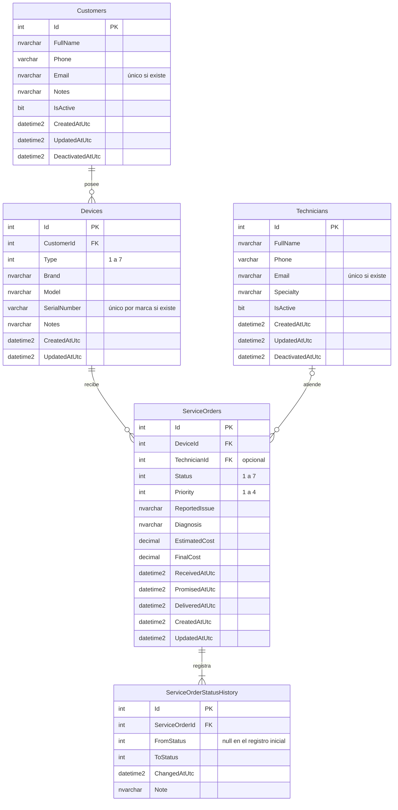

# Modelo de datos de FixTrack

Este documento describe las tablas de la base de datos FixTrackDB (SQL Server), sus relaciones y las reglas que las protegen. Sirve como referencia para preparar los diagramas entidad-relación y de clases del proyecto.

El esquema se crea con la migración de Entity Framework Core `20261020031151_InitialCreate`, ubicada en `src/FixTrack.Infrastructure/Persistence/Migrations/`. Las entidades de C# están en `src/FixTrack.Domain/` y su configuración de base de datos en `src/FixTrack.Infrastructure/Persistence/Configurations/`.

## Diagrama entidad-relación

Los tamaños exactos de cada columna figuran en las tablas de la sección siguiente.

## Relaciones y cardinalidades

| Relación | Cardinalidad | Clave foránea | Al eliminar el registro principal |
| --- | --- | --- | --- |
| Un cliente posee equipos | Customers 1 — 0..N Devices | `Devices.CustomerId` (obligatoria) | Se impide (`NO ACTION`) |
| Un equipo recibe órdenes de servicio en distintos momentos | Devices 1 — 0..N ServiceOrders | `ServiceOrders.DeviceId` (obligatoria) | Se impide (`NO ACTION`) |
| Un técnico atiende órdenes; una orden puede no tener técnico todavía | Technicians 0..1 — 0..N ServiceOrders | `ServiceOrders.TechnicianId` (opcional) | Se impide (`NO ACTION`) |
| Cada orden conserva su historial de estados | ServiceOrders 1 — 1..N ServiceOrderStatusHistory | `ServiceOrderStatusHistory.ServiceOrderId` (obligatoria) | Se impide (`NO ACTION`) |

Ninguna relación borra en cascada. No pueden existir equipos sin cliente, órdenes sin equipo ni historial sin orden. Tampoco se puede eliminar un cliente, equipo, técnico u orden que tenga registros dependientes.

## Tablas

### Customers (clientes)

Personas o empresas que traen equipos al taller. Un cliente **no se elimina**: se desactiva (`IsActive = 0`) y conserva su historial.

| Columna | Tipo | Nulo | Descripción |
| --- | --- | --- | --- |
| `Id` | int, IDENTITY | No | Clave primaria |
| `FullName` | nvarchar(150), intercalación `Modern_Spanish_100_CI_AI` | No | Nombre completo o razón social. La búsqueda no distingue mayúsculas ni tildes |
| `Phone` | varchar(20) | No | De 7 a 15 dígitos; admite `+` inicial, espacios, guiones y paréntesis |
| `Email` | nvarchar(254) | Sí | En minúsculas. Único entre clientes cuando existe |
| `Notes` | nvarchar(500) | Sí | Observaciones del taller |
| `IsActive` | bit | No | Estado del cliente |
| `CreatedAtUtc` | datetime2(3) | No | Fecha de registro (UTC) |
| `UpdatedAtUtc` | datetime2(3) | Sí | Última modificación (UTC) |
| `DeactivatedAtUtc` | datetime2(3) | Sí | Fecha de la desactivación vigente (UTC) |

Restricciones: `CK_Customers_FullName_NotEmpty`, `CK_Customers_Phone_NotEmpty`, `CK_Customers_Email_Format` (formato `usuario@dominio.ext`), `CK_Customers_Deactivation` (activo ⇔ sin fecha de desactivación).

Índices: `UX_Customers_Email` (único, filtrado `WHERE Email IS NOT NULL`), `IX_Customers_IsActive_FullName` (listado por estado ordenado por nombre), `IX_Customers_Phone`.

### Devices (equipos)

Computadoras, laptops y otros dispositivos de un cliente.

| Columna | Tipo | Nulo | Descripción |
| --- | --- | --- | --- |
| `Id` | int, IDENTITY | No | Clave primaria |
| `CustomerId` | int | No | Cliente propietario (FK) |
| `Type` | int | No | 1 Laptop · 2 Escritorio · 3 Todo en uno · 4 Tableta · 5 Impresora · 6 Monitor · 7 Otro |
| `Brand` | nvarchar(60) | No | Marca |
| `Model` | nvarchar(100) | Sí | Modelo |
| `SerialNumber` | varchar(100) | Sí | Número de serie del fabricante |
| `Notes` | nvarchar(500) | Sí | Estado físico, accesorios entregados |
| `CreatedAtUtc`, `UpdatedAtUtc` | datetime2(3) | No / Sí | Auditoría (UTC) |

Restricciones: `CK_Devices_Type` (1 a 7), `CK_Devices_Brand_NotEmpty`.

Índices: `IX_Devices_CustomerId`, `UX_Devices_Brand_SerialNumber` (único por marca, filtrado `WHERE SerialNumber IS NOT NULL`).

### Technicians (técnicos)

Personal técnico del taller. Igual que los clientes, se desactiva en lugar de eliminarse.

| Columna | Tipo | Nulo | Descripción |
| --- | --- | --- | --- |
| `Id` | int, IDENTITY | No | Clave primaria |
| `FullName` | nvarchar(150), `Modern_Spanish_100_CI_AI` | No | Nombre completo |
| `Phone` | varchar(20) | Sí | Teléfono |
| `Email` | nvarchar(254) | Sí | Único entre técnicos cuando existe |
| `Specialty` | nvarchar(100) | Sí | Especialidad |
| `IsActive`, `CreatedAtUtc`, `UpdatedAtUtc`, `DeactivatedAtUtc` | | | Igual que en Customers |

Restricciones: `CK_Technicians_FullName_NotEmpty`, `CK_Technicians_Email_Format`, `CK_Technicians_Deactivation`.

Índices: `UX_Technicians_Email` (único filtrado), `IX_Technicians_IsActive_FullName`.

### ServiceOrders (órdenes de servicio)

Cada reparación de un equipo. El número visible (`OS-000042`) se calcula a partir del `Id` y no se guarda.

| Columna | Tipo | Nulo | Descripción |
| --- | --- | --- | --- |
| `Id` | int, IDENTITY | No | Clave primaria |
| `DeviceId` | int | No | Equipo reparado (FK) |
| `TechnicianId` | int | Sí | Técnico asignado (FK). Puede asignarse después |
| `Status` | int | No | 1 Recibida · 2 En diagnóstico · 3 En reparación · 4 En espera de repuestos · 5 Lista para entrega · 6 Entregada · 7 Cancelada |
| `Priority` | int | No | 1 Baja · 2 Normal · 3 Alta · 4 Urgente |
| `ReportedIssue` | nvarchar(1000) | No | Problema reportado por el cliente |
| `Diagnosis` | nvarchar(2000) | Sí | Diagnóstico técnico |
| `EstimatedCost` | decimal(10,2) | Sí | Costo estimado |
| `FinalCost` | decimal(10,2) | Sí | Costo final |
| `ReceivedAtUtc` | datetime2(3) | No | Recepción del equipo |
| `PromisedAtUtc` | datetime2(3) | Sí | Entrega comprometida con el cliente |
| `DeliveredAtUtc` | datetime2(3) | Sí | Entrega efectiva |
| `CreatedAtUtc`, `UpdatedAtUtc` | datetime2(3) | No / Sí | Auditoría (UTC) |

Restricciones:

- `CK_ServiceOrders_Status` (1 a 7) y `CK_ServiceOrders_Priority` (1 a 4).
- `CK_ServiceOrders_ReportedIssue_NotEmpty`.
- `CK_ServiceOrders_EstimatedCost` y `CK_ServiceOrders_FinalCost` (no negativos).
- `CK_ServiceOrders_PromisedAt` (la entrega comprometida no es anterior a la recepción).
- `CK_ServiceOrders_Delivery` (existe fecha de entrega solo si el estado es Entregada).

Índices: `IX_ServiceOrders_DeviceId`, `IX_ServiceOrders_TechnicianId`, `IX_ServiceOrders_Status_PromisedAtUtc` (consulta principal del futuro algoritmo de priorización).

### ServiceOrderStatusHistory (historial de estados)

Un registro por cada cambio de estado de una orden, incluido el inicial (`FromStatus = NULL`, `ToStatus = 1`).

| Columna | Tipo | Nulo | Descripción |
| --- | --- | --- | --- |
| `Id` | int, IDENTITY | No | Clave primaria |
| `ServiceOrderId` | int | No | Orden (FK) |
| `FromStatus` | int | Sí | Estado anterior |
| `ToStatus` | int | No | Estado nuevo |
| `ChangedAtUtc` | datetime2(3) | No | Momento del cambio (UTC) |
| `Note` | nvarchar(500) | Sí | Comentario del cambio |

Restricciones: `CK_ServiceOrderStatusHistory_ToStatus` (1 a 7), `CK_ServiceOrderStatusHistory_FromStatus` (1 a 7 y distinto del nuevo estado).

Índice: `IX_ServiceOrderStatusHistory_ServiceOrderId_ChangedAtUtc`.

Trigger `TR_ServiceOrderStatusHistory_AppendOnly`: rechaza cualquier `UPDATE` o `DELETE` sobre la tabla con el error 50001. El historial es de solo inserción.

## Reglas del negocio implementadas

| Regla | Dónde se aplica |
| --- | --- |
| Nombre: 3 a 150 caracteres, al menos dos letras, sin símbolos extraños | Dominio (`ContactRules`) |
| Teléfono: 7 a 15 dígitos, `+` solo al inicio | Dominio (`ContactRules`) |
| Correo: formato válido, en minúsculas, único entre clientes | Dominio, aplicación y base de datos (índice único) |
| Los clientes se desactivan y reactivan; no se eliminan | Dominio (`Customer.Deactivate/Reactivate`), restricción `CK_Customers_Deactivation` y claves foráneas |
| Toda orden nace como Recibida y registra ese estado en el historial | Dominio (`ServiceOrder`) |
| Una orden no vuelve a Recibida; solo se entrega si estaba Lista para entrega; una orden entregada o cancelada ya no cambia | Dominio (`ServiceOrder.ChangeStatus`) |
| Montos con dos decimales, no negativos, hasta 99 999 999.99 | Dominio y restricciones CHECK |
| Todas las fechas se guardan en UTC | Dominio (rechaza fechas que no son UTC) y conversor de EF Core |
| El historial de estados no se modifica ni se elimina | Trigger, claves foráneas `NO ACTION` y dominio (solo agrega registros) |

## Notas para los diagramas

- **Diagrama de clases:** las entidades `Customer`, `Device`, `Technician`, `ServiceOrder` y `ServiceOrderStatusChange` heredan de `Entity`, que aporta `Id` y la igualdad por identidad. `ServiceOrderStatusChange` es la clase que corresponde a la tabla `ServiceOrderStatusHistory`.
- **Enumeraciones:** `DeviceType`, `ServiceOrderStatus` y `ServiceOrderPriority` se guardan como enteros. Sus valores están en las tablas anteriores.
- **Tabla técnica:** `__EFMigrationsHistory` la crea Entity Framework Core para registrar las migraciones aplicadas. No forma parte del modelo del negocio.
- **Estado de la implementación:** en la fase 2A solo el módulo Clientes usa estas tablas desde la interfaz. Equipos, técnicos y órdenes ya tienen su estructura y reglas, pero sus pantallas llegan en fases posteriores.
