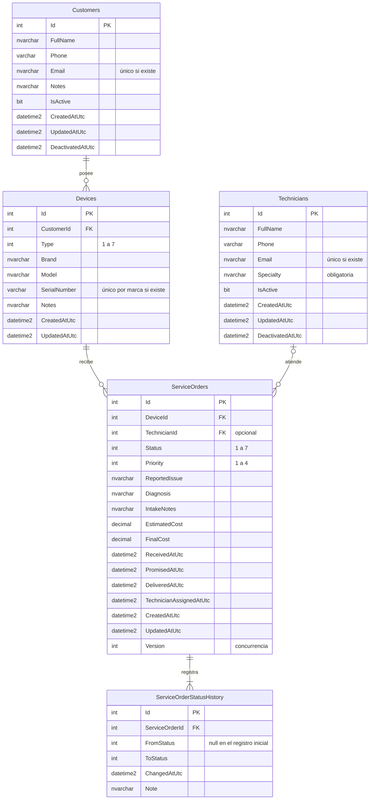
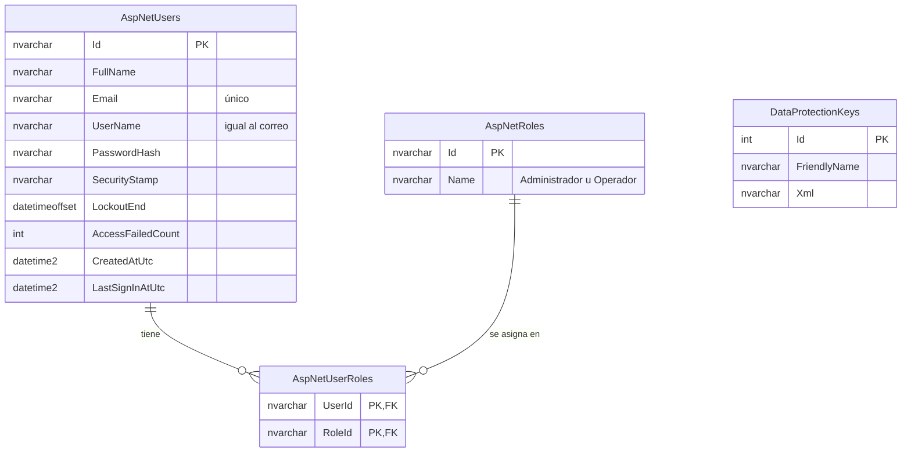
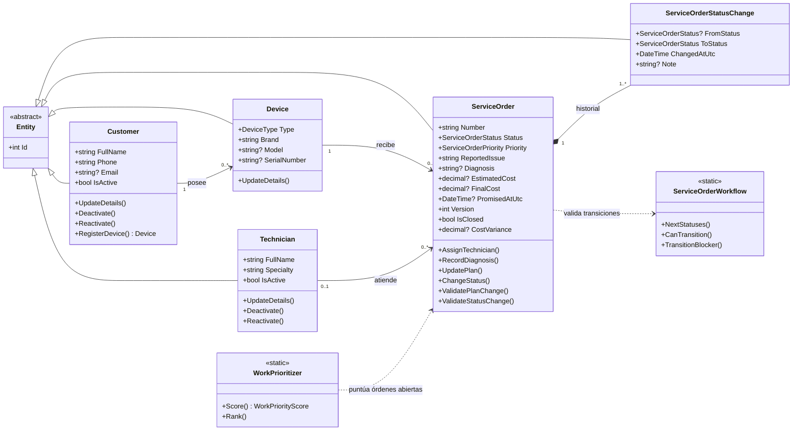

# Modelo de datos de FixTrack

Este documento describe las tablas de la base de datos FixTrackDB (SQL Server), sus relaciones y las reglas que las protegen. Sirve como referencia para preparar los diagramas entidad-relación y de clases del proyecto.

El esquema se crea con las migraciones de Entity Framework Core de `src/FixTrack.Infrastructure/Persistence/Migrations/`:

| Migración | Fase | Cambios |
| --- | --- | --- |
| `20261020031151_InitialCreate` | 2A | Crea las cinco tablas, sus claves, restricciones, índices y el trigger del historial |
| `20261020045452_TechnicianSpecialtyAndDeviceSerialRules` | 2B | `Technicians.Specialty` pasa a ser obligatoria (`NOT NULL` y no vacía); `Devices.SerialNumber`, si existe, no puede ser una cadena vacía |
| `20261020060713_ServiceOrderWorkflowFields` | 3 | Agrega a `ServiceOrders` las observaciones de recepción, la fecha de asignación del técnico y la versión para la concurrencia; dos restricciones nuevas y un índice por fecha de recepción |
| `20261020071400_IdentityAndDataProtectionKeys` | 3 | Tablas de ASP.NET Core Identity (cuentas y roles), los roles Administrador y Operador, y la tabla `DataProtectionKeys` |

Ninguna migración borra tablas, columnas ni datos. Las dos de la fase 3 solo agregan columnas que admiten `NULL` (o con valor inicial 0), restricciones que los datos existentes ya cumplían y tablas nuevas. Antes de aplicarlas a FixTrackDB se revisó su script SQL.

Las entidades de C# están en `src/FixTrack.Domain/` y su configuración de base de datos en `src/FixTrack.Infrastructure/Persistence/Configurations/`.

## Diagrama entidad-relación

Los tamaños exactos de cada columna figuran en las tablas de la sección siguiente.

### Cuentas de acceso

Las tablas de ASP.NET Core Identity son independientes de las del taller: ninguna clave foránea las une con clientes, equipos, técnicos u órdenes. Solo se muestran las tablas que FixTrack usa; `AspNetUserClaims`, `AspNetUserLogins`, `AspNetUserTokens` y `AspNetRoleClaims` existen porque Identity las crea, pero están vacías.

## Relaciones y cardinalidades

| Relación | Cardinalidad | Clave foránea | Al eliminar el registro principal |
| --- | --- | --- | --- |
| Un cliente posee equipos | Customers 1 — 0..N Devices | `Devices.CustomerId` (obligatoria) | Se impide (`NO ACTION`) |
| Un equipo recibe órdenes de servicio en distintos momentos | Devices 1 — 0..N ServiceOrders | `ServiceOrders.DeviceId` (obligatoria) | Se impide (`NO ACTION`) |
| Un técnico atiende órdenes; una orden puede no tener técnico todavía | Technicians 0..1 — 0..N ServiceOrders | `ServiceOrders.TechnicianId` (opcional) | Se impide (`NO ACTION`) |
| Cada orden conserva su historial de estados | ServiceOrders 1 — 1..N ServiceOrderStatusHistory | `ServiceOrderStatusHistory.ServiceOrderId` (obligatoria) | Se impide (`NO ACTION`) |

Ninguna relación del taller borra en cascada. No pueden existir equipos sin cliente, órdenes sin equipo ni historial sin orden. Tampoco se puede eliminar un cliente, equipo, técnico u orden que tenga registros dependientes.

En las tablas de Identity, las claves foráneas sí borran en cascada (por ejemplo, `AspNetUserRoles` → `AspNetUsers`), porque así las define ASP.NET Core Identity. FixTrack no elimina cuentas: las deshabilita. Una prueba verifica que la cascada solo exista en tablas `AspNet*`.

## Tablas

### Customers (clientes)

Personas o empresas que traen equipos al taller. Un cliente **no se elimina**: se desactiva (`IsActive = 0`) y conserva su historial.

| Columna | Tipo | Nulo | Descripción |
| --- | --- | --- | --- |
| `Id` | int, IDENTITY | No | Clave primaria |
| `FullName` | nvarchar(150), intercalación `Modern_Spanish_100_CI_AI` | No | Nombre completo o razón social. La búsqueda no distingue mayúsculas ni tildes |
| `Phone` | varchar(20) | No | De 7 a 15 dígitos; admite `+` inicial, espacios, guiones y paréntesis |
| `Email` | nvarchar(254) | Sí | En minúsculas. Único entre clientes cuando existe |
| `Notes` | nvarchar(500) | Sí | Observaciones del taller |
| `IsActive` | bit | No | Estado del cliente |
| `CreatedAtUtc` | datetime2(3) | No | Fecha de registro (UTC) |
| `UpdatedAtUtc` | datetime2(3) | Sí | Última modificación (UTC) |
| `DeactivatedAtUtc` | datetime2(3) | Sí | Fecha de la desactivación vigente (UTC) |

Restricciones: `CK_Customers_FullName_NotEmpty`, `CK_Customers_Phone_NotEmpty`, `CK_Customers_Email_Format` (formato `usuario@dominio.ext`), `CK_Customers_Deactivation` (activo ⇔ sin fecha de desactivación).

Índices: `UX_Customers_Email` (único, filtrado `WHERE Email IS NOT NULL`), `IX_Customers_IsActive_FullName` (listado por estado ordenado por nombre), `IX_Customers_Phone`.

### Devices (equipos)

Computadoras, laptops y otros dispositivos de un cliente.

| Columna | Tipo | Nulo | Descripción |
| --- | --- | --- | --- |
| `Id` | int, IDENTITY | No | Clave primaria |
| `CustomerId` | int | No | Cliente propietario (FK) |
| `Type` | int | No | 1 Laptop · 2 Escritorio · 3 Todo en uno · 4 Tableta · 5 Impresora · 6 Monitor · 7 Otro |
| `Brand` | nvarchar(60) | No | Marca |
| `Model` | nvarchar(100) | Sí | Modelo |
| `SerialNumber` | varchar(100) | Sí | Número de serie del fabricante |
| `Notes` | nvarchar(500) | Sí | Estado físico, accesorios entregados |
| `CreatedAtUtc`, `UpdatedAtUtc` | datetime2(3) | No / Sí | Auditoría (UTC) |

Restricciones: `CK_Devices_Type` (1 a 7), `CK_Devices_Brand_NotEmpty`, `CK_Devices_SerialNumber_NotEmpty` (la serie es `NULL` o tiene texto; una cadena vacía chocaría con otras en el índice único).

El número de serie se guarda en mayúsculas y solo admite letras sin tilde, números, espacios, guiones, puntos y barras (la columna es `varchar`). Su unicidad por marca no distingue mayúsculas: `Dell / dl-01` y `DELL / DL-01` son el mismo equipo.

Índices: `IX_Devices_CustomerId`, `UX_Devices_Brand_SerialNumber` (único por marca, filtrado `WHERE SerialNumber IS NOT NULL`).

### Technicians (técnicos)

Personal técnico del taller. Igual que los clientes, se desactiva en lugar de eliminarse.

| Columna | Tipo | Nulo | Descripción |
| --- | --- | --- | --- |
| `Id` | int, IDENTITY | No | Clave primaria |
| `FullName` | nvarchar(150), `Modern_Spanish_100_CI_AI` | No | Nombre completo |
| `Phone` | varchar(20) | Sí | Teléfono |
| `Email` | nvarchar(254) | Sí | Único entre técnicos cuando existe |
| `Specialty` | nvarchar(100) | No | Especialidad, de 3 a 100 caracteres |
| `IsActive`, `CreatedAtUtc`, `UpdatedAtUtc`, `DeactivatedAtUtc` | | | Igual que en Customers |

Restricciones: `CK_Technicians_FullName_NotEmpty`, `CK_Technicians_Specialty_NotEmpty`, `CK_Technicians_Email_Format`, `CK_Technicians_Deactivation`.

Índices: `UX_Technicians_Email` (único filtrado), `IX_Technicians_IsActive_FullName`.

### ServiceOrders (órdenes de servicio)

Cada reparación de un equipo. El número visible (`OS-000042`) se calcula a partir del `Id` y no se guarda.

| Columna | Tipo | Nulo | Descripción |
| --- | --- | --- | --- |
| `Id` | int, IDENTITY | No | Clave primaria |
| `DeviceId` | int | No | Equipo reparado (FK) |
| `TechnicianId` | int | Sí | Técnico asignado (FK). Puede asignarse después |
| `Status` | int | No | 1 Recibida · 2 En diagnóstico · 3 En reparación · 4 En espera de repuestos · 5 Lista para entrega · 6 Entregada · 7 Cancelada |
| `Priority` | int | No | 1 Baja · 2 Normal · 3 Alta · 4 Urgente |
| `ReportedIssue` | nvarchar(1000) | No | Problema reportado por el cliente |
| `IntakeNotes` | nvarchar(500) | Sí | Observaciones de recepción: estado físico, accesorios entregados (fase 3) |
| `Diagnosis` | nvarchar(2000) | Sí | Diagnóstico técnico |
| `EstimatedCost` | decimal(10,2) | Sí | Costo estimado, en quetzales |
| `FinalCost` | decimal(10,2) | Sí | Costo final, en quetzales. Solo existe en órdenes entregadas |
| `ReceivedAtUtc` | datetime2(3) | No | Recepción del equipo. La fija el servidor |
| `PromisedAtUtc` | datetime2(3) | Sí | Entrega comprometida con el cliente |
| `DeliveredAtUtc` | datetime2(3) | Sí | Entrega efectiva |
| `TechnicianAssignedAtUtc` | datetime2(3) | Sí | Última asignación o reasignación del técnico (fase 3) |
| `CreatedAtUtc`, `UpdatedAtUtc` | datetime2(3) | No / Sí | Auditoría (UTC) |
| `Version` | int | No | Aumenta con cada cambio. Es el token de concurrencia optimista: detecta cuando dos personas modifican la misma orden (fase 3) |

Restricciones:

- `CK_ServiceOrders_Status` (1 a 7) y `CK_ServiceOrders_Priority` (1 a 4).
- `CK_ServiceOrders_ReportedIssue_NotEmpty`.
- `CK_ServiceOrders_EstimatedCost` y `CK_ServiceOrders_FinalCost` (no negativos).
- `CK_ServiceOrders_PromisedAt` (la entrega comprometida no es anterior a la recepción).
- `CK_ServiceOrders_Delivery` (existe fecha de entrega solo si el estado es Entregada).
- `CK_ServiceOrders_FinalCost_OnDelivery` (fase 3): una orden entregada tiene costo final y las demás no lo tienen.
- `CK_ServiceOrders_TechnicianAssignment` (fase 3): el técnico y su fecha de asignación existen juntos o faltan juntos.

Índices: `IX_ServiceOrders_DeviceId`, `IX_ServiceOrders_TechnicianId`, `IX_ServiceOrders_Status_PromisedAtUtc` (órdenes abiertas, vencidas y próximas entregas) e `IX_ServiceOrders_ReceivedAtUtc` (órdenes recientes y antigüedad, fase 3).

### ServiceOrderStatusHistory (historial de estados)

Un registro por cada cambio de estado de una orden, incluido el inicial (`FromStatus = NULL`, `ToStatus = 1`).

| Columna | Tipo | Nulo | Descripción |
| --- | --- | --- | --- |
| `Id` | int, IDENTITY | No | Clave primaria |
| `ServiceOrderId` | int | No | Orden (FK) |
| `FromStatus` | int | Sí | Estado anterior |
| `ToStatus` | int | No | Estado nuevo |
| `ChangedAtUtc` | datetime2(3) | No | Momento del cambio (UTC) |
| `Note` | nvarchar(500) | Sí | Comentario del cambio |

Restricciones: `CK_ServiceOrderStatusHistory_ToStatus` (1 a 7), `CK_ServiceOrderStatusHistory_FromStatus` (1 a 7 y distinto del nuevo estado).

Índice: `IX_ServiceOrderStatusHistory_ServiceOrderId_ChangedAtUtc`.

Trigger `TR_ServiceOrderStatusHistory_AppendOnly`: rechaza cualquier `UPDATE` o `DELETE` sobre la tabla con el error 50001. El historial es de solo inserción. Una prueba contra SQL Server real lo verifica dentro de una transacción revertida.

### AspNetUsers, AspNetRoles y AspNetUserRoles (cuentas de acceso, fase 3)

Tablas estándar de ASP.NET Core Identity. FixTrack agrega tres columnas a `AspNetUsers`:

| Columna | Tipo | Nulo | Descripción |
| --- | --- | --- | --- |
| `FullName` | nvarchar(150) | No | Nombre que se muestra en la interfaz (`CK_AspNetUsers_FullName_NotEmpty`) |
| `CreatedAtUtc` | datetime2(3) | No | Fecha de creación de la cuenta |
| `LastSignInAtUtc` | datetime2(3) | Sí | Último inicio de sesión correcto |

- El correo es el usuario: `Email` y `UserName` tienen el mismo valor y son únicos (`UserNameIndex`).
- La contraseña se guarda solo como hash (`PasswordHash`, PBKDF2 de Identity).
- **Cuenta deshabilitada:** `LockoutEnd` = `9999-12-31 23:59:59.9999999 +00:00`. Se distingue del bloqueo temporal por intentos fallidos, que dura 15 minutos. Al deshabilitar se renueva `SecurityStamp`, lo que cierra las sesiones abiertas en menos de un minuto.
- `AspNetRoles` se crea con dos filas de identificador fijo: **Administrador** y **Operador**. Cada cuenta tiene exactamente un rol.

### DataProtectionKeys (fase 3)

Claves de ASP.NET Core Data Protection, que protegen la cookie de sesión y los tokens antifalsificación. Se guardan en la base para que las sesiones sigan siendo válidas tras reiniciar o volver a desplegar el contenedor, que no tiene disco persistente. Data Protection crea y rota las claves por sí solo; nadie debe editarlas.

## Reglas del negocio implementadas

| Regla | Dónde se aplica |
| --- | --- |
| Nombre: 3 a 150 caracteres, al menos dos letras, sin símbolos extraños | Dominio (`ContactRules`) |
| Teléfono: 7 a 15 dígitos, `+` solo al inicio | Dominio (`ContactRules`) |
| Correo: formato válido, en minúsculas, único entre clientes | Dominio, aplicación y base de datos (índice único) |
| Los clientes se desactivan y reactivan; no se eliminan | Dominio (`Customer.Deactivate/Reactivate`), restricción `CK_Customers_Deactivation` y claves foráneas |
| Un equipo se registra solo a nombre de un cliente **activo**; los equipos de un cliente inactivo se conservan y pueden consultarse | Dominio (`Customer.RegisterDevice`) y aplicación (`DeviceService`) |
| El propietario de un equipo no cambia: su historial de reparaciones queda vinculado al equipo | Dominio (`Device` no expone un cambio de propietario; `UpdateDetails` solo modifica datos técnicos) |
| Marca obligatoria; modelo, serie y observaciones opcionales con longitud limitada; serie única por marca | Dominio (`DeviceRules`), aplicación e índice `UX_Devices_Brand_SerialNumber` |
| Técnico: nombre y especialidad obligatorios; teléfono y correo opcionales con formato válido; correo único | Dominio (`TechnicianRules`), aplicación e índice `UX_Technicians_Email` |
| Los técnicos se desactivan y reactivan; no se eliminan | Dominio (`Technician.Deactivate/Reactivate`) y restricción `CK_Technicians_Deactivation` |
| No se puede desactivar un técnico con órdenes abiertas (ni entregadas ni canceladas) asignadas; primero hay que reasignarlas | Aplicación (`TechnicianService.DeactivateAsync`) |
| La desactivación y una asignación simultánea no pueden cruzarse: ambas bloquean la fila del técnico (`UPDLOCK`) dentro de una transacción | Aplicación (`TechnicianService`, `ServiceOrderService`) e infraestructura (`TechnicianRepository.FindForAssignmentAsync`) |
| Solo un técnico activo puede recibir asignaciones | Dominio (`ServiceOrder.AssignTechnician`) |
| Una orden solo se registra para un equipo existente cuyo propietario es el cliente elegido, y ese cliente debe estar activo | Dominio (constructor de `ServiceOrder`) y aplicación (`ServiceOrderService.CreateAsync`) |
| Toda orden nace como Recibida y registra ese estado en el historial | Dominio (`ServiceOrder`) |
| Las transiciones de estado siguen el flujo definido; En diagnóstico y En reparación exigen técnico; salir del diagnóstico exige diagnóstico; En espera de repuestos y Cancelada exigen nota; Entregada exige costo final | Dominio (`ServiceOrderWorkflow`, `ServiceOrder.ChangeStatus`) y restricciones `CK_ServiceOrders_FinalCost_OnDelivery` y `CK_ServiceOrders_Delivery` |
| Una orden entregada o cancelada ya no cambia | Dominio (`ServiceOrder`) |
| La entrega comprometida no es anterior a la recepción ni está a más de 365 días; una nueva fecha no puede quedar en el pasado | Dominio (`ServiceOrderRules`, `ServiceOrder.UpdatePlan`) y `CK_ServiceOrders_PromisedAt` |
| Montos en quetzales con dos decimales, no negativos, hasta 99 999 999.99 | Dominio y restricciones CHECK |
| Dos cambios simultáneos sobre la misma orden no se sobrescriben | Dominio (`Version`), aplicación (comparación con la versión del formulario) y EF Core (token de concurrencia) |
| Todas las fechas se guardan en UTC | Dominio (rechaza fechas que no son UTC) y conversor de EF Core |
| El historial de estados no se modifica ni se elimina; el cambio de estado y su registro se guardan juntos | Trigger, claves foráneas `NO ACTION` y dominio (solo agrega registros en el mismo guardado) |
| Solo los administradores gestionan técnicos y cuentas; no se puede deshabilitar la propia cuenta ni cambiar el propio rol; siempre queda al menos un administrador habilitado | Web (políticas de autorización) e infraestructura (`UserAccountService`) |

## Notas para los diagramas

- **Diagrama de clases:** las entidades `Customer`, `Device`, `Technician`, `ServiceOrder` y `ServiceOrderStatusChange` heredan de `Entity`, que aporta `Id` y la igualdad por identidad. `ServiceOrderStatusChange` es la clase que corresponde a la tabla `ServiceOrderStatusHistory`.
- **Enumeraciones:** `DeviceType`, `ServiceOrderStatus` y `ServiceOrderPriority` se guardan como enteros. Sus valores están en las tablas anteriores. `WorkQueue` y `RecommendedAction` no se guardan: los calcula el algoritmo de priorización.
- **Clases de reglas sin estado** (estáticas): `ServiceOrderWorkflow` (transiciones), `ServiceOrderRules` (validaciones), `ServiceOrderSchedule` (orden vencida) y `WorkPrioritizer` (puntuación y desempates). Se explican en [flujo-de-ordenes.md](flujo-de-ordenes.md).
- **Cuentas:** `FixTrackUser` (en Infrastructure) hereda de `IdentityUser` y agrega `FullName`, `CreatedAtUtc` y `LastSignInAtUtc`. Los nombres de los roles están en `Roles` (Application).
- **Tablas técnicas:** `__EFMigrationsHistory` (migraciones aplicadas) y `DataProtectionKeys` no forman parte del modelo del negocio.

### Diagrama de clases del dominio

- **Operaciones del dominio:**
  - `Customer`: `UpdateDetails`, `Deactivate`, `Reactivate`, `RegisterDevice`.
  - `Device`: `UpdateDetails`. Se crea únicamente con `Customer.RegisterDevice`.
  - `Technician`: `UpdateDetails`, `Deactivate`, `Reactivate`.
  - `ServiceOrder`: se crea con su equipo (cuyo propietario debe estar activo) y, opcionalmente, un técnico activo. Operaciones: `AssignTechnician`, `RecordDiagnosis`, `UpdatePlan`, `ChangeStatus`. `ValidatePlanChange` y `ValidateStatusChange` revisan un cambio sin aplicarlo, para mostrar los errores por campo.
- **Estado de la implementación:** desde la fase 3, todas las tablas se usan desde la interfaz: Clientes, Equipos, Técnicos, Órdenes de servicio con su historial, y Cuentas de acceso.
