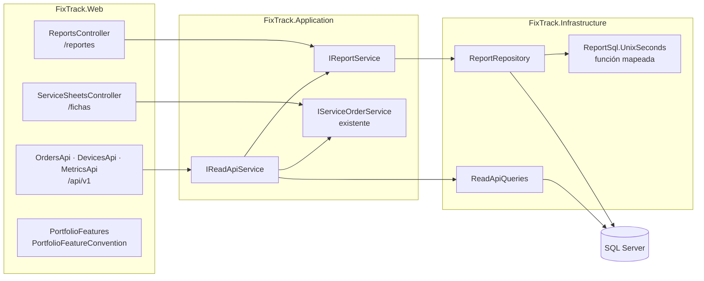

# FixTrack: extras de portafolio

Tres funciones opcionales que amplían FixTrack como proyecto profesional, **desactivadas por defecto** y separadas del proyecto universitario:

| Extra | Feature flag | Qué agrega |
| --- | --- | --- |
| Centro de reportes y analítica | `PortfolioFeatures:Reports` | `/reportes`: indicadores, gráficos, comparación por prioridad, actividad por técnico y exportación CSV |
| Fichas de servicio imprimibles | `PortfolioFeatures:PrintableSheets` | `/fichas/recepcion/{id}` y `/fichas/entrega/{id}`: documentos A4 para imprimir o guardar como PDF |
| API REST de solo lectura | `PortfolioFeatures:ReadOnlyApi` | `/api/v1/ordenes`, `/api/v1/ordenes/{id}`, `/api/v1/equipos` y `/api/v1/metricas` |

Con las tres en `false` (el valor de `appsettings.json`), FixTrack es exactamente la versión académica. Este documento no cambia el manual de usuario, los diagramas ni los demás documentos del proyecto.

## Contenido

1. [Activación](#1-activación)
2. [La versión académica no cambia](#2-la-versión-académica-no-cambia)
3. [Arquitectura](#3-arquitectura)
4. [Centro de reportes](#4-centro-de-reportes)
5. [Exportación CSV](#5-exportación-csv)
6. [Fichas imprimibles](#6-fichas-imprimibles)
7. [API REST v1](#7-api-rest-v1)
8. [Seguridad](#8-seguridad)
9. [Decisiones técnicas](#9-decisiones-técnicas)
10. [Pruebas y evidencias](#10-pruebas-y-evidencias)
11. [Comandos](#11-comandos)
12. [Limitaciones](#12-limitaciones)

## 1. Activación

Cada extra se habilita por separado. Los valores se leen al iniciar: después de cambiarlos hay que reiniciar la aplicación.

| Clave | Variable de entorno | Valor predeterminado | Efecto |
| --- | --- | --- | --- |
| `PortfolioFeatures:Reports` | `PortfolioFeatures__Reports` | `false` | Centro de reportes y exportación CSV; agrega "Análisis → Reportes" al menú |
| `PortfolioFeatures:PrintableSheets` | `PortfolioFeatures__PrintableSheets` | `false` | Fichas imprimibles; agrega sus enlaces en el detalle de una orden |
| `PortfolioFeatures:ReadOnlyApi` | `PortfolioFeatures__ReadOnlyApi` | `false` | API REST v1 de solo lectura |
| `PortfolioFeatures:ExportMaxRows` | `PortfolioFeatures__ExportMaxRows` | `5000` | Máximo de órdenes por exportación CSV (de 1 a 50 000) |
| `PortfolioFeatures:ApiRequestsPerMinute` | `PortfolioFeatures__ApiRequestsPerMinute` | `120` | Solicitudes por minuto y sesión de la API (de 1 a 10 000) |

Los valores aceptados son `true` y `false`. Un valor no válido detiene el inicio con un mensaje que indica la clave.

**Solo en tu equipo, con user-secrets** (no quedan en el repositorio):

```bash
dotnet user-secrets set --project src/FixTrack.Web "PortfolioFeatures:Reports" "true"
dotnet user-secrets set --project src/FixTrack.Web "PortfolioFeatures:PrintableSheets" "true"
dotnet user-secrets set --project src/FixTrack.Web "PortfolioFeatures:ReadOnlyApi" "true"
dotnet run --project src/FixTrack.Web --launch-profile http
```

Para volver a la versión académica: `dotnet user-secrets remove --project src/FixTrack.Web "PortfolioFeatures:Reports"` (y las demás).

**Solo durante una ejecución, con variables de entorno:**

```bash
PortfolioFeatures__Reports=true PortfolioFeatures__ReadOnlyApi=true \
  dotnet run --project src/FixTrack.Web --launch-profile http
```

**Con Docker:** `docker run -e PortfolioFeatures__Reports=true …` junto con las variables habituales (cadena de conexión y certificado).

> **No los habilites en Render** mientras QA no lo apruebe. Con user-secrets en Desarrollo, FixTrack se conecta a la base configurada para tu equipo: para explorar los extras con datos de prueba, usa una base local desechable (ver [Comandos](#11-comandos)).

Al iniciar con algún extra habilitado, la bitácora lo registra: `Extras de portafolio habilitados: PortfolioFeatures:Reports, …`.

## 2. La versión académica no cambia

Mientras los extras están desactivados:

- **Sus rutas no existen.** Una convención de MVC (`PortfolioFeatureConvention`) quita sus controladores del modelo de la aplicación antes de crear las rutas. `/reportes`, `/fichas/…` y `/api/v1/…` responden **igual que cualquier ruta inexistente**: sin sesión, redirigen al inicio de sesión; con sesión, muestran la página 404. No ejecutan su autorización ni revelan que existen. Una prueba compara la respuesta con la de una ruta inventada byte a byte (salvo el nonce).
- **Ninguna pantalla cambia.** El menú, el detalle de la orden y las demás pantallas no muestran enlaces nuevos. Los íconos de los extras van en un sprite aparte (`portfolio-icons.svg`) y sus estilos en hojas aparte (`reports.css`, `sheets.css`, `order-documents.css`), así que el HTML académico no cambia, tampoco las huellas de versión de `site.css` ni de `icons.svg`.
- **El proceso de las solicitudes es el mismo.** Las piezas de la API (respuestas JSON de error, límite de solicitudes) solo se activan con su flag y solo en las rutas `/api`.
- **No hay cambios de esquema.** Ningún extra agrega tablas, columnas, índices ni migraciones: todo se calcula con el modelo existente.

**Comprobación de extremo a extremo.** La versión base (`main`, commit 16e0262) y la nueva, con los extras desactivados, se ejecutaron sobre la misma base local y se compararon 22 pantallas. Incluyeron panel, órdenes con sus vistas y paginación, detalle de órdenes entregadas, en curso y canceladas, nueva orden, cola, clientes, equipos, técnicos, usuarios, auditoría, cambio de contraseña y rutas inexistentes. El HTML resultó **idéntico byte a byte**, salvo los valores que cambian en cada solicitud (nonce, tokens antifalsificación, el identificador del formulario y la hora de cálculo). Las capturas de 5 de esas pantallas en ambas versiones tienen el mismo SHA-256. El resultado está en las evidencias locales de QA (`qa-evidence/portfolio-extras/academico/`; como en las demás fases, la carpeta `qa-evidence/` queda fuera del repositorio).

## 3. Arquitectura

Los extras siguen las capas existentes. El dominio no cambia.



| Capa | Archivos nuevos | Responsabilidad |
| --- | --- | --- |
| Aplicación | `Reports/ReportPeriod.cs`, `ReportModels.cs`, `IReportRepository.cs`, `IReportService.cs`, `ReportService.cs` | Período en días locales, validación, filtros rápidos, armado del reporte, series y promedios |
| Aplicación | `ReadApi/ReadApiModels.cs` | Consultas paginadas de la API, límites y caso de uso `IReadApiService` |
| Infraestructura | `Persistence/Repositories/ReportRepository.cs`, `ReadApiQueries.cs`, `Persistence/ReportSql.cs` | Agregaciones y proyecciones en SQL con EF Core |
| Presentación | `Portfolio/*`, `Reports/*`, `Api/*`, `Controllers/ReportsController.cs`, `ServiceSheetsController.cs`, `Views/Reports/*`, `Views/ServiceSheets/*`, `TagHelpers/PortfolioIconTagHelper.cs`, `wwwroot/css/{reports,sheets,order-documents}.css`, `wwwroot/js/sheets.js`, `wwwroot/icons/portfolio-icons.svg` | Feature flags, páginas, gráficos SVG, CSV, documentos A4 y API |

Cambios en archivos existentes, todos sin efecto con los extras desactivados:

- `Program.cs`: registra los extras.
- `appsettings.json`: declara las flags en `false`.
- `SidebarViewComponent` y `ServiceOrders/Details.cshtml`: enlaces solo con su flag.
- `FixTrackDbContext`: registra la función SQL de duraciones.
- `ServiceOrderQueries`: la proyección del listado pasó a ser compartida, con el mismo SQL.
- Registro de servicios en Aplicación e Infraestructura.

## 4. Centro de reportes

### 4.1 Indicadores y la fecha de cada uno

Cada indicador usa la fecha de su propio evento. Una orden recibida en septiembre y entregada en octubre cuenta como entregada en octubre, pero no como recibida.

| Indicador | Órdenes consideradas | Fecha que decide el período |
| --- | --- | --- |
| Órdenes recibidas | Todas las que cumplen los filtros | `ReceivedAtUtc` (recepción) |
| Órdenes entregadas | Estado Entregada | `DeliveredAtUtc` (entrega) |
| Órdenes canceladas | Estado Cancelada | Fecha del cambio a "Cancelada" en `ServiceOrderStatusHistory` |
| Entregas con atraso | Entregadas con fecha comprometida | Entrega; atraso = `DeliveredAtUtc > PromisedAtUtc` |
| Tiempo promedio de reparación | Entregadas | Entrega; duración = entrega − recepción |
| Tiempo hasta quedar lista | Entregadas con paso a "Lista para entrega" | Entrega; duración = último paso a "Lista para entrega" − recepción (cuenta las reaperturas) |
| Ingresos registrados | Entregadas | Entrega; suma de `FinalCost` |
| Costo promedio por reparación | Entregadas | Entrega; ingresos ÷ entregas |
| Costo final frente al estimado | Entregadas con `EstimatedCost` | Entrega; Σ final − Σ estimado y su porcentaje |
| Estado actual de las recibidas | Recibidas en el período | Recepción; agrupadas por estado actual |
| Comparación por prioridad | Recibidas y entregadas | Cada columna con su fecha |
| Actividad por técnico | Asignadas al técnico | Recepción y entrega del período; "Abiertas ahora" es la carga actual, sin período |

Los costos estimados y finales nunca se mezclan. Los **ingresos registrados** son los costos finales capturados al entregar: FixTrack no tiene un módulo de pagos, así que no son cobros confirmados, y la interfaz y la API lo dicen.

Cuando no hay datos, un promedio o un porcentaje es `null` y la interfaz muestra **"Sin datos"**. Nunca se muestra 0 % ni un promedio inventado. Una "Lectura rápida" resume en frases lo que conviene revisar (puntualidad, tiempo de espera del cliente, desvío de los estimados y órdenes abiertas sin técnico), solo con los datos que existen.

### 4.2 Período, filtros y zona horaria

- **Filtros rápidos:** últimos 7, 30 o 90 días y este año, todos hasta hoy incluido. Sin parámetros, se usan los últimos 30 días.
- **Fechas:** `desde` y `hasta` (AAAA-MM-DD), ambas incluidas.
- **Filtros de órdenes:** estado actual, prioridad y técnico (o "sin técnico asignado"). Se aplican a todos los indicadores.
- **Validación:** la fecha final debe ser igual o posterior a la inicial y no posterior a hoy; el período abarca como máximo **366 días** y no puede empezar antes del 2000-01-01. Un filtro no válido muestra el error junto al campo y responde **400**.

Las fechas se guardan en UTC y los días se interpretan en la zona horaria de la aplicación, la misma con la que FixTrack muestra todas sus fechas: `America/Guatemala` en la imagen de producción (`TZ`). El período del 1 al 31 de octubre se consulta como el intervalo **[1 oct 00:00, 1 nov 00:00) local**, inicio incluido y fin excluido, que en UTC es `[2026-10-01T06:00Z, 2026-11-01T06:00Z)`. Una orden recibida a las 23:59 del día 31 cuenta y una recibida a las 00:00 del día siguiente no, sin depender de la precisión de las fechas.

`ReportPeriod` contempla zonas con horario de verano, aunque Guatemala no lo tiene. Cada límite se calcula día por día, y si un día no tiene medianoche se usa su primer minuto válido. Las series se agrupan por tramos de desfase constante, con una consulta por tramo. Hay pruebas con `America/New_York` (marzo de 2026) y `America/Havana`.

### 4.3 Gráficos

Son SVG generados en el servidor con Razor (`Reports/Charts.cs`), sin bibliotecas de JavaScript ni estilos en línea, que la CSP de FixTrack prohíbe:

- **Órdenes recibidas y entregadas:** barras agrupadas por día, semana (lunes a domingo) o mes, según la duración del período.
- **Ingresos registrados:** línea con área.
- **Estado actual de las recibidas:** barras horizontales con los colores de estado del sistema de diseño.
- **Comparación por prioridad** y **actividad por técnico:** tablas con barras de proporción.

Accesibilidad:

- Cada gráfico tiene título y descripción (`role="img"`, `aria-labelledby`, `<title>` y `<desc>`), un resumen en texto, una tabla de datos desplegable ("Ver los datos del gráfico") y la leyenda.
- Cada gráfico se dibuja en dos versiones, ancha y estrecha, para que el texto siga siendo legible en un teléfono.
- Los colores salen de las variables del tema claro y oscuro.
- La revisión con axe-core (WCAG 2.1 A y AA) de las páginas de los extras, en dos anchos y dos temas, no encontró violaciones.

### 4.4 Rendimiento: SQL de las agregaciones

Todos los cálculos son agregaciones en SQL Server con EF Core (`AsNoTracking`, proyecciones, `GROUP BY` y `COUNT`/`SUM` condicionales). Ninguno carga órdenes en memoria. Un reporte ejecuta **8 consultas fijas** sin importar la cantidad de órdenes; una prueba lo comprueba con el triple de datos y otra cuenta las consultas contra SQL Server. Se usan los índices existentes, sin migraciones.

EF Core no traduce la resta de dos fechas (`TimeSpan`) dentro de una agregación. La función `ReportSql.UnixSeconds` está mapeada por proveedor: `DATEDIFF_BIG(SECOND, '1970-01-01T00:00:00', fecha)` en SQL Server y `unixepoch(fecha)` en SQLite, que usan las pruebas. Así la base suma duraciones como restas de enteros. Las mismas expectativas se comprueban en SQLite y en SQL Server.

SQL real generado por EF Core para SQL Server (registro de la aplicación; se omiten los alias de columnas):

```sql
-- Entregas del período, agrupadas por prioridad (puntualidad, montos y duraciones en una sola pasada)
SELECT [s].[Priority], COUNT(*),
       COUNT(CASE WHEN [s].[PromisedAtUtc] IS NOT NULL THEN 1 END),
       COUNT(CASE WHEN [s].[PromisedAtUtc] IS NOT NULL AND [s].[DeliveredAtUtc] > [s].[PromisedAtUtc] THEN 1 END),
       COALESCE(SUM([s].[FinalCost]), 0.0),
       COUNT(CASE WHEN [s].[EstimatedCost] IS NOT NULL THEN 1 END),
       COALESCE(SUM([s].[EstimatedCost]), 0.0),
       COALESCE(SUM(CASE WHEN [s].[EstimatedCost] IS NOT NULL THEN [s].[FinalCost] END), 0.0),
       COALESCE(SUM(DATEDIFF_BIG(SECOND, '1970-01-01T00:00:00', [s].[DeliveredAtUtc])
                  - DATEDIFF_BIG(SECOND, '1970-01-01T00:00:00', [s].[ReceivedAtUtc])), 0)
FROM [ServiceOrders] AS [s]
WHERE [s].[Status] = 6 AND [s].[DeliveredAtUtc] >= @start AND [s].[DeliveredAtUtc] < @end
GROUP BY [s].[Priority]

-- Canceladas en el período, fechadas por su cambio en el historial
SELECT COUNT(*)
FROM [ServiceOrders] AS [s]
WHERE [s].[Status] = 7 AND [s].[Id] IN (
    SELECT [s0].[ServiceOrderId] FROM [ServiceOrderStatusHistory] AS [s0]
    WHERE [s0].[ToStatus] = 7 AND [s0].[ChangedAtUtc] >= @start AND [s0].[ChangedAtUtc] < @end)

-- Recibidas por día local: el desfase de la zona (−360 min en Guatemala) llega como parámetro
SELECT [s0].[Key] AS [Day], COUNT(*) AS [Count]
FROM (SELECT CONVERT(date, DATEADD(minute, CAST(@p AS int), [s].[ReceivedAtUtc])) AS [Key]
      FROM [ServiceOrders] AS [s]
      WHERE [s].[ReceivedAtUtc] >= @start AND [s].[ReceivedAtUtc] < @end) AS [s0]
GROUP BY [s0].[Key]

-- Tiempo hasta el último paso a "Lista para entrega" de las entregadas del período
SELECT COUNT(*), COALESCE(SUM(DATEDIFF_BIG(SECOND, '1970-01-01T00:00:00', [s2].[ReadyAtUtc])
                            - DATEDIFF_BIG(SECOND, '1970-01-01T00:00:00', [s2].[ReceivedAtUtc])), 0)
FROM (SELECT [s].[ReceivedAtUtc], [s1].[ReadyAtUtc], 1 AS [Key]
      FROM [ServiceOrders] AS [s]
      INNER JOIN (SELECT [s0].[ServiceOrderId] AS [OrderId], MAX([s0].[ChangedAtUtc]) AS [ReadyAtUtc]
                  FROM [ServiceOrderStatusHistory] AS [s0] WHERE [s0].[ToStatus] = 5
                  GROUP BY [s0].[ServiceOrderId]) AS [s1] ON [s].[Id] = [s1].[OrderId]
      WHERE [s].[Status] = 6 AND [s].[DeliveredAtUtc] >= @start AND [s].[DeliveredAtUtc] < @end) AS [s2]
GROUP BY [s2].[Key]
```

Las otras cuatro consultas siguen el mismo patrón:

- recibidas por estado y prioridad;
- entregas e ingresos por día local;
- actividad por técnico con `COUNT`/`SUM` condicionales en un `GROUP BY [TechnicianId]`;
- nombres de los técnicos.

## 5. Exportación CSV

`GET /reportes/exportar` descarga las órdenes del período con los mismos filtros. Con `por=recepcion` (predeterminado) se eligen por fecha de recepción y con `por=entrega`, por fecha de entrega.

- **Formato:**
  - UTF-8 con BOM, para que Excel reconozca las tildes; separador coma y fin de línea CRLF (RFC 4180).
  - Encabezados en español.
  - Fechas en hora local con el formato `AAAA-MM-DD HH:MM`.
  - Montos exactos con punto decimal y dos decimales (`1250.00`), sin símbolo, en columnas `(GTQ)`.
- **Columnas:**
  - orden, fecha de recepción, estado y prioridad;
  - cliente, tipo de equipo, marca, modelo y número de serie;
  - técnico y problema reportado;
  - entrega comprometida, fecha de entrega, costo estimado y costo final.

  Por minimización de datos **no incluye** teléfonos ni correos de clientes o técnicos, ni datos de cuentas, historial o auditoría.
- **Escape:** los campos con comas, comillas o saltos de línea van entre comillas dobles, con las comillas duplicadas.
- **Inyección de fórmulas (CSV Formula Injection):**
  - Un campo escrito por personas que empieza con `=`, `+`, `-` o `@` (también en ancho completo, `＝＋－＠`, o precedido de espacios), con tabulador o con salto de línea, se exporta como texto: apóstrofo inicial y entre comillas.
  - Ejemplo: `=HYPERLINK("http://…")` se exporta como `"'=HYPERLINK(""http://…"")"`.
  - Las columnas que genera FixTrack (número, fechas, montos y nombres de estados) no pasan por ese filtro, porque nunca empiezan así.
- **Límite:** como máximo `ExportMaxRows` órdenes (5000 por defecto). Si el resultado es mayor, **no se exporta nada**: una exportación parcial podría tomarse por completa. La página explica cómo reducirlo (período más corto o más filtros).
- **Permisos:** solo Administrador y Operador. La cuenta Consulta ve el reporte, pero recibe 403 al exportar: es una cuenta compartida de demostración y no debe descargar datos de clientes en bloque.
- **Sin almacenamiento:** el archivo se genera en memoria para esa descarga, con `Cache-Control: no-store`, y no se guarda en el servidor ni en la base.

## 6. Fichas imprimibles

| Ruta | Documento | Disponible para |
| --- | --- | --- |
| `/fichas/recepcion/{id}` | Ficha de recepción | Cualquier orden |
| `/fichas/entrega/{id}` | Comprobante de entrega | Solo órdenes **entregadas**; las demás responden **409** con una explicación y un enlace a la ficha de recepción |

- **Ficha de recepción:**
  - identidad de FixTrack, número de orden, fecha y hora de recepción y fecha de emisión;
  - cliente (nombre, teléfono y correo, porque es el documento que recibe el propio cliente) y equipo (tipo, marca, modelo y serie);
  - problema reportado, accesorios y observaciones, prioridad, entrega comprometida y costo estimado;
  - espacio para la firma de quien entrega el equipo y de quien lo recibe.
- **Comprobante de entrega:**
  - número, cliente, equipo y diagnóstico registrado;
  - estado final, fecha de entrega, costo final (con el estimado y la diferencia) y técnico responsable;
  - firma de recibido conforme.
- **No es una factura.** Ambos documentos lo indican en el pie: no son facturas ni comprobantes fiscales o tributarios.

**Diseño de impresión** (`sheets.css`):

- **Página:** plantilla propia sin el menú de la aplicación; `@page { size: A4; margin: 14mm 14mm 16mm }` y numeración "Página x de y".
- **Blanco y negro:** sin fondos de color y logo en gris (`print-color-adjust: economy`).
- **Pantalla frente a impresión:** en pantalla, la hoja blanca sobre un fondo neutro (también en tema oscuro) y una barra con "Volver a la orden" e "Imprimir o guardar PDF". En `@media print` la barra desaparece.
- **Saltos de página:** las secciones y las firmas no se parten (`break-inside: avoid`); un texto largo puede continuar en la página siguiente sin recortes (`white-space: pre-wrap`, `overflow-wrap: anywhere`, `orphans`/`widows`).
- **Campos opcionales:** muestran un texto explícito ("Sin fecha comprometida", "No registrado", "Por definir después del diagnóstico").

El PDF lo genera el navegador ("Guardar como PDF"): no hay dependencias de generación de PDF en el servidor ni archivos guardados.

**Seguridad:** las fichas exigen sesión y la política del taller, igual que el detalle de la orden, y los tres roles pueden verlas. No hay enlaces públicos por número de orden. Un Id inexistente responde 404 sin datos. Todo el texto se codifica (HTML escapado), la página lleva `noindex` y el único script es externo (CSP).

## 7. API REST v1

### 7.1 Principios

- **Solo lectura:** cuatro recursos `GET`. `POST`, `PUT`, `PATCH` y `DELETE` responden **405** con `Allow: GET, HEAD`.
- **Versión en la ruta:** `/api/v1/…`.
- **JSON en español:** camelCase, fechas UTC en ISO 8601 (`2026-10-04T18:00:00Z`) y montos como números en quetzales (`"moneda": "GTQ"`).
- **DTO explícitos** (`Api/ApiContracts.cs`, `Api/ApiMetrics.cs`): nunca se serializan entidades de EF Core.
  - **Excluidos:** teléfonos y correos (de clientes y técnicos), datos de cuentas de Identity, autores de los cambios, notas del historial, auditoría, versiones y tokens.
  - Una prueba verifica la lista exacta de campos de cada respuesta.
- **Errores en Problem Details** (`application/problem+json`, RFC 9457), en español, con `traceId` y **sin trazas técnicas**.
- **Reutiliza los casos de uso:** el detalle sale de `IServiceOrderService` y las métricas de `IReportService`, sin duplicar reglas.

### 7.2 Autenticación, autorización y otros orígenes

- **Autenticación:** la API usa la **sesión de FixTrack** (cookie `FixTrack.Sesion`): se inicia sesión en la aplicación y las solicitudes desde el navegador o con la misma cookie quedan autenticadas. No hay claves de API ni tokens en el repositorio.
- **Autorización:** solo **Administrador y Operador**, también para `GET`. La cuenta Consulta recibe 403: es compartida y la API facilita extraer datos en bloque.
- **Sin sesión:** 401 en JSON, en lugar de la redirección al inicio de sesión.
- **Otros orígenes:**
  - **Sin CORS:** ningún otro sitio puede leer las respuestas.
  - La cookie es `SameSite=Lax` y `HttpOnly`: un sitio externo no la envía en solicitudes `fetch` ni en imágenes o scripts, y aunque el navegador navegara a la URL, la respuesta solo la vería el propio usuario.
  - Las respuestas son objetos JSON (no arreglos sueltos), con `X-Content-Type-Options: nosniff` y `Cache-Control: no-store`.
  - No hay operaciones de escritura que proteger contra CSRF.
- **Límite de solicitudes:** `ApiRequestsPerMinute` por sesión (120 por defecto; sin sesión, por dirección IP). Al superarlo, la respuesta es 429. En FixTrack el limitador se evalúa antes de la autenticación, así que la partición usa la huella SHA-256 de la cookie, no su contenido.

### 7.3 Recursos

**`GET /api/v1/ordenes`**: listado paginado.

| Parámetro | Valores | Predeterminado |
| --- | --- | --- |
| `pagina` | 1 a 10 000 | 1 |
| `porPagina` | 1 a 100 | 20 |
| `estado` | `recibida`, `en-diagnostico`, `en-reparacion`, `en-espera-de-repuestos`, `lista-para-entrega`, `entregada`, `cancelada` | todos |
| `prioridad` | `baja`, `normal`, `alta`, `urgente` | todas |
| `tecnico` | Id de técnico o `sin-asignar` | todos |
| `equipo`, `cliente` | Id | todos |
| `recibidaDesde`, `recibidaHasta` | AAAA-MM-DD (hora local, ambas incluidas) | sin límite |
| `orden` | `recibida`, `comprometida`, `prioridad`, `numero`; con `-` delante, descendente | `-recibida` |

El orden es una lista cerrada y el Id desempata siempre, así que la paginación es estable. Las órdenes sin fecha comprometida quedan al final. Una página posterior a la última devuelve `datos` vacío con el total real.

```json
{
  "datos": [
    {
      "id": 97,
      "numero": "OS-000097",
      "estado": { "codigo": "entregada", "nombre": "Entregada" },
      "prioridad": { "codigo": "urgente", "nombre": "Urgente" },
      "cliente": { "id": 5, "nombre": "José Ramírez (demo)" },
      "equipo": { "id": 7, "tipo": { "codigo": "escritorio", "nombre": "Computadora de escritorio" }, "marca": "Lenovo", "modelo": "ThinkCentre M70q" },
      "tecnico": { "id": 4, "nombre": "Diego Alvarado (demo)" },
      "recibidaEn": "2026-10-08T15:06:00Z",
      "entregaComprometidaEn": "2026-10-15T15:06:00Z",
      "entregadaEn": "2026-10-11T22:06:00Z",
      "atrasada": false
    }
  ],
  "paginacion": { "pagina": 1, "porPagina": 3, "total": 76, "totalPaginas": 26 }
}
```

*Ejemplo ficticio: respuesta real de `GET /api/v1/ordenes?estado=entregada&orden=-prioridad&porPagina=3` sobre la base local de demostración, recortada al primer elemento (completa en las evidencias locales, `api/01-ordenes-listado.json`). Los nombres llevan "(demo)".*

**`GET /api/v1/ordenes/{id}`**: detalle.

- **Contenido:** los campos del listado más el número de serie del equipo, el técnico (con especialidad y fecha de asignación), `problemaReportado`, `observacionesRecepcion`, `diagnostico`, `costos` (`moneda`, `estimado`, `final` y `diferencia`), `actualizadaEn` e `historial` (fecha, estado y estado anterior; sin autores ni notas).
- **Errores:** un Id inexistente responde 404 (`"title": "Orden no encontrada"`) y un Id que no es número, 404.

**`GET /api/v1/equipos`**: listado paginado con `pagina`, `porPagina`, `tipo` (`laptop`, `escritorio`, `todo-en-uno`, `tableta`, `impresora`, `monitor`, `otro`), `cliente` y `orden` (`registrado`, `marca`; con `-` delante, descendente). Cada equipo trae tipo, marca, modelo, número de serie, cliente (Id y nombre), cantidad de órdenes y fecha de registro.

**`GET /api/v1/metricas`**: los cálculos del centro de reportes, con sus mismos parámetros (`rango` = `7d`, `30d`, `90d`, `anio`, o `desde` y `hasta`; `estado`, `prioridad` y `tecnico`). Devuelve:

- `periodo`, con las fechas locales, la zona horaria y el intervalo UTC consultado;
- `ordenes`, `puntualidad`, `tiempos` (horas) y `montos`, con una `nota` sobre los ingresos registrados;
- `porEstado`, `porPrioridad`, `serie` y `tecnicos`, donde el `id` nulo agrupa las órdenes sin técnico.

```json
{
  "periodo": { "desde": "2026-09-22", "hasta": "2026-10-21", "zonaHoraria": "America/Guatemala",
               "inicioUtc": "2026-09-22T06:00:00Z", "finUtc": "2026-10-22T06:00:00Z", "agrupacion": "dia" },
  "filtros": { "estado": null, "prioridad": null, "tecnico": null, "sinTecnico": false },
  "ordenes": { "recibidas": 29, "entregadas": 18, "canceladas": 2 },
  "puntualidad": { "entregasConFechaComprometida": 16, "entregasConAtraso": 7, "porcentajeATiempo": 56 },
  "tiempos": { "promedioHorasHastaEntrega": 118.1, "promedioHorasHastaLista": 82 },
  "montos": { "moneda": "GTQ", "ingresosRegistrados": 10320.00, "costoPromedioPorEntrega": 573.33,
              "entregasConCostoEstimado": 18, "costoEstimadoTotal": 10100.00, "costoFinalDeEntregasConEstimado": 10320.00,
              "diferenciaFinalMenosEstimado": 220.00, "diferenciaPorcentual": 2.2,
              "nota": "Ingresos registrados: costo final de las órdenes entregadas en el período. FixTrack no registra pagos: no son cobros confirmados." }
}
```

*Ejemplo ficticio: respuesta real de `GET /api/v1/metricas?rango=30d` sobre la base local de demostración, recortada (sin `porEstado`, `porPrioridad`, `serie`, `tecnicos` ni `calculadoEn`; completa en `api/04-metricas-30-dias.json`).*

### 7.4 Códigos de respuesta

| Código | Cuándo |
| --- | --- |
| 200 | Consulta correcta (`application/json; charset=utf-8`) |
| 400 | Parámetro no válido: `errors` indica cada parámetro con su mensaje |
| 401 | Sin sesión |
| 403 | Rol sin acceso (Consulta) |
| 404 | Orden inexistente o ruta desconocida dentro de `/api` |
| 405 | Método de escritura |
| 429 | Límite de solicitudes superado |
| 500 | Error inesperado (el detalle queda en la bitácora con el `traceId`) |
| 503 | La base de datos no responde (`Retry-After`) |

```json
{
  "type": "https://www.rfc-editor.org/rfc/rfc9110#section-15.5.1",
  "title": "Parámetros no válidos",
  "status": 400,
  "detail": "Revisa los parámetros indicados en errors.",
  "errors": {
    "orden": ["Usa uno de estos valores (con «-» delante para orden descendente): recibida, comprometida, prioridad, numero."],
    "porPagina": ["Debe ser un número entero entre 1 y 100."],
    "estado": ["El valor «perdida» no es válido. Usa recibida, en-diagnostico, en-reparacion, en-espera-de-repuestos, lista-para-entrega, entregada o cancelada."]
  },
  "traceId": "00-fe614f0a1dc4d1dff1d95647e7c294eb-7a4782caccc3936a-00"
}
```

*Respuesta real de `GET /api/v1/ordenes?porPagina=500&estado=perdida&orden=costo` (`api/05-error-400-parametros.json`).*

### 7.5 Probarla en local

Con la API habilitada y la sesión iniciada en el navegador, basta con abrir `http://localhost:5104/api/v1/ordenes?porPagina=5`. Desde la terminal hay que obtener primero la cookie con el formulario de inicio de sesión (token antifalsificación incluido) y reutilizarla. Las evidencias locales (`qa-evidence/portfolio-extras/api/`) guardan respuestas reales de la base de demostración.

No se publica documentación interactiva (Swagger u OpenAPI): este documento describe el contrato, y las pruebas de `ReadApiTests` lo verifican.

## 8. Seguridad

| Riesgo | Medida | Prueba |
| --- | --- | --- |
| Rutas visibles con los extras apagados | Los controladores no se registran; respuesta idéntica a una ruta inexistente | `PortfolioDisabledTests` |
| Acceso sin sesión | Política del taller en reportes y fichas; la API exige rol y responde 401 en JSON | `ReportsPageTests`, `ServiceSheetsTests`, `ReadApiTests` |
| Extracción masiva con la cuenta compartida | Consulta no exporta CSV ni usa la API (403) | `ReportsPageTests`, `ReadApiTests` |
| Inyección de fórmulas en CSV | Apóstrofo y comillas en los campos escritos por personas | `CsvTests`, `ReportsPageTests` |
| Inyección SQL | Solo LINQ parametrizado; la función SQL usa fragmentos constantes; el orden de la API es una lista cerrada | `ReadApiTests` (`orden=-numero;DROP TABLE` → 400) |
| XSS | Razor y SVG codificados; JSON con `<`, `>`, `&` y comillas escapados | `ServiceSheetsTests`, `ReadApiTests` |
| Datos personales y de cuentas | DTO y CSV con campos explícitos, sin teléfonos, correos, cuentas, autores, notas ni auditoría | `ReadApiTests`, `ReportsPageTests`, `CsvTests` |
| Trazas técnicas en errores | Problem Details genéricos; el detalle solo en la bitácora | `ReadApiFailureTests` |
| Consultas costosas | Período de hasta 366 días, página de hasta 100, exportación limitada, consultas fijas y límite de solicitudes | `ReportRepositoryTests`, `ReadApiTests`, `ReadApiFailureTests` |
| Otros orígenes | Sin CORS, `SameSite=Lax`, sin escritura | `ReadApiTests` |
| Documentos en caché o en el servidor | `no-store`; CSV y PDF no se guardan | `ReportsPageTests` |

Los extras no cambian Identity, roles, Data Protection, la cadena de conexión ni las variables de producción.

## 9. Decisiones técnicas

- **Feature flags con una convención de MVC.** Quitar el controlador evita filtros que respondan 404 después de la autorización, que revelarían la ruta a quien sí tiene sesión. Se descartó la librería `Microsoft.FeatureManagement`: tres booleanos no la justifican.
- **SVG en el servidor en lugar de Chart.js u otra biblioteca.**
  - Respeta la CSP sin `unsafe-inline` y no agrega dependencias ni JavaScript.
  - Se imprime bien y produce HTML que se puede probar.
  - La geometría (escalas "redondas", etiquetas, barras) es C# puro con pruebas.
- **Agregaciones condicionales y una función mapeada por proveedor** en lugar de traer filas y calcular en memoria. Es la única forma de promediar duraciones en SQL con EF Core 10 sin escribir SQL a mano; las pruebas comparan SQLite y SQL Server.
- **Sin tablas nuevas.** Las cancelaciones se fechan con el historial existente, que es de solo inserción.
- **Impresión con CSS** en lugar de una biblioteca de PDF en el servidor: menos dependencias, nada guardado y el mismo HTML para la pantalla y el papel.
- **API con DTO propios y opciones JSON propias.** Las opciones de MVC no cambian, así que las respuestas JSON académicas (`/clientes/opciones`) quedan idénticas.
- **Sin OpenAPI.** Agregaría dependencias y un documento publicado. Queda como mejora: se puede servir solo en Desarrollo y con autenticación.

## 10. Pruebas y evidencias

Hay **212 casos** de los extras, dentro de los 835 de la solución. Con SQL Server local pasan todos; sin él se omiten 3 de los extras. Las 623 pruebas de la versión académica siguen intactas.

| Archivo | Casos | Qué verifica |
| --- | --- | --- |
| `Web/Portfolio/PortfolioFeaturesTests.cs` | 7 | Flags en `false` por defecto; cada flag registra solo sus controladores |
| `Web/Portfolio/PortfolioDisabledTests.cs` | 23 | Con los extras apagados, cada ruta responde igual que una inexistente (con y sin sesión); sin endpoints ni enlaces nuevos |
| `Application/ReportPeriodTests.cs` | 24 | Límites UTC en Guatemala, validación, filtros rápidos, agrupación, horario de verano, días sin medianoche, series semanales y mensuales |
| `Infrastructure/ReportRepositoryTests.cs` | 12 | Indicadores con fechas exactas, límites inclusivos y exclusivos, período vacío, filtros, cantidad de consultas constante, exportación |
| `SqlServer/ReportSqlServerTests.cs` | 2 | Los mismos resultados en SQL Server, con `DATEDIFF_BIG` y 8 consultas |
| `Web/Portfolio/CsvTests.cs` | 30 | Escape, Unicode, inyección de fórmulas (incluidas variantes de ancho completo), montos, fechas, BOM, sin datos de contacto |
| `Web/Portfolio/ReportPresentationTests.cs` | 28 | Parámetros, ejes, barras, etiquetas, formatos |
| `Web/Portfolio/ReportsPageTests.cs` | 20 | Página completa, gráficos accesibles, errores 400, permisos por rol, CSV de extremo a extremo, límite, fórmulas |
| `Web/Portfolio/ServiceSheetsTests.cs` | 14 | Ficha y comprobante, campos opcionales, 409, 404, permisos, escape, CSS de impresión |
| `Web/Portfolio/ReadApiTests.cs` | 48 | 401, 403, paginación, límites, filtros, orden, contratos exactos, 404, 405, CORS, métricas, datos sensibles, escape JSON |
| `Web/Portfolio/ReadApiFailureTests.cs` | 3 | 500 sin detalles, 503 con `Retry-After`, 429 |
| `SqlServer/ReadApiSqlServerTests.cs` | 1 | Filtros, orden con nulos y página en SQL Server, sin N+1 |

Las pruebas que escriben datos usan SQLite en memoria o bases SQL Server desechables. Nunca tocan FixTrackDB. CI no necesita credenciales de Somee.

Las evidencias de QA de esta fase están en `qa-evidence/portfolio-extras/`, una carpeta local que, como en las fases anteriores, queda fuera del repositorio (`.gitignore`). Contiene:

- capturas reales (Chrome sin interfaz, base local de demostración con datos ficticios marcados "(demo)" y extras habilitados solo en local);
- los PDF A4 generados por el navegador y respuestas de la API;
- la comparación HTML con la versión base y la revisión de accesibilidad;
- `manifest.json`, con el commit, el navegador, las dimensiones y el SHA-256 de cada archivo.

## 11. Comandos

```bash
dotnet restore
dotnet build -c Release
dotnet test -c Release

# Con SQL Server local desechable (incluye las pruebas de traducción de los reportes y la API)
FIXTRACK_TEST_SQLSERVER_SERVER="Server=127.0.0.1,14333;User ID=sa;Password=<contraseña local>;Encrypt=True;TrustServerCertificate=True;" \
  dotnet test -c Release

docker build -t fixtrack .
```

Para explorar los extras con datos de prueba sin tocar FixTrackDB:

1. Crea una base vacía en un SQL Server local.
2. Inicia la aplicación con `ConnectionStrings__FixTrack` apuntando a esa base: la variable de entorno tiene prioridad sobre user-secrets.
3. Ejecuta `aplicar-migraciones` y `crear-administrador`.
4. Inicia FixTrack con `PortfolioFeatures__…=true`.

## 12. Limitaciones

- **Los extras se activan al iniciar.** Cambiar una flag exige reiniciar la aplicación.
- **El período de un reporte abarca como máximo 366 días** y no puede terminar después de hoy.
- **No hay cobros.** Los "ingresos registrados" son costos finales capturados al entregar; FixTrack no tiene pagos, facturación ni moneda distinta del quetzal.
- **Los filtros usan la situación actual de la orden** (estado y técnico), no la que tenía en el período. La actividad por técnico atribuye cada orden a su técnico actual: una orden reasignada cuenta para el último.
- **La zona horaria es la del servidor.** En la imagen de producción es America/Guatemala; ejecutando FixTrack en otra zona, los días se interpretan en esa zona, igual que el resto de las fechas de la aplicación.
- **Las fichas dependen del navegador para el PDF.** Los márgenes y los encabezados del diálogo de impresión dependen de su configuración; la numeración de páginas con `@page` requiere Chrome 131 o posterior, o un navegador equivalente.
- **La API usa la cookie de sesión.** No hay tokens para integraciones de servidor a servidor ni documentación OpenAPI.
- **El límite de solicitudes de la API está en memoria.** Se reinicia con la aplicación y, detrás de un proxy no configurado como confiable, sin sesión, todos comparten la dirección IP del proxy.
- **Sin índices nuevos.** Las consultas por fecha de entrega recorren `ServiceOrders` sin un índice propio; con el volumen de un taller es suficiente, y un índice en `DeliveredAtUtc` exigiría una migración.
